# RUNBOOK (Cognito + IAM Identity Center): AgentCore Identity 2LO, 3LO and OBO

Goal: prove that an AgentCore Runtime agent querying/updating Redshift **acts as the calling IdC user**,
so Redshift permissions defined for IdC groups (schema/table/column grants, RLS) are enforced,
and that Redshift is reachable **only** from the operator workstation and the AgentCore runtime.

All results below are sample outputs.

## Contents
- [Shared foundation](#shared-foundation): architecture overview, prerequisites, VPC, Cognito, web GUIs, cost
- [Part 1 · Amazon Quick → Gateway](#part-quick): Quick (another AWS account) is the 3LO OAuth client; per-user Cedar on the Gateway (not OBO)
- [Part 2 · 3LO](#part-3lo): user consent → Token Vault → Cognito userInfo
- [Part 3 · 2LO](#part-2lo): the agent's own token → Gateway → Redshift service user
- [Part 4 · OBO](#part-obo): Cognito JWT → IdC token → Redshift as the user, plus [per-user Gateway tool RBAC](#part-obo-rbac)
- [Appendix](#appendix): Agent Registry, animated walkthrough, full teardown

<a name="shared-foundation"></a>
## Shared foundation

Used by all four parts.

| # | Step | Purpose | Result |
|---|---|---|---|
| 1 | [Architecture overview](#shared-overview) | the four scenarios on one Cognito pool + IdC | 4 diagrams |
| 2 | [Prerequisites](#shared-prereq) | tools, IdC instance, venv, run.sh | ready |
| 3 | [Step 1 · Runtime VPC with a fixed egress IP](#shared-step-1) | VPC + NAT so every runtime has one egress IP | NAT EIP 47.131.152.68 |
| 4 | [Step 2 · Cognito user pool (end-user IdP)](#shared-step-2) | admin-create-only pool + OBO app client + 4 users | pool ap-southeast-1_kSVpAo5yl, client kff7mg63m7d94n6f2euip41na |
| 5 | [Ops · admin-only user creation on ALL Cognito pools](#shared-ops) | enforce AllowAdminCreateUserOnly everywhere | 41 pools scanned, 6 fixed |
| 6 | [Step 14 · Web GUIs on AWS (API Gateway HTTP API → Lambda)](#shared-step-14) | use the GUIs without running anything locally | OBO GUI 604penmkc9 · 2LO/3LO GUI k9vfijvbu9 |
| 7 | [Cost (approximate, while running)](#shared-cost) | what is billed while the PoC runs | ≈ $0.72/hour |

_Click a step to expand its commands, actual results and verification._

<a name="shared-overview"></a>
<details id="shared-overview"><summary><b>Architecture overview</b> · result: 3 diagrams</summary>

This runbook covers the **Cognito + IAM Identity Center** implementation of the three AgentCore Identity patterns. All three share the runtime VPC, the Cognito user pool and the web GUIs below.

| Pattern | Diagram | Part |
|---|---|---|
| Amazon Quick → Gateway (3LO by Quick) | 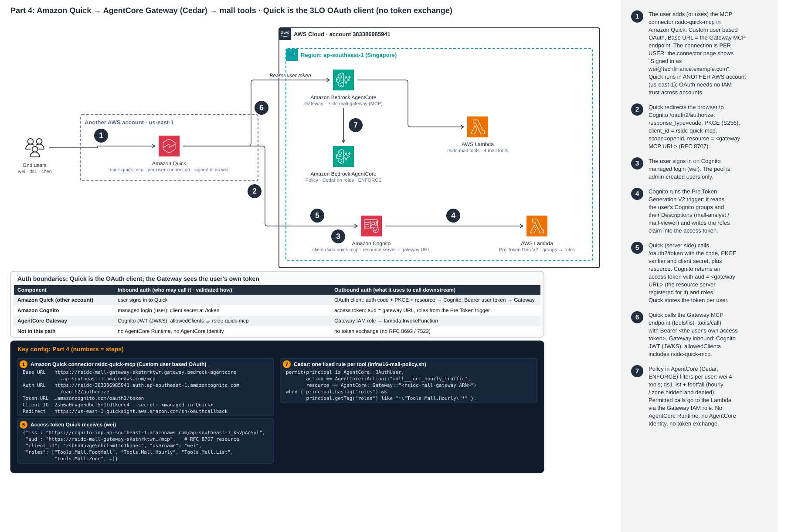 | [Part 1 · Quick](#part-quick) |
| 3LO (user consent + Token Vault) |  | [Part 2 · 3LO](#part-3lo) |
| 2LO (client credentials) | 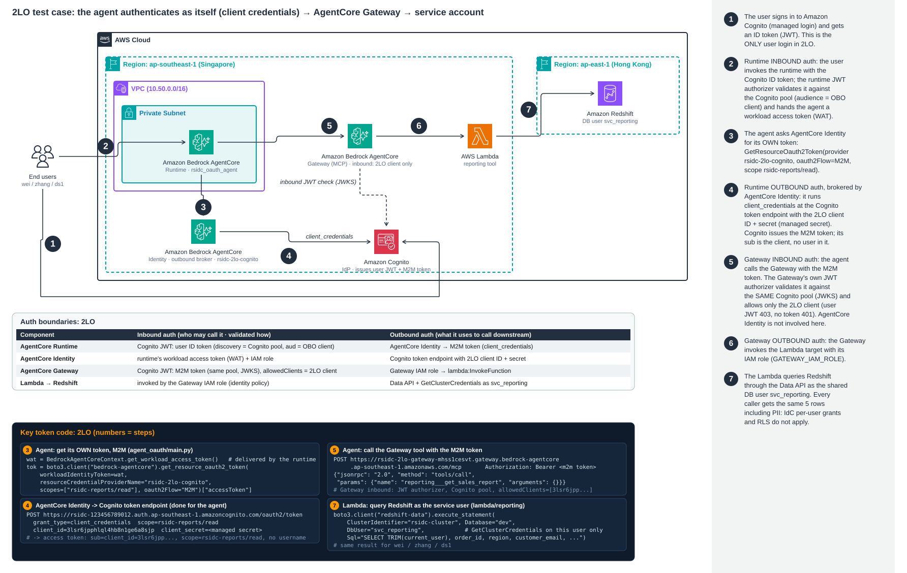 | [Part 3 · 2LO](#part-2lo) |
| OBO (identity propagation to Redshift) | 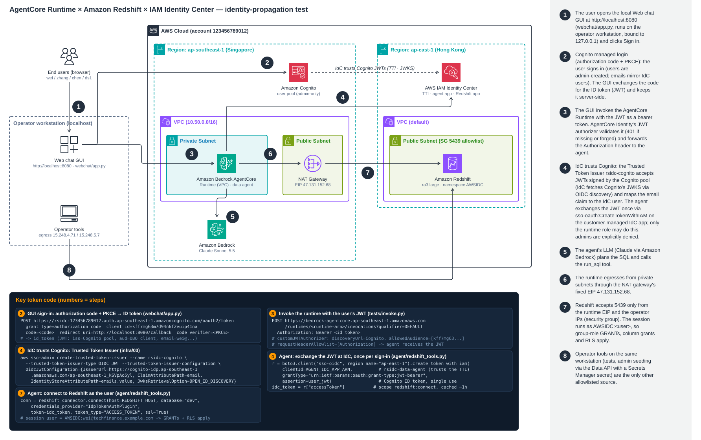 | [Part 4 · OBO](#part-obo) |

</details>

<a name="shared-prereq"></a>
<details id="shared-prereq"><summary><b>Prerequisites</b> · result: ready</summary>

- AWS CLI v2, `uv`, Python 3.12 (via uv), `nc`, `zip`; AWS profile `default` with admin rights in 383386985941.
- Existing IdC instance `ssoins-715869a9a6444dc5` (ap-east-1), with users wei/zhang/chen/ds1 in the groups risk-team, marketing-team, platform-team and data-scientists.
- Agent venv: `cd agent && uv venv --python 3.12 .venv && uv pip install --python .venv/bin/python -r requirements.txt requests`
- **Always run steps through `infra/run.sh`.** It loads `infra/00-config.sh` and `infra/state.env`, where resource IDs are saved. Every step is idempotent and safe to re-run.

---

</details>

<a name="shared-step-1"></a>
<details id="shared-step-1"><summary><b>Step 1 · Runtime VPC with a fixed egress IP</b> · result: NAT EIP 47.131.152.68</summary>

`infra/run.sh ./infra/01-runtime-network.sh`

Creates VPC 10.50.0.0/16, a public subnet with an IGW and NAT GW plus EIP, two private subnets (apse1-az1/az2), and an egress-only SG.

**Result:**
```
Runtime NAT EIP: 47.131.152.68
RT_VPC_ID=vpc-040e99e21800a355c  RT_NAT_ID=nat-042a3797afe93a19f  RT_SG_ID=sg-03bd7cebf86c77315
RT_PRIV_SUBNET_1=subnet-0bf130ed318f05d66  RT_PRIV_SUBNET_2=subnet-0a3ac30526d744713
```
**Verify:** `aws ec2 describe-nat-gateways --region ap-southeast-1 --nat-gateway-ids nat-042a3797afe93a19f --query 'NatGateways[0].[State,NatGatewayAddresses[0].PublicIp]'` → `available 47.131.152.68`

<!-- console-shots:start -->
**AWS console (captured from the logged-in browser session):**

*VPC → NAT gateways → rsidc-rt-nat: public NAT, EIP 47.131.152.68 (the runtime's only egress IP)*  
URL at capture (2026-10-05 15:53:06 HKT): <https://ap-southeast-1.console.aws.amazon.com/vpcconsole/home?region=ap-southeast-1#NatGatewayDetails:natGatewayId=nat-042a3797afe93a19f>

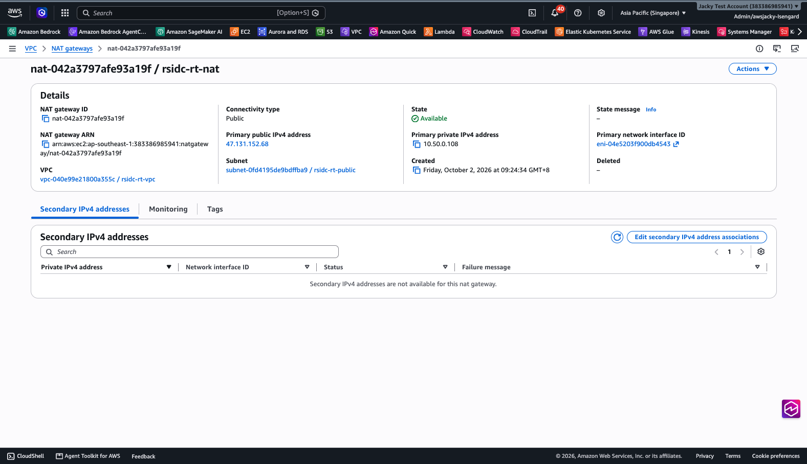

<!-- console-shots:end -->

</details>

<a name="shared-step-2"></a>
<details id="shared-step-2"><summary><b>Step 2 · Cognito user pool (end-user IdP)</b> · result: pool ap-southeast-1_kSVpAo5yl, client kff7mg63m7d94n6f2euip41na</summary>

`infra/run.sh ./infra/02-cognito.sh`

Admin-create-only pool, plus a public app client (USER_PASSWORD_AUTH) and four users whose emails match IdC users. Passwords go to `tests/.users.env` (chmod 600, gitignored).

**Result:**
```
| ds1   | tojackywu@gmail.com           | CONFIRMED |
| zhang | zhang@techfinance.example.com | CONFIRMED |
| chen  | chen@techfinance.example.com  | CONFIRMED |
| wei   | wei@techfinance.example.com   | CONFIRMED |
COGNITO_POOL_ID=ap-southeast-1_kSVpAo5yl  COGNITO_CLIENT_ID=kff7mg63m7d94n6f2euip41na
```
**Verify:** `aws cognito-idp describe-user-pool --region ap-southeast-1 --user-pool-id ap-southeast-1_kSVpAo5yl --query UserPool.AdminCreateUserConfig` → `AllowAdminCreateUserOnly: true`

<!-- console-shots:start -->
**AWS console (captured from the logged-in browser session):**

*Cognito → rsidc-users → Users: 4 admin-created users, emails verified (they mirror IdC users)*  
URL at capture (2026-10-05 15:53:14 HKT): <https://ap-southeast-1.console.aws.amazon.com/cognito/v2/idp/user-pools/ap-southeast-1_kSVpAo5yl/user-management/users?region=ap-southeast-1>

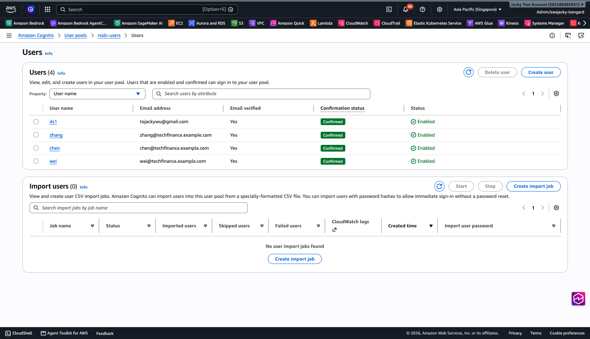

*Cognito → rsidc-users → Sign-up: Self-registration = Disabled (admin-only user creation)*  
URL at capture (2026-10-05 15:53:22 HKT): <https://ap-southeast-1.console.aws.amazon.com/cognito/v2/idp/user-pools/ap-southeast-1_kSVpAo5yl/authentication/sign-up?region=ap-southeast-1>

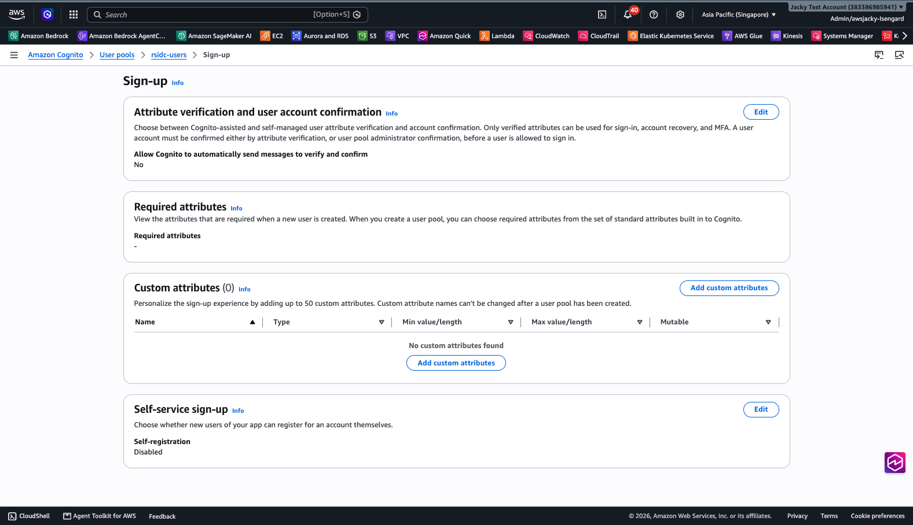

<!-- console-shots:end -->

</details>

<a name="shared-ops"></a>
<details id="shared-ops"><summary><b>Ops · admin-only user creation on ALL Cognito pools</b> · result: 41 pools scanned, 6 fixed</summary>

`agent_obo/.venv/bin/python infra/ops/cognito-disable-self-signup.py [--dry-run]`

The script scans every region and sets `AllowAdminCreateUserOnly=true` wherever self sign-up is still allowed. `UpdateUserPool` resets any omitted setting to its default, so the script copies each pool's full config back and prints a before/after diff.

**Result (2026-10-02):** 41 pools scanned. 6 still allowed self sign-up, all in us-east-1 with 0 users: `67YaKCmhR`, `8KbkOcNzT`, `JA2ECDabY`, `MAuafT7PT`, `UajACnw7W`, `hCgDYq4vq`. Each diff showed a single change:
`{"AdminCreateUserConfig.AllowAdminCreateUserOnly": [false, true]}`

**Verify:**
- `--dry-run` reports 0 pools remaining.
- A `SignUp` call against `us-east-1_67YaKCmhR` (with a valid SECRET_HASH) and against `rsidc-users` both fail with `NotAuthorizedException: SignUp is not permitted for this user pool`.

</details>

<a name="shared-step-14"></a>
<details id="shared-step-14"><summary><b>Step 14 · Web GUIs on AWS (API Gateway HTTP API → Lambda)</b> · result: OBO GUI 604penmkc9 · 2LO/3LO GUI k9vfijvbu9</summary>

**Purpose:** use the OBO GUI and the 2LO/3LO GUI without running anything locally. API Gateway provides HTTPS, which Cognito requires for any callback that isn't localhost. There's no Function URL, no public Lambda policy, no EC2 and no S3.
```bash
infra/run.sh bash infra/14-deploy-webchat.sh
```
**What it creates or changes:**
- IAM role `rsidc-webchat-role`. It grants logs, `CompleteResourceTokenAuth`, and `GetSecretValue` on the 3LO provider secret only.
- Lambda functions `rsidc-webchat-obo` and `rsidc-webchat-oauth` (python3.12, arm64, reserved concurrency 1). Each resource policy allows only `apigateway.amazonaws.com`, with `SourceArn` set to its own API.
- HTTP APIs `rsidc-webchat-obo` and `rsidc-webchat-oauth` (quick create: `$default` route and auto-deployed stage, payload 2.0, 30 s integration timeout).
- The API callback and logout URLs, added to the OBO Cognito client (through step 13).
- `<oauth-api>/3lo/callback`, added to the OAuth workload identity return URLs.
- IP allowlist: **none at the moment.** The in-Lambda allowlist was removed on 2026-10-06 at the user's request; the IP limit will be added in front of the API later (for example a REST API resource policy or WAF). Until then, access is gated only by Cognito sign-in, and the pool's users are admin-created only.

**Actual result (2026-10-06):**
```
OBO GUI:     https://604penmkc9.execute-api.ap-southeast-1.amazonaws.com
2LO/3LO GUI: https://k9vfijvbu9.execute-api.ap-southeast-1.amazonaws.com
Lambda policy: {'Service': 'apigateway.amazonaws.com'} lambda:InvokeFunction  ArnLike AWS:SourceArn arn:aws:execute-api:...:604penmkc9/*
```
**End-to-end browser test (signed in as wei):**
- OBO `SQL: SELECT * FROM sales.orders`: 5 rows.
- OBO natural-language question: answered, Lambda duration about 6.2 s (well under the 30 s limit).
- 2LO: outbound token `client_id=3lsr6jpphlql4hb8n1ge6a8sjp`, scope `rsidc-reports/read`, rows returned as `svc_reporting`.
- 3LO with forced re-consent: `CompleteResourceTokenAuth → OK`, and the identity guard confirmed the token belongs to the caller.

**Issues found during this step** (see `history/004-…`):
1. The first revision used Lambda Function URLs with `AuthType NONE` and a public `Principal: *` permission. The account's security automation (`lambda_function_policy_block_public_access`) removed those policies. It was replaced by API Gateway, and the Function URLs were deleted.
2. 3LO `CompleteResourceTokenAuth` failed with `AccessDenied when retrieving secret`, because the call reads the provider's client secret using the caller's own credentials. The fix grants `GetSecretValue` on that one secret.

**How you can verify:**
```bash
source infra/state.env
curl -s -o /dev/null -w "%{http_code}\n" $WEB_OBO_URL/      # 200
aws lambda get-policy --function-name rsidc-webchat-obo --region ap-southeast-1 --query Policy --output text   # only apigateway.amazonaws.com
aws lambda get-function-url-config --function-name rsidc-webchat-obo --region ap-southeast-1   # ResourceNotFoundException (no URL)
```
Then open the OBO URL and sign in as wei/zhang/chen/ds1 (passwords in `tests/.users.env`).
**Teardown:**
```bash
for f in obo oauth; do
  aws apigatewayv2 delete-api --region ap-southeast-1 --api-id $(aws apigatewayv2 get-apis --region ap-southeast-1 --query "Items[?Name=='rsidc-webchat-$f'].ApiId|[0]" --output text)
  aws lambda delete-function --region ap-southeast-1 --function-name rsidc-webchat-$f
done
```
Also delete the role `rsidc-webchat-role`.
**Cost:** effectively $0: HTTP API $1.00 per million requests, plus Lambda per request.

</details>

<a name="shared-cost"></a>
<details id="shared-cost"><summary><b>Cost (approximate, while running)</b> · result: ≈ $0.72/hour</summary>

| Resource | ~USD/hour |
|---|---|
| Redshift ra3.large ×1 (ap-east-1) | ~0.65 |
| NAT Gateway + EIP (ap-southeast-1) | ~0.065 + data |
| AgentCore Runtime | consumption only (pennies for these tests) |
| Bedrock (Claude) | per token (N4 tests only) |
| 2LO/3LO: Gateway, Lambda, 2nd runtime, credential providers | consumption only (≈0 at test volume) |
| Cognito, IdC, S3, Secrets Manager | ≈0 |

**About $0.72/hour, or roughly $17/day.** Tear down when you're done.

</details>

---

<a name="part-quick"></a>
## Part 1 · Amazon Quick → rsidc-mall-gateway (3LO, with Quick as the OAuth client; not OBO)

Amazon Quick, in **another AWS account (us-east-1)**, calls the AgentCore Gateway `rsidc-mall-gateway` directly as an MCP client. There is **no AgentCore Runtime, no AgentCore Identity and no token exchange** in this path. Quick is the OAuth client: it signs the user in to Cognito and stores that user's own access token. The Gateway (Cedar) then enforces per-user tool access on it.

**Architecture:**


_Numbered steps: 1 the connector in Quick (per-user connection) → 2 authorize (code + PKCE + `resource`) → 3 sign-in → 4 Pre Token trigger adds `roles` → 5 token (aud = gateway URL) → 6 Bearer user token to the Gateway → 7 Cedar per user → Lambda._

| # | Step | Purpose | Result |
|---|---|---|---|
| 1 | [Classification: 3LO, not OBO](#quick-class) | which AgentCore Identity pattern this is | 3LO (authorization code), with Quick as the OAuth client |
| 2 | [Quick connector configuration](#quick-config) | what is configured in Quick | Ready, signed in as wei@techfinance.example.com |
| 3 | [Cognito and Gateway setup (AWS side)](#quick-aws) | resource server, scopes, callbacks, allowedClients | `infra/16-mall-cognito.py`; gateway allowedClients include the Quick client |
| 4 | [Enabled tools as wei](#quick-tools) | what Quick discovered | 4 Read tools (= wei's 4 roles) |
| 5 | [Troubleshooting: "No access token was found…"](#quick-troubleshoot) | the first connection attempt failed | fixed: resource server = gateway URL (history/007) |
| 6 | [Demo steps (wei → ds1)](#quick-demo) | show per-user enforcement in Quick | wei: 4 tools ✓ · ds1: **to be recorded** |
| 7 | [Teardown](#quick-teardown) | remove the connector | delete it in Quick; AWS side as in Part 4 · Per-user enforcement downstream → Customer version teardown |

_Click a step to expand it._

<a name="quick-class"></a>
<details id="quick-class"><summary><b>Step 1 · Classification: 3LO, not OBO</b> · result: 3LO, with Quick as the OAuth client</summary>

| Question | Part 4 (Quick → Gateway) | Part 2 · AgentCore 3LO | Part 4 · OBO |
|---|---|---|---|
| Who is the OAuth client? | **Amazon Quick** (connector `rsidc-quick-mcp`) | AgentCore Identity (`rsidc-3lo-cognito`) for the agent | the agent / Credential Provider (token exchange) |
| Grant | **authorization code + PKCE** (+ RFC 8707 `resource`) | authorization code (consent) | jwt-bearer (RFC 7523) / token exchange (RFC 8693) |
| Token exchange? | **No**: Quick passes the user's own token | No | **Yes**: the inbound user token is exchanged for a downstream token |
| Where is the user token stored? | **In Quick, per user**: the connector page shows *"Signed in as wei@techfinance.example.com"* | AgentCore Token Vault (agent, user) | not stored: exchanged per call |
| Who enforces per user? | Gateway Cedar on the `roles` claim | the resource itself (Cognito `userInfo`) | Redshift (IdC) / Gateway Cedar |

**Why 3LO:**
- **The user delegates access by signing in:** the user signs in and Quick receives an authorization code, then an access token for that user. This is the classic 3-legged flow: user, client (Quick) and authorization server (Cognito).
- **Each Quick user has their own connection and token:** the connector page shows *"Signed in as wei@…"*.

**Why not OBO:** nothing exchanges one token for another (no RFC 8693 / 7523). The token Quick sends to the Gateway is exactly the one Cognito issued to the user for this resource (`aud` = gateway URL).

</details>

<a name="quick-config"></a>
<details id="quick-config"><summary><b>Step 2 · Quick connector configuration</b> · result: Ready, signed in as wei@techfinance.example.com</summary>

Copied from the user's Quick connector page (2026-10-20):

| Field | Value |
|---|---|
| Connector | Model Context Protocol |
| Name / Description | rsidc-quick-mcp |
| Status | Ready (10/20/2026) |
| Connection purpose | On-demand actions |
| Authentication type | Custom user based OAuth |
| Signed in as | wei@techfinance.example.com |
| Base URL | `https://rsidc-mall-gateway-skatnrktwr.gateway.bedrock-agentcore.ap-southeast-1.amazonaws.com/mcp` |
| Authorization URL | `https://rsidc-383386985941.auth.ap-southeast-1.amazoncognito.com/oauth2/authorize` |
| Token URL | `https://rsidc-383386985941.auth.ap-southeast-1.amazoncognito.com/oauth2/token` |
| Client ID | `2sh6a0uvge5dbcl5m1td1kone4` (Cognito app client `rsidc-quick-mcp`) |
| Client secret | not shown here; it's in the gitignored `tests/.quick-client.env`. **Rotate it after the demo** (it was visible in a screenshot). |
| Redirect URL | `https://us-east-1.quicksight.aws.amazon.com/sn/oauthcallback` |

"Signed in as" is the evidence that the connection is **per user** (the 3LO characteristic): Quick holds wei's own token. Step-by-step guide: [data/quick-mcp-connector.md](data/quick-mcp-connector.md).

</details>

<a name="quick-aws"></a>
<details id="quick-aws"><summary><b>Step 3 · Cognito and Gateway setup (AWS side)</b> · result: resource server, scopes, callbacks, allowedClients</summary>

```bash
infra/run.sh agent_obo/.venv/bin/python infra/16-mall-cognito.py   # Cognito groups, app client rsidc-quick-mcp, resource server, scopes, Quick callbacks
infra/run.sh bash infra/16-mall-gateway.sh                     # gateway rsidc-mall-gateway: allowedClients = [Quick client, OBO client]
infra/run.sh bash infra/16-mall-policy.sh ENFORCE              # 4 fixed Cedar rules on roles
```
- **Cognito resource server:** identifier = `https://rsidc-mall-gateway-skatnrktwr.gateway.bedrock-agentcore.ap-southeast-1.amazonaws.com/mcp`, scope `invoke`. It's required because Quick sends `resource=<that URL>` (see Step 5).
- **App client `rsidc-quick-mcp`:**
  - confidential; `code` flow;
  - scopes `openid email profile <gateway URL>/invoke`;
  - callbacks `https://{us-east-1,us-west-2,ap-southeast-2,eu-west-1}.quicksight.aws.amazon.com/sn/oauthcallback`;
  - access token valid for 60 minutes.
- **Gateway inbound:** `customJWTAuthorizer`, Cognito discovery, `allowedClients = ["2sh6a0uvge5dbcl5m1td1kone4", "kff7mg63m7d94n6f2euip41na"]`.
- **No cross-account IAM is needed:** Quick reaches the Gateway's public HTTPS endpoint with an OAuth bearer token.

</details>

<a name="quick-tools"></a>
<details id="quick-tools"><summary><b>Step 4 · Enabled tools as wei</b> · result: 4 Read tools (= wei's 4 roles)</summary>

From the user's Quick screenshot, under **Enabled tools**:

| Tool | Type | Description |
|---|---|---|
| `mall___get_footfall_summary` | Read | Daily footfall total for one mall |
| `mall___get_hourly_traffic` | Read | Hourly visitor counts (10:00–21:00) for one mall |
| `mall___get_mall_list` | Read | List all malls (id, name, city) |
| `mall___get_zone_comparison` | Read | Visitors per zone for one mall, to compare zones |

This matches wei's roles: the `mall-analyst` group gives Tools.Mall.List, Footfall, Hourly and Zone. The Gateway's `tools/list` is filtered by Cedar on the token Quick holds for wei.

</details>

<a name="quick-troubleshoot"></a>
<details id="quick-troubleshoot"><summary><b>Step 5 · Troubleshooting: "No access token was found for an OAuth authorization code connection"</b> · result: fixed (history/007)</summary>

- **Symptom:** after "Create and continue" and signing in as wei, Quick showed *"No access token was found for an OAuth authorization code connection"*.
- **CloudTrail evidence** (Cognito, ap-southeast-1): `OAuth2_Authorize_GET` 302 → `login_POST` 204 → `Token_POST` **400**, twice per attempt (client secret in a Basic header, then in the body). Both requests carried `resource=https://rsidc-mall-gateway-…/mcp`.
- **Root cause:**
  - Quick follows the MCP authorization spec and sends RFC 8707 `resource`.
  - Cognito binds a resource only if it's a **registered resource server**; otherwise `/oauth2/token` returns `invalid_grant`.
  - Reproduced with the OBO client: no `resource` → 200; any `resource` (even `https://example.com`) → `invalid_grant`.
  - The Pre Token trigger was never invoked for the failed attempts.
- **Fix:** a Cognito resource server with identifier = the gateway MCP URL (scope `invoke`), allowed on `rsidc-quick-mcp`. It's created idempotently by `infra/16-mall-cognito.py`.
- **Verified:**
  - with `resource`, Cognito issues an access token with `aud` = the gateway URL and `roles` intact;
  - wei gets 4 tools; ds1 gets 2 and a direct call to hourly is denied;
  - `tests/mall_rbac_tests.py enforce` 25/25;
  - the Quick connector then reached **Ready**.
- Details: [history/007](history/007-fix-quick-mcp-no-access-token-resource-indicator.md).

</details>

<a name="quick-demo"></a>
<details id="quick-demo"><summary><b>Step 6 · Demo steps (wei → ds1)</b> · result: wei 4 tools ✓ · ds1 to be recorded</summary>

1. **As wei** (already connected; "Signed in as wei@techfinance.example.com"). In Quick chat, ask:
   - "List the malls"
   - "Footfall for HK01 on 2026-10-01"
   - "Hourly traffic for HK01 on 2026-10-01"
   - "Compare zones in HK01 on 2026-10-01"

   Expected: all 4 succeed.
2. **Switch to ds1:**
   - disconnect or sign out of this connector's OAuth connection;
   - clear the Cognito session (use a private window, or delete the cookies for `rsidc-383386985941.auth.ap-southeast-1.amazoncognito.com`);
   - reconnect and sign in as **ds1**.

   **Check that the connector page now shows "Signed in as ds1's email" before testing.** If it still shows wei, you're testing wei's token.
3. **As ds1:**
   - the Gateway returns only `get_mall_list` and `get_footfall_summary`;
   - hourly and zone must fail with "Tool Execution Denied" (HTTP 200, `isError`).

   Also note whether Quick still lists 4 tools (cached at creation). Either way, every call is decided by Cedar.

   **Result: to be recorded** (not yet run in Quick).
4. **Confirm on AWS:**
   ```bash
   aws logs filter-log-events --region ap-southeast-1 \
     --log-group-name /aws/vendedlogs/bedrock-agentcore/gateway/rsidc-mall-gateway \
     --start-time $(( ($(date +%s)-1800)*1000 )) --filter-pattern DENY \
     --query 'events[].message' --output text | grep -o '"decision":"DENY","reason":"[^"]*"' | sort | uniq -c
   ```
   Expect DENY entries for ds1's hourly and zone calls.

</details>

<a name="quick-teardown"></a>
<details id="quick-teardown"><summary><b>Step 7 · Teardown</b> · result: delete the connector in Quick; AWS side as in Part 4 · Per-user enforcement downstream → Customer version teardown</summary>

- **Quick:** delete the `rsidc-quick-mcp` connector in your Quick account. It is an independent Quick resource.
- **AWS:**
  - follow [Part 3 · per-user enforcement → customer version teardown](#part-obo-rbac) (gateway, policy engine, Lambda, Cognito groups, app client);
  - delete the Cognito resource server too: `aws cognito-idp delete-resource-server --region ap-southeast-1 --user-pool-id ap-southeast-1_kSVpAo5yl --identifier https://rsidc-mall-gateway-skatnrktwr.gateway.bedrock-agentcore.ap-southeast-1.amazonaws.com/mcp`.
- **Rotate or delete the client secret** of `rsidc-quick-mcp` after the demo.

</details>

---

<a name="part-3lo"></a>
## Part 2 · 3LO (user consent + Token Vault)

Goal: compare the other AgentCore Identity outbound patterns with OBO on the same Redshift data. The OBO runtime (`rsidc_data_agent`, version 3) and its tests are **not modified**; a **separate** runtime is used.

**3LO architecture** (the user consents once → Token Vault, session binding by the app):


| # | Step | Purpose | Result |
|---|---|---|---|
| 1 | [Step 9 · Cognito OAuth clients for 3LO](#3lo-step-9) | managed login v2 domain + 3LO client | rsidc-3lo-agent code openid email profile; ManagedLoginVersion 2 |
| 2 | [Step 10 · Credential provider rsidc-3lo-cognito](#3lo-step-10) | AgentCore Identity provider + AgentCore callback | callbackUrl set on the 3LO client |
| 3 | [Step 12 · OAuth runtime and 3LO return URLs](#3lo-step-12) | runtime shared with 2LO; session binding return URL | returnUrls [http://localhost:8765/callback] |
| 4 | [Step 13 · 3LO test cases](#3lo-step-13) | consent, Token Vault, session binding, identity guard | PASS (3LO cases of 18/18) + 1 OBSERVED |
| 5 | [Web GUI · 3LO panel](#3lo-gui) | consent + vault as an end user | CompleteResourceTokenAuth OK, identity guard passed |
| 6 | [Comparison with OBO on the same Redshift data](#3lo-compare) | whose identity reaches the resource | user at the resource's IdP |
| 7 | [3LO findings](#3lo-findings) | what we learned | 3 findings |
| 8 | [3LO teardown](#3lo-teardown) | remove the 3LO resources | via 99-teardown.sh |

_Click a step to expand its commands, actual results and verification._

<a name="3lo-step-9"></a>
<details id="3lo-step-9"><summary><b>Step 9 · Cognito OAuth clients for 3LO</b> · result: rsidc-3lo-agent code openid email profile; ManagedLoginVersion 2</summary>

`infra/run.sh ./infra/09-cognito-oauth-clients.sh`

Creates:
- A hosted login domain, `rsidc-383386985941`, on **managed login v2**. v2 is required for `prompt=login`; the classic v1 hosted UI ignores it.
- `rsidc-3lo-agent`: confidential client, authorization `code` only, scopes `openid email profile`.

**Result:**
```
rsidc-3lo-agent  code                email openid profile
authorization_endpoint https://rsidc-383386985941.auth.ap-southeast-1.amazoncognito.com/oauth2/authorize
ManagedLoginVersion 2, ACTIVE
```

</details>

<a name="3lo-step-10"></a>
<details id="3lo-step-10"><summary><b>Step 10 · Credential provider rsidc-3lo-cognito</b> · result: callbackUrl set on the 3LO client</summary>

`infra/run.sh agent_obo/.venv/bin/python infra/10-credential-providers.py`

Creates two `CustomOauth2` providers backed by Cognito discovery. Client secrets go straight into the AgentCore Identity vault and are never printed. The script then sets the 3LO client's callback to the provider's AgentCore callback URL, copying the client's full configuration because `UpdateUserPoolClient` resets omitted fields.

**Result:**
```
rsidc-3lo-cognito  callbackUrl=https://bedrock-agentcore.ap-southeast-1.amazonaws.com/identities/oauth2/callback/9cb308bc-...
3LO client callback -> [that callbackUrl]
```

</details>

<a name="3lo-step-12"></a>
<details id="3lo-step-12"><summary><b>Step 12 · OAuth runtime and 3LO return URLs</b> · result: returnUrls [http://localhost:8765/callback]</summary>

The runtime `rsidc_oauth_agent` is shared with 2LO: full details in [2LO Step 12](#2lo-step-12).

- Its workload identity allows a single 3LO return URL, `http://localhost:8765/callback` (the test's stand-in for the app callback page).

**Result:** `status READY`, `version 4`, `returnUrls ["http://localhost:8765/callback"]`.

</details>

<a name="3lo-step-13"></a>
<details id="3lo-step-13"><summary><b>Step 13 · 3LO test cases</b> · result: PASS (3LO cases of 18/18) + 1 OBSERVED</summary>

`cd tests && ../infra/run.sh ../agent_obo/.venv/bin/python oauth_tests.py` (output in `tests/results-oauth.txt`)

How the 3LO consent is automated: `agent-browser` (headless Chrome) plays the user and signs in on Cognito managed login. A local listener on `:8765` receives the return-URL redirect, and the test then calls `CompleteResourceTokenAuth` with the user's JWT, the app's session-binding step. Vault-state scenarios use **admin-created throwaway Cognito users**, deleted at the end, so every run starts with empty vault slots.

**Result: 18/18 asserted cases matched, plus 1 documented observation**
```
PASS 3LO wei first call -> CONSENT_REQUIRED (authorizationUrl + sessionUri)
PASS 3LO wei signs in at Cognito -> redirected to return URL; CompleteResourceTokenAuth(wei JWT) OK
PASS 3LO wei second call (new runtime session) -> TOKEN_FROM_VAULT, userinfo username=wei
PASS 3LO zhang -> CONSENT_REQUIRED (wei's vault token not reused)
PASS 3LO zhang's session completed with WEI's JWT -> AccessDeniedException (session binding)
PASS 3LO zhang's session completed with zhang's JWT -> OK; zhang gets zhang's token; wei still gets wei's
PASS 3LO shared browser (signed in as wei) consents for temp user A -> agent guard returns IDENTITY_MISMATCH
PASS 3LO recovery: forced re-consent by A in a clean browser -> A's own token
PASS 3LO prompt=login forces the Cognito login form despite an existing session
OBSERVED 3LO with prompt=login sent via customParameters: consent + CompleteResourceTokenAuth OK, but no token stored (CONSENT_REQUIRED)
PASS 3LO control: fresh user C, no prompt=login -> token stored
```
**OBO regression after the 2LO/3LO build:** `validate_matrix.py` still passes 16/16, `negative_tests.py` is unchanged, and the OBO runtime is still at version 3.

</details>

<a name="3lo-gui"></a>
<details id="3lo-gui"><summary><b>Web GUI · 3LO panel</b> · result: CompleteResourceTokenAuth OK, identity guard passed</summary>

**Web GUI for 2LO / 3LO (port 8081)**
1. One-time setup:
   - `infra/run.sh agent_obo/.venv/bin/python infra/13-web-login-client.py` adds the `http://localhost:8081/callback` login callback.
   - The OAuth workload identity return URLs must include `http://localhost:8081/3lo/callback`; `infra/12-deploy-oauth-runtime.sh` sets both.
2. Start it with `infra/run.sh agent_obo/.venv/bin/python webchat/oauth_app.py`, then open http://localhost:8081 and sign in (login 1).
3. **2LO**: *Run sales report via Gateway*. **3LO**: *Connect my profile*. The first time this goes through login 2 (consent), then session binding, then the token is read from the vault. *Check vault only* reads the vault without redirecting.

**Result (2026-10-05, headless Chrome, zhang):**
- **3LO** (force re-consent):
  - `CompleteResourceTokenAuth` returns OK, and the session URI matches the pending one.
  - The vault token is zhang's own: `username=zhang`, `client_id=4mrecmrv…` (the 3LO client). `userInfo` returns zhang's profile.
  - The identity guard passed.
- The OBO GUI on 8080 still works unchanged.

**On AWS (Step 14, signed in as wei):**
- 3LO with forced re-consent: `CompleteResourceTokenAuth → OK`, and the identity guard confirmed the token belongs to the caller.

**Issue found on AWS** (see `history/004-…`):
2. 3LO `CompleteResourceTokenAuth` failed with `AccessDenied when retrieving secret`, because the call reads the provider's client secret using the caller's own credentials. The fix grants `GetSecretValue` on that one secret.

</details>

<a name="3lo-compare"></a>
<details id="3lo-compare"><summary><b>Comparison with OBO on the same Redshift data</b> · result: user at the resource's IdP</summary>

| Pattern | Whose identity reaches the resource | zhang (marketing) sees | ds1 (no grants) sees |
|---|---|---|---|
| **OBO** (Part 4) | the end user (`AWSIDC:zhang@…`) | 2 APAC rows, PII column denied | denied (42501) |
| **3LO** | the end user at the *resource's* IdP (Cognito userInfo) | own profile only | own profile only |

</details>

<a name="3lo-findings"></a>
<details id="3lo-findings"><summary><b>3LO findings</b> · result: 3 findings</summary>

2. **The 3LO Token Vault is isolated per agent and user, and session binding works.** Completing another user's session is rejected.
3. **Shared-browser risk:** if the consent URL is opened in a browser that is already signed in to the IdP as someone else, *that person's* token is stored for the caller. Session binding checks the app user, not the IdP user. **Mitigation that was verified:** the agent compares the vault token's identity with the inbound caller and refuses on mismatch; a forced re-consent in a clean browser then recovers.
4. **`prompt=login`:** Cognito managed login v2 honours it, and the login form is shown. But when it was passed through AgentCore Identity `customParameters`, no token was stored after consent. This should be raised with the service team before relying on it.

</details>

<a name="3lo-teardown"></a>
<details id="3lo-teardown"><summary><b>3LO teardown</b> · result: via 99-teardown.sh</summary>

`infra/run.sh ./infra/99-teardown.sh` now also removes the OAuth runtime, Gateway and target, Lambda, credential providers, the three new IAM roles and the Cognito domain.

</details>

---

<a name="part-2lo"></a>
## Part 3 · 2LO (client credentials)

Goal: compare the other AgentCore Identity outbound patterns with OBO on the same Redshift data. The OBO runtime (`rsidc_data_agent`, version 3) and its tests are **not modified**; a **separate** runtime is used.

**2LO architecture** (the agent authenticates as itself → Gateway → service account):


| # | Step | Purpose | Result |
|---|---|---|---|
| 1 | [Step 9 · Cognito OAuth clients for 2LO](#2lo-step-9) | managed login domain, resource server, 2LO client | rsidc-2lo-agent client_credentials rsidc-reports/read |
| 2 | [Step 10 · Credential provider rsidc-2lo-cognito](#2lo-step-10) | AgentCore Identity provider for the M2M token | rsidc-2lo-cognito in the token vault |
| 3 | [Step 11 · 2LO downstream: Gateway → Lambda → Redshift service user](#2lo-step-11) | tool the agent calls with its own token | gateway rsidc-2lo-gateway READY, allowedClients = 2LO client |
| 4 | [Step 12 · OAuth agent runtime rsidc_oauth_agent (shared by 2LO and 3LO)](#2lo-step-12) | separate runtime; OBO runtime untouched | READY, version 4 |
| 5 | [Step 13 · 2LO test cases](#2lo-step-13) | run the suite; 2LO assertions | PASS (2LO cases of 18/18) |
| 6 | [Web GUI · 2LO panel](#2lo-gui) | click through 2LO as an end user | token sub = 2LO client, rows as svc_reporting |
| 7 | [Comparison with OBO on the same Redshift data](#2lo-compare) | whose identity reaches Redshift | 2LO = svc_reporting for everyone |
| 8 | [2LO findings](#2lo-findings) | what we learned | 2 findings |
| 9 | [2LO teardown](#2lo-teardown) | remove the 2LO resources | via 99-teardown.sh |

_Click a step to expand its commands, actual results and verification._

<a name="2lo-step-9"></a>
<details id="2lo-step-9"><summary><b>Step 9 · Cognito OAuth clients for 2LO</b> · result: rsidc-2lo-agent client_credentials rsidc-reports/read</summary>

`infra/run.sh ./infra/09-cognito-oauth-clients.sh`

Creates:
- A hosted login domain, `rsidc-383386985941`, on **managed login v2**. v2 is required for `prompt=login`; the classic v1 hosted UI ignores it.
- Resource server `rsidc-reports` with scope `read`.
- `rsidc-2lo-agent`: confidential client, `client_credentials` only.

**Result:**
```
rsidc-2lo-agent  client_credentials  rsidc-reports/read
authorization_endpoint https://rsidc-383386985941.auth.ap-southeast-1.amazoncognito.com/oauth2/authorize
ManagedLoginVersion 2, ACTIVE
```

<!-- console-shots:start -->
**AWS console (captured from the logged-in browser session):**

*Cognito → rsidc-users → App clients: OBO client, rsidc-2lo-agent, rsidc-3lo-agent*  
URL at capture (2026-10-05 15:54:20 HKT): <https://ap-southeast-1.console.aws.amazon.com/cognito/v2/idp/user-pools/ap-southeast-1_kSVpAo5yl/applications/app-clients?region=ap-southeast-1>

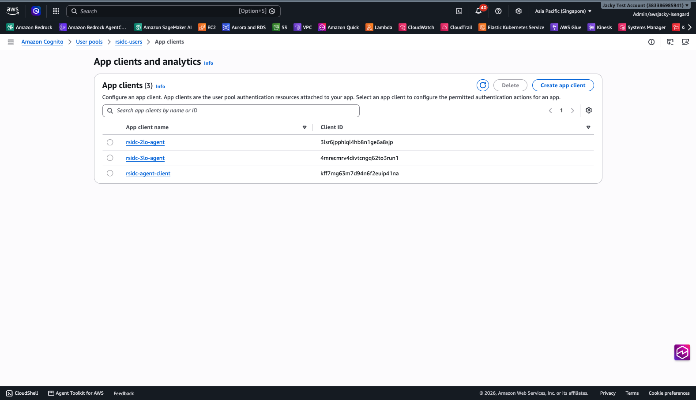

*Cognito → rsidc-users → Domain: rsidc-383386985941 with Managed login (v2)*  
URL at capture (2026-10-05 15:54:28 HKT): <https://ap-southeast-1.console.aws.amazon.com/cognito/v2/idp/user-pools/ap-southeast-1_kSVpAo5yl/branding/domain?region=ap-southeast-1>

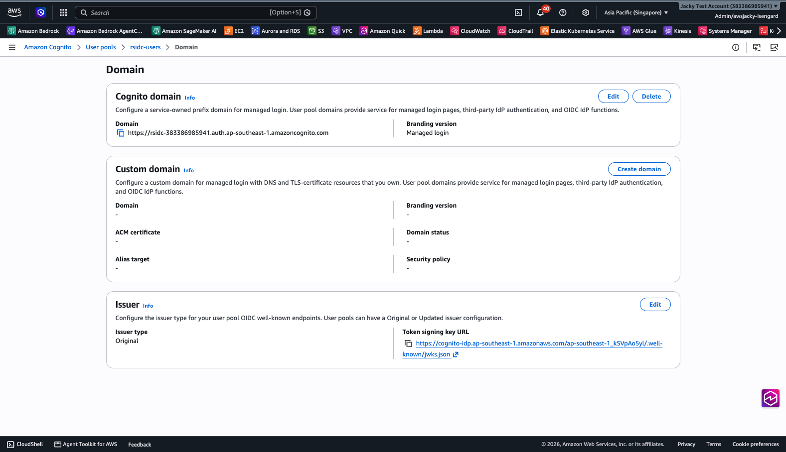

<!-- console-shots:end -->

</details>

<a name="2lo-step-10"></a>
<details id="2lo-step-10"><summary><b>Step 10 · Credential provider rsidc-2lo-cognito</b> · result: rsidc-2lo-cognito in the token vault</summary>

`infra/run.sh agent_obo/.venv/bin/python infra/10-credential-providers.py`

Creates two `CustomOauth2` providers backed by Cognito discovery. Client secrets go straight into the AgentCore Identity vault and are never printed. The script then sets the 3LO client's callback to the provider's AgentCore callback URL, copying the client's full configuration because `UpdateUserPoolClient` resets omitted fields.

**Result:**
```
rsidc-2lo-cognito  arn:...:token-vault/default/oauth2credentialprovider/rsidc-2lo-cognito
```

<!-- console-shots:start -->
**AWS console (captured from the logged-in browser session):**

*AgentCore → Identity: Outbound Auth providers rsidc-2lo-cognito and rsidc-3lo-cognito (Custom OAuth2)*  
URL at capture (2026-10-05 15:54:36 HKT): <https://ap-southeast-1.console.aws.amazon.com/bedrock-agentcore/identity?region=ap-southeast-1>

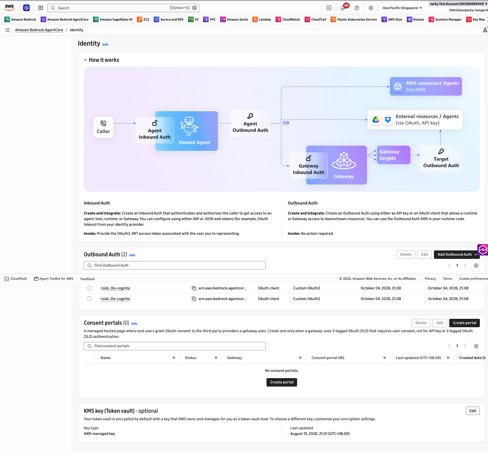

*AgentCore → Identity → rsidc-2lo-cognito: Custom OAuth2, client 3lsr6jpphlql4hb8n1ge6a8sjp, Cognito discovery URL, secret in AgentCore-managed Secrets Manager; M2M token fetches*  
URL at capture (2026-10-05 15:54:45 HKT): <https://ap-southeast-1.console.aws.amazon.com/bedrock-agentcore/identity/rsidc-2lo-cognito?region=ap-southeast-1>


<!-- console-shots:end -->

</details>

<a name="2lo-step-11"></a>
<details id="2lo-step-11"><summary><b>Step 11 · 2LO downstream: Gateway → Lambda → Redshift service user</b> · result: gateway rsidc-2lo-gateway READY, allowedClients = 2LO client</summary>

`infra/run.sh ./infra/11-2lo-gateway.sh`

Creates:
- DB user `svc_reporting` with SELECT on `sales.orders`, all rows (`infra/sql/02-svc-reporting.sql`).
- Lambda `rsidc-reporting`, which uses the Redshift Data API with `GetClusterCredentials` scoped to `dbuser:rsidc-cluster/svc_reporting`.
- Gateway `rsidc-2lo-gateway` (MCP, CUSTOM_JWT, **allowedClients = 2LO client only**) with target `reporting`, authenticated by the Gateway IAM role.

**Result:**
```
gateway READY  https://rsidc-2lo-gateway-mhss1cesvt.gateway.bedrock-agentcore.ap-southeast-1.amazonaws.com/mcp
allowedClients [3lsr6jpphlql4hb8n1ge6a8sjp]   target reporting READY
```

<!-- console-shots:start -->
**AWS console (captured from the logged-in browser session):**

*AgentCore → Gateways → rsidc-2lo-gateway: MCP gateway, IAM role rsidc-gateway-role, target 'reporting' (Lambda)*  
URL at capture (2026-10-05 15:57:23 HKT): <https://ap-southeast-1.console.aws.amazon.com/bedrock-agentcore/toolsAndGateways/rsidc-2lo-gateway-mhss1cesvt>


*AgentCore → Gateways → rsidc-2lo-gateway → Inbound Auth: Cognito, Allowed clients = 3lsr6jpphlql4hb8n1ge6a8sjp (2LO client only)*  
URL at capture (2026-10-05 15:59:43 HKT): <https://ap-southeast-1.console.aws.amazon.com/bedrock-agentcore/toolsAndGateways/rsidc-2lo-gateway-mhss1cesvt?region=ap-southeast-1>


*Lambda → rsidc-reporting → Configuration: Gateway target that queries Redshift as svc_reporting*  
URL at capture (2026-10-05 15:55:02 HKT): <https://ap-southeast-1.console.aws.amazon.com/lambda/home?region=ap-southeast-1#/functions/rsidc-reporting?tab=configure>

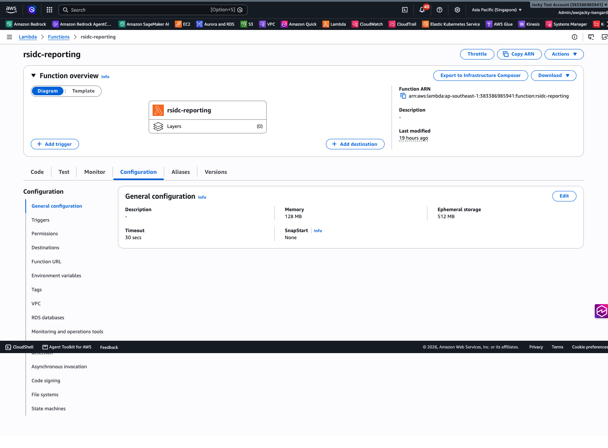

<!-- console-shots:end -->

</details>

<a name="2lo-step-12"></a>
<details id="2lo-step-12"><summary><b>Step 12 · OAuth agent runtime rsidc_oauth_agent (shared by 2LO and 3LO)</b> · result: READY, version 4</summary>

This runtime serves both 2LO and 3LO; Part 2 (3LO) links back here.

**Who authenticates what (2LO / 3LO):**

| Component | Inbound auth (who may call it, validated how) | Outbound auth (what it uses downstream) |
|---|---|---|
| AgentCore Runtime `rsidc_oauth_agent` | **Cognito JWT**: the user's ID token (discovery = Cognito pool, audience = OBO client) | **AgentCore Identity**: 2LO `rsidc-2lo-cognito` (M2M) / 3LO `rsidc-3lo-cognito` (Token Vault) |
| AgentCore Identity | The runtime's workload access token + IAM role; for 3LO, the app's `CompleteResourceTokenAuth` | Cognito token endpoint (client_credentials / authorization code) |
| AgentCore Gateway (2LO) | **Cognito JWT**: the M2M token from the same pool (JWKS), allowedClients = 2LO client. **Not** AgentCore Identity. | Gateway IAM role (`GATEWAY_IAM_ROLE`) → Lambda |
| Cognito `userInfo` (3LO) | The user's access token, validated by Cognito itself | - |

`infra/run.sh ./infra/12-deploy-oauth-runtime.sh`

Deploys `rsidc_oauth_agent` (code in `agent_oauth/`):
- Same Cognito JWT inbound auth and VPC as the OBO runtime; the `Authorization` header is forwarded.
- Its own role, which can only call `GetResourceOauth2Token` on the two providers and read their client secrets. It has no Redshift, IdC or Bedrock model access.
- Its workload identity allows a single 3LO return URL, `http://localhost:8765/callback` (the test's stand-in for the app callback page).

**Result:** `status READY`, `version 4`, `returnUrls ["http://localhost:8765/callback"]`.

<!-- console-shots:start -->
**AWS console (captured from the logged-in browser session):**

*AgentCore → Runtime → rsidc_oauth_agent → Version 4: separate runtime for 2LO/3LO (JWT inbound, VPC, env CP_2LO / CP_3LO / GW_URL)*  
URL at capture (2026-10-05 15:55:10 HKT): <https://ap-southeast-1.console.aws.amazon.com/bedrock-agentcore/agents/rsidc_oauth_agent-4lxrH9AmnT/version/4?region=ap-southeast-1>

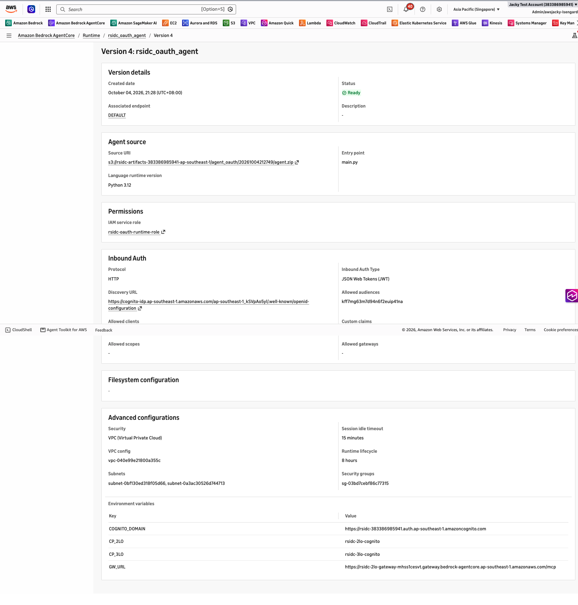

*IAM → rsidc-oauth-runtime-role → oauth-runtime (expanded): GetResourceOauth2Token on token-vault + both credential providers + its workload identity; this is what authorizes the runtime to use rsidc-2lo-cognito*  
URL at capture (2026-10-05 16:01:27 HKT): <https://us-east-1.console.aws.amazon.com/iam/home#/roles/details/rsidc-oauth-runtime-role?section=permissions>


<!-- console-shots:end -->

</details>

<a name="2lo-step-13"></a>
<details id="2lo-step-13"><summary><b>Step 13 · 2LO test cases</b> · result: PASS (2LO cases of 18/18)</summary>

`cd tests && ../infra/run.sh ../agent_obo/.venv/bin/python oauth_tests.py` (output in `tests/results-oauth.txt`)


**Result: 18/18 asserted cases matched, plus 1 documented observation**
```
PASS 2LO as wei / zhang / ds1: 5 rows each, redshift_user=svc_reporting, PII visible; token sub = 2LO client id (no user)
PASS 2LO Gateway with no token -> 401; with a USER id token -> 403 (allowedClients)
```
**OBO regression after the 2LO/3LO build:** `validate_matrix.py` still passes 16/16, `negative_tests.py` is unchanged, and the OBO runtime is still at version 3.

</details>

<a name="2lo-gui"></a>
<details id="2lo-gui"><summary><b>Web GUI · 2LO panel</b> · result: token sub = 2LO client, rows as svc_reporting</summary>

**Web GUI for 2LO / 3LO (port 8081)**
1. One-time setup:
   - `infra/run.sh agent_obo/.venv/bin/python infra/13-web-login-client.py` adds the `http://localhost:8081/callback` login callback.
2. Start it with `infra/run.sh agent_obo/.venv/bin/python webchat/oauth_app.py`, then open http://localhost:8081 and sign in (login 1).
3. **2LO**: *Run sales report via Gateway*. **3LO**: *Connect my profile*. The first time this goes through login 2 (consent), then session binding, then the token is read from the vault. *Check vault only* reads the vault without redirecting.

**Result (2026-10-05, headless Chrome, zhang):**
- **2LO:** the token claims are `sub=client_id=3lsr6jpphlql4hb8n1ge6a8sjp` and `scope=rsidc-reports/read`, with no user. The Redshift user is `svc_reporting`, and all 5 rows including `customer_email` come back.
- The OBO GUI on 8080 still works unchanged.

**On AWS (Step 14, signed in as wei):**
- 2LO: outbound token `client_id=3lsr6jpphlql4hb8n1ge6a8sjp`, scope `rsidc-reports/read`, rows returned as `svc_reporting`.

</details>

<a name="2lo-compare"></a>
<details id="2lo-compare"><summary><b>Comparison with OBO on the same Redshift data</b> · result: 2LO = svc_reporting for everyone</summary>

| Pattern | Whose identity reaches the resource | zhang (marketing) sees | ds1 (no grants) sees |
|---|---|---|---|
| **OBO** (Part 4) | the end user (`AWSIDC:zhang@…`) | 2 APAC rows, PII column denied | denied (42501) |
| **2LO** | the agent / service (`svc_reporting`) | all 5 rows **with PII** | all 5 rows **with PII** |

</details>

<a name="2lo-findings"></a>
<details id="2lo-findings"><summary><b>2LO findings</b> · result: 2 findings</summary>

1. **2LO bypasses per-user data controls by design.** Use it only for data every caller may see, and authorize at the agent/tool level (Gateway allowedClients and scopes).
5. **The Data API is an IAM path, not a network path.** The 2LO Lambda's Data API calls are not governed by the Redshift security group. Scope `GetClusterCredentials` to one DB user, as done here, and consider `aws:SourceVpce` or IP conditions.

</details>

<a name="2lo-teardown"></a>
<details id="2lo-teardown"><summary><b>2LO teardown</b> · result: via 99-teardown.sh</summary>

`infra/run.sh ./infra/99-teardown.sh` now also removes the OAuth runtime, Gateway and target, Lambda, credential providers, the three new IAM roles and the Cognito domain.

</details>

---

<a name="part-obo"></a>
## Part 4 · OBO (identity propagation to Redshift)

**OBO architecture** (Cognito JWT → runtime → IdC token exchange → Redshift as the user; IdC trusts Cognito through the Trusted Token Issuer):


| # | Step | Purpose | Result |
|---|---|---|---|
| 1 | [OBO architecture and design](#obo-arch) | agent acts as the IdC user in Redshift | single-hop identity chain |
| 2 | [Step 3 · IdC Trusted Token Issuer + Redshift IdC application](#obo-step-3) | IdC trusts Cognito JWTs; Redshift trusts IdC | TTI tti-54429cde…, namespace AWSIDC Completed |
| 3 | [Step 4 · Redshift cluster, network-restricted](#obo-step-4) | ra3.large; SG = 3 × /32 | available; SG 3 CIDRs, no 0.0.0.0/0 |
| 4 | [Step 5 · Seed data + grants to IdC group roles](#obo-step-5) | tables, rows, grants, RLS | 29 statements FINISHED |
| 5 | [Step 6 · Runtime execution role (no Redshift permissions)](#obo-step-6) | least-privilege runtime role | no Redshift permissions |
| 6 | [Step 7 · Customer-managed IdC app for the agent token exchange](#obo-step-7) | CreateTokenWithIAM target + ActorPolicy | scope redshift:connect; explicit Deny for everyone else |
| 7 | [Step 8 · Deploy the agent to AgentCore Runtime](#obo-step-8) | rsidc_data_agent with Cognito JWT inbound | READY (VPC) |
| 8 | [Step 9 · Validate the access-control matrix through the agent](#obo-step-9) | every persona × statement | 16/16 PASS |
| 9 | [Step 10 · Negative and security tests](#obo-step-10) | forged / replayed JWT, prompt injection, network, admin exchange | N1–N4b, NET1–NET5, X1–X2 as expected |
| 10 | [Web GUI · OBO chat](#obo-gui) | chat as the end user (local 8080 + AWS) | wei 5 rows · zhang 2 APAC rows, no email |
| 11 | [Key findings](#obo-findings) | what we learned | 7 findings |
| 12 | [OBO teardown](#obo-teardown) | remove steps 1–8 | 99-teardown.sh (no final snapshot) |

_Click a step to expand its commands, actual results and verification._

<a name="obo-arch"></a>
<details id="obo-arch"><summary><b>OBO architecture and design</b> · result: single-hop identity chain</summary>

_Diagram: see the top of Part 4. The text view and design notes follow._

```
 User's browser ──▶ Web chat GUI  http://localhost:8080  (webchat/obo_app.py on the operator workstation, 127.0.0.1 only)
   │  Sign in → Cognito managed login (auth code + PKCE); ID token (JWT) kept server-side by the GUI
   ▼  Authorization: Bearer <JWT>
 AgentCore Runtime  [ap-southeast-1, VPC mode]
   ├─ AgentCore Identity inbound auth: customJWTAuthorizer (Cognito discovery URL, aud = app client)
   ├─ Authorization header forwarded to agent (requestHeaderAllowlist)
   ├─ agent: sso-oauth:CreateTokenWithIAM(JWT)  ──►  IAM Identity Center [ap-east-1]
   │         (once per sign-in, cached in session)    Trusted Token Issuer (Cognito, email → emails.value)
   │                                                  customer-managed app rsidc-data-agent (scope redshift:connect)
   │  IdC access token (token_type=ACCESS_TOKEN)
   ▼  egress via NAT GW, EIP 47.131.152.68
 Redshift ra3.large [ap-east-1], IdC app namespace AWSIDC
   SG 5439 ingress: 47.131.152.68/32 (runtime), 15.248.4.71/32 + 15.248.5.7/32 (workstation) — nothing else
   Session user = AWSIDC:<email>, roles = AWSIDC:<idc-group>  → GRANTs + RLS apply
```
(CLI alternative to the GUI: `tests/chat.py`. Test harness: `tests/validate_matrix.py`.)

Why the design looks like this:
- **No service account to Redshift.** The runtime role has zero Redshift permissions. Every Redshift session is the end user.
- **The token exchange happens in the agent, once.** IdC treats an external JWT as **single-use** (`jti` replay protection). Passing the JWT straight to Redshift (`EXT_JWT`) breaks on the second connection, so the agent exchanges it once for a reusable IdC access token.
- **AgentCore Gateway was not needed.** The agent calls Redshift directly with the user's token, which keeps the identity chain to a single hop.
- **Cross-region by necessity.** The IdC instance lives in ap-east-1, and AgentCore isn't offered there. ap-southeast-1 is the nearest region that has it.

</details>

<a name="obo-step-3"></a>
<details id="obo-step-3"><summary><b>Step 3 · IdC Trusted Token Issuer + Redshift IdC application</b> · result: TTI tti-54429cde…, namespace AWSIDC Completed</summary>

`infra/run.sh ./infra/03-idc-redshift-app.sh`

The TTI trusts Cognito and maps the `email` claim to IdC `emails.value`. It also creates the IAM role for Redshift and the Redshift IdC app (namespace `AWSIDC`), and assigns 4 groups. data-engineers is deliberately not assigned.

**Result:**
```
"ns": "AWSIDC", "status": "Completed",
"sso": "arn:aws:sso::383386985941:application/ssoins-715869a9a6444dc5/apl-7158c218c69d902a",
"tti": [{"TrustedTokenIssuerArn": ".../tti-54429cde-c0b0-70e4-eeec-ba89c6508f18", "AuthorizedAudiencesList": ["kff7mg63m7d94n6f2euip41na"]}]
assignments: 4 groups
```
**Verify:** `aws redshift describe-redshift-idc-applications --region ap-east-1 --query 'RedshiftIdcApplications[].[IdentityNamespace,IdcOnboardStatus]'` → `AWSIDC Completed`

### 3a. Trusted Token Issuer: "IdC trusts JWTs issued by Cognito"
IAM Identity Center does not sign users in here; Cognito does. The **Trusted Token Issuer (TTI)** is the IdC setting that says "*a JWT signed by this Cognito user pool is acceptable proof of who the user is*". It also says how to find the matching IdC user. The TTI is created once at the IdC instance level, and IdC applications then opt in to it.

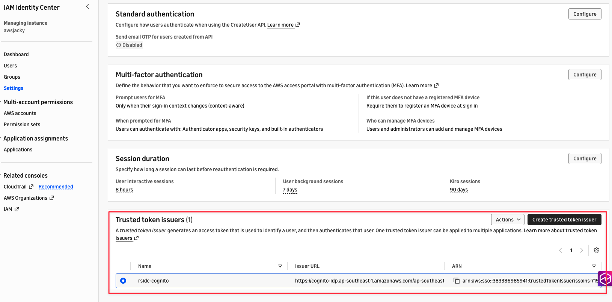

*Console: IAM Identity Center → Settings → Authentication → **Trusted token issuers** → `rsidc-cognito`.*

| Setting | Value | Meaning |
|---|---|---|
| Name | `rsidc-cognito` | |
| Type | `OIDC_JWT` | the issuer produces OIDC JWTs |
| Issuer URL | `https://cognito-idp.ap-southeast-1.amazonaws.com/ap-southeast-1_kSVpAo5yl` | the token's `iss` must equal this exactly |
| JWKS retrieval | `OPEN_ID_DISCOVERY` | IdC fetches Cognito's signing keys from `<issuer>/.well-known/openid-configuration` → `jwks_uri`, and verifies the JWT signature |
| Claim attribute path | `email` | the claim in the JWT that identifies the user |
| Identity store attribute path | `emails.value` | the IdC user attribute that the claim must match |
| ARN | `arn:aws:sso::383386985941:trustedTokenIssuer/ssoins-715869a9a6444dc5/tti-54429cde-c0b0-70e4-eeec-ba89c6508f18` | |

The TTI on its own grants nothing. Each IdC application must list it and say **which audiences** it accepts:

| IdC application | Where the TTI is referenced | Authorized audience (`aud`) |
|---|---|---|
| `rsidc-redshift` (Redshift IdC app, namespace `AWSIDC`) | `AuthorizedTokenIssuerList` (step 3) | `kff7mg63m7d94n6f2euip41na` (OBO Cognito client) |
| `rsidc-data-agent` (customer-managed app used by the agent) | jwt-bearer grant → `AuthorizedTokenIssuers` (step 7) | `kff7mg63m7d94n6f2euip41na` |

**What IdC checks when the agent calls `CreateTokenWithIAM(assertion = Cognito ID token)`:**
1. `iss` equals the TTI issuer URL, and the signature verifies against Cognito's JWKS.
2. `aud` is in the application's authorized audiences.
3. The token is not expired, and its `jti` has not been redeemed before. This is why a JWT is single-use; see history/001.
4. The value of the `email` claim is looked up in the identity store under `emails.value`. It must match **exactly one** IdC user, and that user becomes the session identity.
5. The user, via their groups, must be **assigned** to the application (assignment required).

Example with real values: Cognito user `wei` has `email = wei@techfinance.example.com`. IdC user `wei` has `emails.value = wei@techfinance.example.com`. So Redshift sees `AWSIDC:wei@techfinance.example.com` with the roles of wei's IdC groups.

**Create it (as done in `infra/03-idc-redshift-app.sh`):**
```bash
aws sso-admin create-trusted-token-issuer --region ap-east-1 \
  --instance-arn arn:aws:sso:::instance/ssoins-715869a9a6444dc5 \
  --name rsidc-cognito --trusted-token-issuer-type OIDC_JWT \
  --trusted-token-issuer-configuration "OidcJwtConfiguration={IssuerUrl=https://cognito-idp.ap-southeast-1.amazonaws.com/ap-southeast-1_kSVpAo5yl,ClaimAttributePath=email,IdentityStoreAttributePath=emails.value,JwksRetrievalOption=OPEN_ID_DISCOVERY}"
```

**Verify:**
```bash
infra/run.sh bash -c 'aws sso-admin describe-trusted-token-issuer --region $IDC_REGION --trusted-token-issuer-arn $TTI_ARN'
infra/run.sh bash -c 'aws redshift describe-redshift-idc-applications --region $IDC_REGION --query "RedshiftIdcApplications[0].AuthorizedTokenIssuerList"'
infra/run.sh bash -c 'aws sso-admin get-application-grant --region $IDC_REGION --application-arn $AGENT_IDC_APP_ARN --grant-type urn:ietf:params:oauth:grant-type:jwt-bearer'
```
Actual output (2026-10-05):
```json
"OidcJwtConfiguration": {
  "IssuerUrl": "https://cognito-idp.ap-southeast-1.amazonaws.com/ap-southeast-1_kSVpAo5yl",
  "ClaimAttributePath": "email",
  "IdentityStoreAttributePath": "emails.value",
  "JwksRetrievalOption": "OPEN_ID_DISCOVERY"
}
rsidc-redshift   AuthorizedTokenIssuerList: [{TrustedTokenIssuerArn: …tti-54429cde…, AuthorizedAudiencesList: [kff7mg63m7d94n6f2euip41na]}]
rsidc-data-agent JwtBearer.AuthorizedTokenIssuers: [{TrustedTokenIssuerArn: …tti-54429cde…, AuthorizedAudiences: [kff7mg63m7d94n6f2euip41na]}]
```

**Design notes:**
- The mapping key is **email**, so Cognito users can only be **admin-created**, with a verified email. A self-registered user choosing someone else's email would otherwise be mapped to that IdC user. Self sign-up is disabled on every pool (see Ops below).
- Keep emails unique in the IdC identity store. The TTI needs exactly one match.
- Cognito **access** tokens carry no `email` and no `aud` claim. That's why the agent exchanges the **ID token**. Another client (for example Quick, which sends access tokens) would need a different claim mapping or a pre-token-generation Lambda.
- Only the audiences listed per application are accepted. The 2LO/3LO clients (Parts 2–3) are not listed, so their tokens cannot be exchanged for Redshift access.

<!-- console-shots:start -->
**AWS console (captured from the logged-in browser session):**

*IAM Identity Center → Applications (AWS managed): rsidc-redshift (Redshift IdC application)*  
URL at capture (2026-10-05 15:53:38 HKT): <https://ap-east-1.console.aws.amazon.com/singlesignon/home?region=ap-east-1#/instances/715869a9a6444dc5/applications>

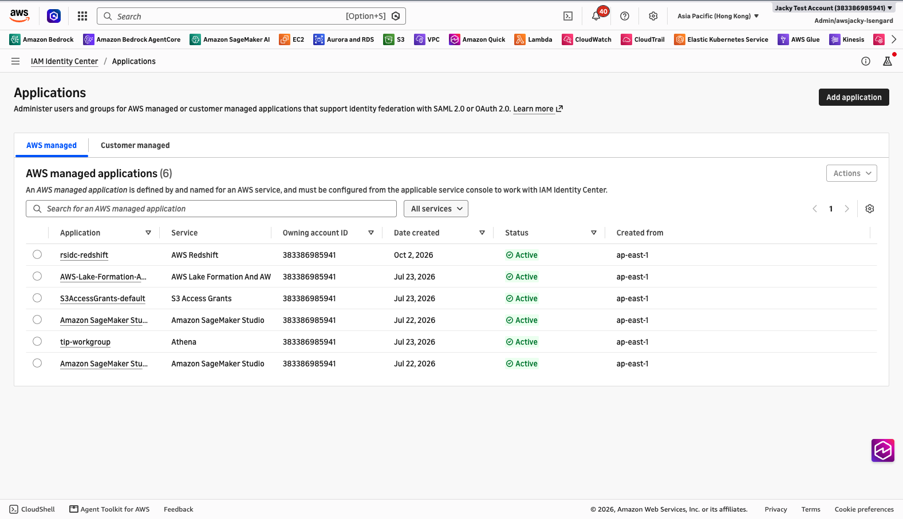

*IAM Identity Center → Settings → **Authentication** tab → Trusted token issuers: rsidc-cognito (click the Authentication tab; the console does not change the URL for tabs)*  
URL at capture (2026-10-05 15:59:32 HKT): <https://ap-east-1.console.aws.amazon.com/singlesignon/home?region=ap-east-1&tab=network-security#/instances/715869a9a6444dc5/settings>


<!-- console-shots:end -->

</details>

<a name="obo-step-4"></a>
<details id="obo-step-4"><summary><b>Step 4 · Redshift cluster, network-restricted</b> · result: available; SG 3 CIDRs, no 0.0.0.0/0</summary>

`infra/run.sh ./infra/04-redshift-cluster.sh`

ra3.large single node, encrypted, admin password in Secrets Manager, attached to the IdC app. The SG has one /32 rule per allowed source and no egress rules.

> ⚠️ **Gotcha found here:** the workstation has **two egress IPs**. HTTPS (checkip) left as `15.248.5.7`, but TCP 5439 left as `15.248.4.71`, so the first connection test timed out. `00-config.sh` now detects both, using `portquiz.net:5439` and `checkip`. To override, set `MY_IPS="a.b.c.d e.f.g.h"`.

**Result:**
```
status: available   host: rsidc-cluster.c4lxyavyzchh.ap-east-1.redshift.amazonaws.com
SG ingress 5439: 15.248.5.7/32 (operator), 47.131.152.68/32 (AgentCore NAT EIP), 15.248.4.71/32 (operator)
```
**Verify:** `aws ec2 describe-security-groups --region ap-east-1 --group-ids $RS_SG_ID --query 'SecurityGroups[0].IpPermissions[].IpRanges[].CidrIp'` → exactly those 3 CIDRs and no `0.0.0.0/0`.

<!-- console-shots:start -->
**AWS console (captured from the logged-in browser session):**

*Redshift → rsidc-cluster → Properties: ra3.large, publicly addressable, IdC connection*  
URL at capture (2026-10-05 15:53:47 HKT): <https://ap-east-1.console.aws.amazon.com/redshiftv2/home?region=ap-east-1#/cluster-details?cluster=rsidc-cluster&tab=properties>


*EC2 → Security group rsidc-redshift-sg: exactly 3 inbound /32 rules on 5439 (2 operator IPs + runtime NAT EIP), 0 outbound*  
URL at capture (2026-10-05 15:53:55 HKT): <https://ap-east-1.console.aws.amazon.com/ec2/home?region=ap-east-1#SecurityGroup:groupId=sg-04a28577466e150f5>

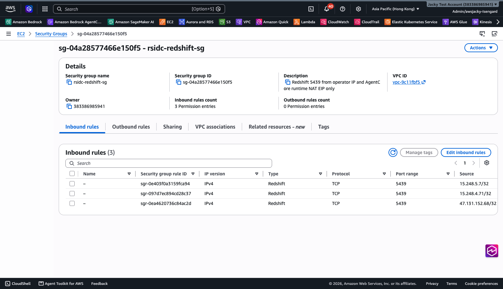

<!-- console-shots:end -->

</details>

<a name="obo-step-5"></a>
<details id="obo-step-5"><summary><b>Step 5 · Seed data + grants to IdC group roles</b> · result: 29 statements FINISHED</summary>

`infra/run.sh agent_obo/.venv/bin/python infra/05-seed-redshift.py`

This runs `infra/sql/01-seed-and-grants.sql` as the admin via the Redshift Data API. The Data API is IAM-authenticated and is used only for admin setup. Expected permission model:

| IdC group (persona) | sales.orders | marketing.campaigns | risk.credit_limits |
|---|---|---|---|
| risk-team (wei) | SELECT, all rows | ✗ | SELECT/INSERT/UPDATE |
| marketing-team (zhang) | SELECT **non-PII columns only**, **APAC rows only (RLS)** | SELECT/UPDATE | ✗ |
| platform-team (chen) | SELECT | SELECT | SELECT (read-only) |
| data-scientists (ds1) | ✗ (no grants at all) | ✗ | ✗ |

**Result:** all 29 statements `[FINISHED]` (see `infra/05.log`).

<!-- data-views:start -->
### Data in Redshift and who can see it (snapshot 2026-10-05)

Cluster `rsidc-cluster` (ap-east-1) → database **`dev`** → 3 user tables, 9 rows. The full data below was read as the admin (`rsadmin`), which bypasses RLS. Values that the matrix UPDATE cases modify (`budget`, `risk_score`) grow by +1 per matrix run.

**dev.marketing.campaigns**

| campaign_id | name | budget | status |
|---|---|---|---|
| 1 | Mid-Autumn Promo | 50004.00 | ACTIVE |
| 2 | Double 11 | 120000.00 | PLANNED |

**dev.risk.credit_limits**

| customer_email | credit_limit | risk_score |
|---|---|---|
| alice@cust.example | 10000.00 | 724 |
| carol@cust.example | 5000.00 | 640 |

**dev.sales.orders**

| order_id | region | customer_email | amount | order_date |
|---|---|---|---|---|
| 1 | APAC | alice@cust.example | 1200.00 | 2026-09-01 |
| 2 | APAC | bob@cust.example | 560.50 | 2026-09-03 |
| 3 | EMEA | carol@cust.example | 980.00 | 2026-09-05 |
| 4 | AMER | dave@cust.example | 2300.00 | 2026-09-07 |
| 5 | EMEA | erin@cust.example | 150.25 | 2026-09-09 |

### What each persona gets back (same SQL, run through the OBO agent as that user)

Regenerate with: `cd tests && ../infra/run.sh ../agent_obo/.venv/bin/python data_views.py && ../infra/run.sh ../agent_obo/.venv/bin/python render_data_views.py`

| Persona (IdC group) | Redshift session user | `SELECT * FROM marketing.campaigns` | `SELECT * FROM risk.credit_limits` | `SELECT * FROM sales.orders` |
|---|---|---|---|---|
| wei (risk-team) | `AWSIDC:wei@techfinance.example.com` | ✗ permission denied for schema marketing | 2/2 rows | 5/5 rows |
| zhang (marketing-team) | `AWSIDC:zhang@techfinance.example.com` | 2/2 rows | ✗ permission denied for schema risk | 2/5 rows, columns: order_id, region, amount, order_date (hidden: customer_email) |
| chen (platform-team) | `AWSIDC:chen@techfinance.example.com` | 2/2 rows | 2/2 rows | 5/5 rows |
| ds1 (data-scientists) | `AWSIDC:tojackywu@gmail.com` | ✗ permission denied for schema marketing | ✗ permission denied for schema risk | ✗ permission denied for schema sales |

**zhang: `SELECT * FROM sales.orders`** (RLS keeps only the APAC rows; the column grant **silently drops `customer_email`** from `SELECT *`; naming the column explicitly returns `42501 permission denied`)

| order_id | region | amount | order_date |
|---|---|---|---|
| 1 | APAC | 1200.00 | 2026-09-01 |
| 2 | APAC | 560.50 | 2026-09-03 |

<!-- data-views:end -->

</details>

<a name="obo-step-6"></a>
<details id="obo-step-6"><summary><b>Step 6 · Runtime execution role (no Redshift permissions)</b> · result: no Redshift permissions</summary>

`infra/run.sh ./infra/06-runtime-role.sh`

Grants only Bedrock InvokeModel (anthropic models), logs/xray, workload identity, and S3 read for the code bundle. See `infra/policies/agent-runtime-permissions.json`.
**Verify:** `aws iam list-role-policies --role-name rsidc-agent-runtime-role` → `agent-runtime`, `idc-token-exchange` (the second is added in step 7). Neither contains `redshift:*`.

<!-- console-shots:start -->
**AWS console (captured from the logged-in browser session):**

*IAM → rsidc-agent-runtime-role → Permissions (expanded): Bedrock, logs, workload identity, CreateTokenWithIAM on one IdC app; no redshift:**  
URL at capture (2026-10-05 16:01:15 HKT): <https://us-east-1.console.aws.amazon.com/iam/home#/roles/details/rsidc-agent-runtime-role?section=permissions>

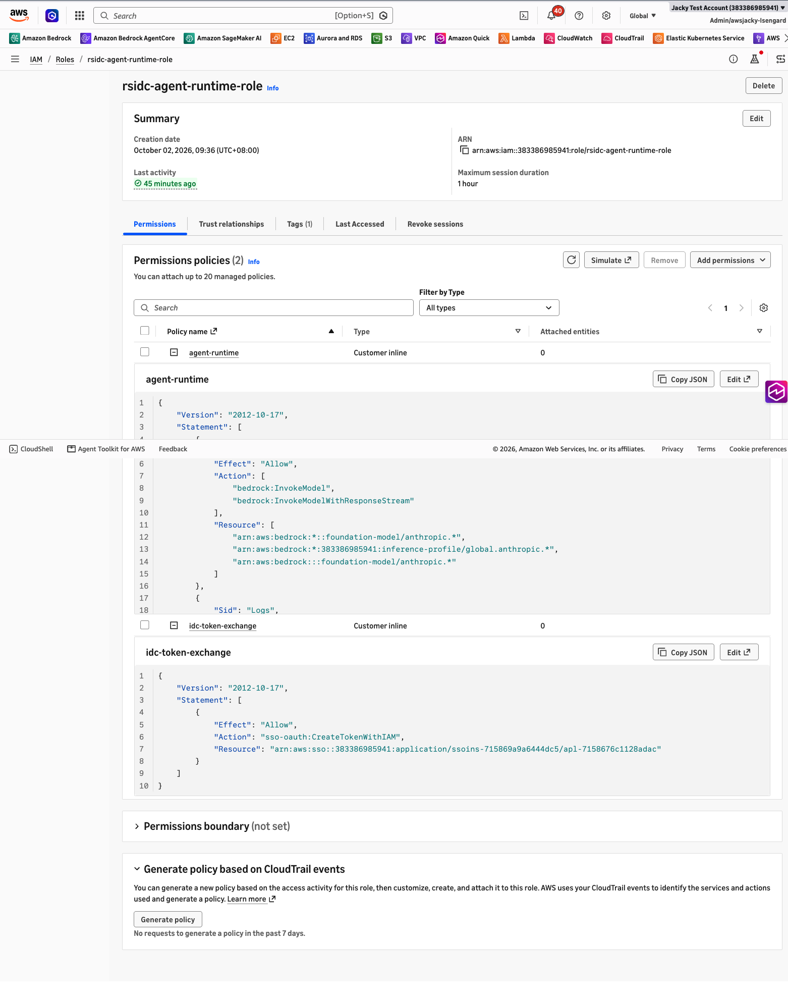

<!-- console-shots:end -->

</details>

<a name="obo-step-7"></a>
<details id="obo-step-7"><summary><b>Step 7 · Customer-managed IdC app for the agent token exchange</b> · result: scope redshift:connect; explicit Deny for everyone else</summary>

`infra/run.sh ./infra/07-idc-agent-app.sh`

The app `rsidc-data-agent` gets:
- a jwt-bearer grant trusting the Cognito TTI with audience = client id,
- scope `redshift:connect`,
- assignment required (4 groups),
- an ActorPolicy that **allows only the runtime role and explicitly denies every other principal**.

The runtime role gets `sso-oauth:CreateTokenWithIAM` on this app only.

**Result:**
```
Scopes: ["redshift:connect"]   Grant: AuthorizedTokenIssuers=[tti-54429cde..., aud kff7mg63m7d94n6f2euip41na]   Assignments: 4
ActorPolicy: Allow (runtime role) / Deny DenyEveryoneElseIncludingAdmins
AGENT_IDC_APP_ARN=arn:aws:sso::383386985941:application/ssoins-715869a9a6444dc5/apl-7158676c1128adac
```

<!-- console-shots:start -->
**AWS console (captured from the logged-in browser session):**

*IAM Identity Center → Applications → Customer managed → rsidc-data-agent: TTI authentication Configured, 4 groups assigned, trusted for AWS Redshift (1 access scope)*  
URL at capture (2026-10-05 15:58:20 HKT): <https://ap-east-1.console.aws.amazon.com/singlesignon/home?region=ap-east-1#/instances/715869a9a6444dc5/applications/ins-7158676c1128adac>

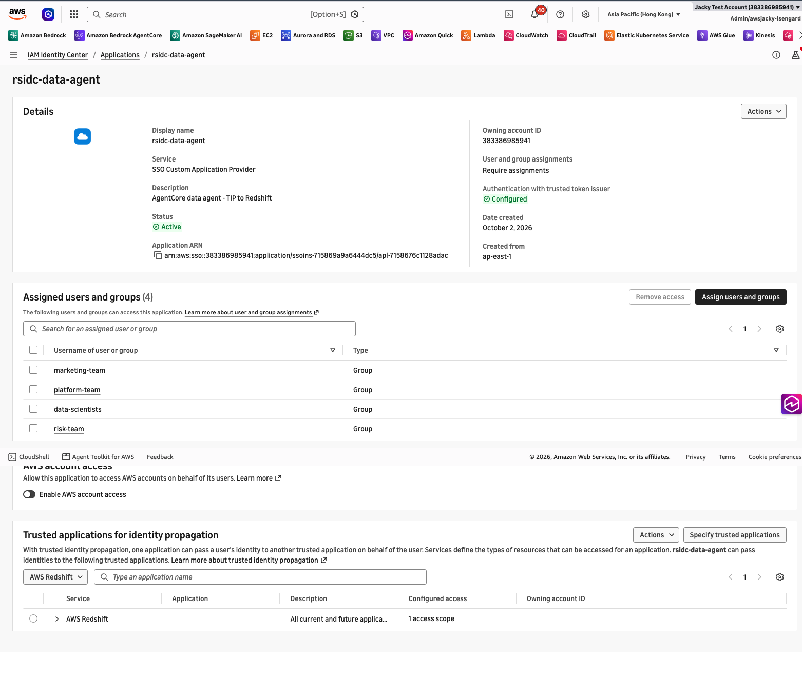

<!-- console-shots:end -->

</details>

<a name="obo-step-8"></a>
<details id="obo-step-8"><summary><b>Step 8 · Deploy the agent to AgentCore Runtime</b> · result: READY (VPC)</summary>

`infra/run.sh ./infra/08-deploy-runtime.sh`

Direct code deploy: a linux/arm64 zip uploaded to S3, PYTHON_3_12, entry point `main.py`. VPC mode, Cognito JWT authorizer, and the `Authorization` header forwarded to the agent.

**Result:**
```
"status": "READY", "net": "VPC",
"auth": {"customJWTAuthorizer": {"discoveryUrl": "https://cognito-idp.ap-southeast-1.amazonaws.com/ap-southeast-1_kSVpAo5yl/.well-known/openid-configuration", "allowedAudience": ["kff7mg63m7d94n6f2euip41na"]}},
"headers": {"requestHeaderAllowlist": ["Authorization"]}
RT_ARN=arn:aws:bedrock-agentcore:ap-southeast-1:383386985941:runtime/rsidc_data_agent-BoemCIApSW
```
Agent payloads: `{"sql": "..."}` runs exactly that SQL as the caller (deterministic tests). `{"prompt": "..."}` uses the Claude agent (`global.anthropic.claude-sonnet-5-5`) with a `run_sql` tool.

---

<!-- console-shots:start -->
**AWS console (captured from the logged-in browser session):**

*AgentCore → Runtime → rsidc_data_agent → Version 3: Inbound Auth = JWT (Cognito discovery, audience kff7mg63m7d94n6f2euip41na), VPC mode, env vars*  
URL at capture (2026-10-05 15:54:12 HKT): <https://ap-southeast-1.console.aws.amazon.com/bedrock-agentcore/agents/rsidc_data_agent-BoemCIApSW/version/3?region=ap-southeast-1>

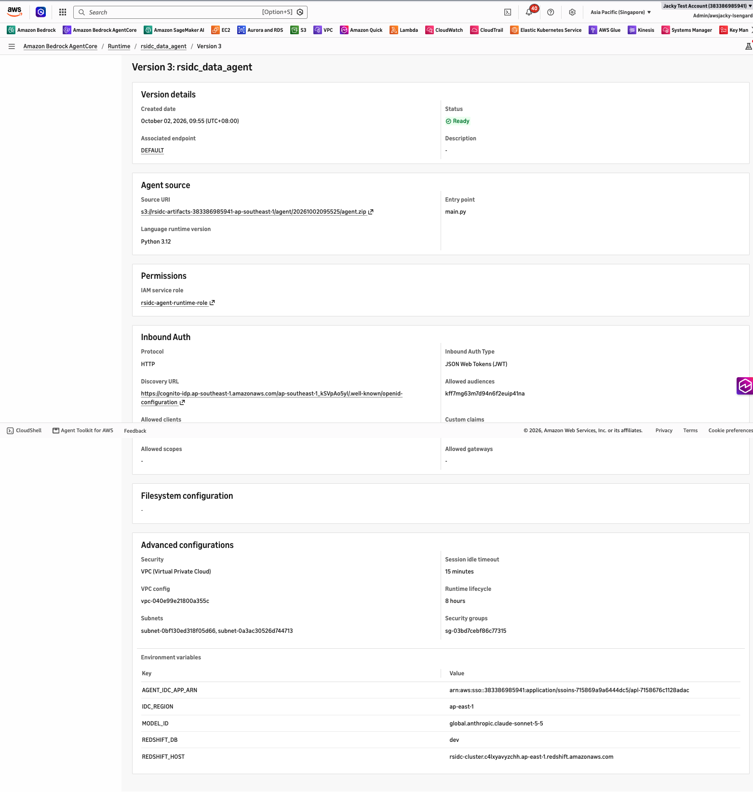

<!-- console-shots:end -->

</details>

<a name="obo-step-9"></a>
<details id="obo-step-9"><summary><b>Step 9 · Validate the access-control matrix through the agent</b> · result: 16/16 PASS</summary>

`cd tests && ../infra/run.sh ../agent_obo/.venv/bin/python validate_matrix.py`

A DENY only counts as PASS when Redshift itself refuses the statement (`42501 permission denied`). A connection or authentication failure counts as FAIL.

**Result** (`tests/results-matrix.txt`):
```
PASS | wei   | whoami                        | ALLOW | [['AWSIDC:wei@techfinance.example.com']]
PASS | wei   | read risk                     | ALLOW | rows=2
PASS | wei   | update risk                   | ALLOW | rowcount=1
PASS | wei   | read sales (all regions)      | ALLOW | rows=5
PASS | wei   | read marketing                | DENY  | 42501 permission denied for schema marketing
PASS | zhang | whoami                        | ALLOW | [['AWSIDC:zhang@techfinance.example.com']]
PASS | zhang | update marketing              | ALLOW | rowcount=1
PASS | zhang | sales non-PII cols (RLS APAC) | ALLOW | rows=2          ← RLS: only 2 APAC of 5 rows
PASS | zhang | sales PII column              | DENY  | 42501 permission denied for relation orders  ← column-level grant
PASS | zhang | read risk                     | DENY  | 42501 permission denied for schema risk
PASS | chen  | read risk                     | ALLOW | rows=2
PASS | chen  | read sales (all regions)      | ALLOW | rows=5
PASS | chen  | update risk (read-only team)  | DENY  | 42501 permission denied for relation credit_limits
PASS | chen  | privilege escalation attempt  | DENY  | 42501 permission denied for relation campaigns  (GRANT)
PASS | ds1   | whoami (authenticated)        | ALLOW | [['AWSIDC:tojackywu@gmail.com']]
PASS | ds1   | read sales (no grants)        | DENY  | 42501 permission denied for schema sales
16/16 cases matched expectation
```

</details>

<a name="obo-step-10"></a>
<details id="obo-step-10"><summary><b>Step 10 · Negative and security tests</b> · result: N1–N4b, NET1–NET5, X1–X2 as expected</summary>

`cd tests && ../infra/run.sh ../agent_obo/.venv/bin/python negative_tests.py` (output in `tests/results-negative.txt`)

| # | Test | Result |
|---|---|---|
| N1 | No `Authorization` header | **HTTP 401** `Missing Authentication Token` (rejected by AgentCore Identity before the agent code runs) |
| N2 | Forged JWT (zhang's token with the email changed to chen) | **HTTP 401** `Invalid Signature for bearerToken` |
| N3 | Same JWT reused in a **new** runtime session | `InvalidGrantException: JWT is already redeemed`. IdC enforces one use per JWT, so a new conversation needs a fresh sign-in or refreshed token. |
| N4a | LLM agent: zhang asks for customer_email in all regions | The agent returns only the 2 APAC rows and says the email column isn't visible to the user |
| N4b | LLM agent: prompt injection asking it to run `GRANT ...` and read risk | The agent refuses the GRANT, and the read fails with `42501 permission denied for schema risk`. Even if the LLM obeyed, Redshift would deny it (see the chen escalation case). |

`infra/run.sh tests/network_tests.sh` (output in `tests/results-network.txt`):

| # | Test | Result |
|---|---|---|
| NET1 | Source IPs Redshift saw for `AWSIDC:*` users (`stl_connection_log`) | Only `15.248.4.71` (workstation) and `47.131.152.68` (runtime NAT EIP) |
| NET2 | Workstation → 5439 with its rule present | `succeeded` |
| NET3 | Workstation rules revoked | `Operation timed out` |
| NET4 | Runtime while the workstation is blocked | HTTP 200, `AWSIDC:chen@...` (the runtime path is independent) |
| NET5 | Workstation rules restored | `succeeded`. The SG is back to the 3 CIDRs. |
| X1 | Admin IAM user `jacky` calls CreateTokenWithIAM with wei's JWT | Before the fix: **succeeded** (finding). After the explicit Deny: **AccessDeniedException** |
| X2 | Runtime role exchange after the fix | HTTP 200, `AWSIDC:wei@...` |

</details>

<a name="obo-gui"></a>
<details id="obo-gui"><summary><b>Web GUI · OBO chat</b> · result: wei 5 rows · zhang 2 APAC rows, no email</summary>

1. One-time: `infra/run.sh agent_obo/.venv/bin/python infra/13-web-login-client.py`. This adds Cognito managed login (code + PKCE, callback `http://localhost:8080/callback`) to the **existing** OBO client. Only the OAuth fields change; `USER_PASSWORD_AUTH`, the audience and the token lifetimes are untouched.
2. Start the GUI with `infra/run.sh agent_obo/.venv/bin/python webchat/obo_app.py`, then open http://localhost:8080.
3. Choose **Sign in** and use wei / zhang / chen / ds1 with the password from `tests/.users.env`. Then chat in natural language, or type `SQL: …` to run an exact statement as that user. **Sign out** switches users.

**Result (2026-10-05, headless Chrome):**
- wei: `SELECT * FROM sales.orders` returns 5 rows including `customer_email`, and the agent reports `AWSIDC:wei@techfinance.example.com`.
- After sign-out, zhang: the same query returns 2 APAC rows without `customer_email`, and `SELECT customer_email` is denied by Redshift (42501).

**On AWS (Step 14, signed in as wei):**
- OBO `SQL: SELECT * FROM sales.orders`: 5 rows.
- OBO natural-language question: answered, Lambda duration about 6.2 s (well under the 30 s limit).

</details>

<a name="obo-findings"></a>
<details id="obo-findings"><summary><b>Key findings</b> · result: 7 findings</summary>

1. **Access control is enforced by Redshift on the real IdC identity**, not by the agent. Users show up as `AWSIDC:<email>` and groups as `AWSIDC:<group>` roles. Schema, table and column grants and RLS all apply through the agent exactly as they would for a direct user.
2. **An external JWT is single-use at IdC.** The direct `EXT_JWT` approach failed on the second connection with `Token credentials expired or invalid`. The fix is to exchange once per sign-in (`CreateTokenWithIAM`) and reuse the IdC access token for its lifetime of about 1 hour. Because the cache is per runtime session (one microVM each), a new session needs a fresh user token.
3. **The IdC app ActorPolicy alone does not stop same-account admins.** An IAM principal with `sso-oauth:*` could exchange a user's JWT. The fix is an explicit `Deny` for every principal except the runtime role. An SCP is recommended in addition.
4. **Authenticated is not authorized.** ds1 can sign in (the group is assigned to the app) but has no grants, so every data access is denied.
5. **Column grants silently trim `SELECT *`.** zhang's `SELECT * FROM sales.orders` returns 4 columns with no error; `customer_email` is just omitted. Only naming the column explicitly is denied (42501).
6. **Metadata is visible.** `svv_tables` lists tables a user can't read (zhang sees `risk.credit_limits` listed). Turn on Redshift metadata security if table names are sensitive.
7. **Corporate networks can use different egress IPs per port.** Detect the IP that actually carries 5439 traffic before allowlisting it.

</details>

<a name="obo-teardown"></a>
<details id="obo-teardown"><summary><b>OBO teardown</b> · result: 99-teardown.sh (no final snapshot)</summary>

`infra/run.sh ./infra/99-teardown.sh`. It asks you to type `delete rsidc`, then deletes everything from steps 1–8 in reverse order, including the Redshift cluster **without a final snapshot**. The pre-existing IdC instance, users and groups are never touched.

</details>

<a name="part-obo-rbac"></a>
## Part 4 · Per-user enforcement downstream (Gateway tool RBAC)

Cognito-based Gateway tool RBAC (originally Parts 3 and 4). Entra ID version → [RUNBOOK-entra-id.md](RUNBOOK-entra-id.md)

**Demo version** (IdC groups → Pre Token trigger → `roles` claim → Cedar; RBAC web GUI → Gateway → tools A/B):

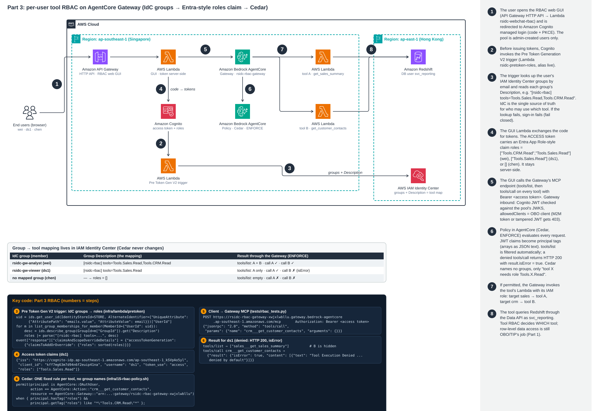

**Customer version** (Amazon Quick or the GUI → Gateway → 4 mall tools; mapping in Cognito group Descriptions):

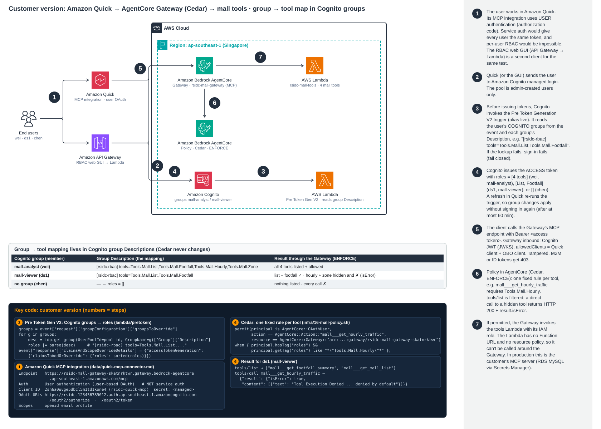

Animated walkthrough: [data/flow-rbac.html](data/flow-rbac.html) (Demo and Customer tabs).

| # | Step | Purpose | Result |
|---|---|---|---|
| 1 | [Gateway tool RBAC · question and design (Cognito + IdC groups)](#rbac-how) | per-user tool access from IdP groups | rsidc-gw-analyst / rsidc-gw-viewer |
| 2 | [Step 15.0 · Policy in AgentCore is available in ap-southeast-1](#rbac-step-15-0) | pre-check | list-policy-engines OK |
| 3 | [Step 15.1 · IdC mapping groups](#rbac-step-15-1) | group → tool mapping in IdC Descriptions | 2 project-owned groups |
| 4 | [Step 15.2 · Tool Lambdas, RBAC gateway, targets](#rbac-step-15-2) | gateway rsidc-rbac-gateway + tools A/B | gateway READY; targets sales, crm READY |
| 5 | [Step 15.3 · Cognito Pre Token Generation V2 trigger](#rbac-step-15-3) | roles claim from IdC groups | diff = trigger only; fail-closed |
| 6 | [Step 15.4 · Policy Engine and Cedar (LOG_ONLY → ENFORCE)](#rbac-step-15-4) | one fixed Cedar rule per tool | rsidc_rbac_pe-b396yeuocw ACTIVE, ENFORCE |
| 7 | [Step 15.5 · Test matrix](#rbac-step-15-5) | wei A+B, ds1 A, chen none; change tests | 12/12 enforce, 10/10 changes |
| 8 | [Gateway RBAC findings](#rbac-findings) | what we learned | 7 findings |
| 9 | [Gateway RBAC teardown](#rbac-teardown) | remove the Gateway RBAC demo resources | ordered commands |
| 10 | [Customer version · Amazon Quick → Gateway → mall tools (Cognito groups)](#mall-version) | the customer's design + per-user RBAC | ENFORCE 25/25, change 5/5 |
| 11 | [Customer version findings](#mall-findings) | what we learned | 4 findings |
| 12 | [Customer version teardown](#mall-teardown) | remove the customer-version resources | ordered commands |
| 13 | [Step 14b · RBAC web GUI (Cognito cards)](#rbac-gui) | browser front end for the RBAC gateways | GUI 80l9l7cdk2: wei all · ds1 partial · chen none |

_Click a step to expand its commands, actual results and verification._

<a name="rbac-how"></a>
<details id="rbac-how"><summary><b>Gateway tool RBAC · question and design (Cognito + IdC groups)</b> · result: rsidc-gw-analyst / rsidc-gw-viewer</summary>

**Question:** with one Gateway in front of several tools, can user1 call tools A and B while user2 can call only A, and can the group → tool mapping live in the IdP rather than in code? This is **plan 1 with an Entra-style `roles` claim**.

**How it works:**

```
IdC group Description "[rsidc-rbac] tools=Tools.Sales.Read,Tools.CRM.Read"     ← who-gets-what lives in IAM Identity Center
   │  (user signs in to Cognito)
Cognito Pre Token Generation V2 → looks up the user's IdC groups by email → access token  "roles": ["Tools.CRM.Read","Tools.Sales.Read"]
   │  Bearer <access token>
AgentCore Gateway rsidc-rbac-gateway (inbound: Cognito JWT, allowedClients = OBO client)
   └─ Policy Engine rsidc_rbac_pe (ENFORCE): one FIXED Cedar permit per tool; tool X requires role "Tools.X.Read"
        ├─ sales___get_sales_summary      → Lambda rsidc-tool-sales (tool A, no PII)
        └─ crm___get_customer_contacts    → Lambda rsidc-tool-crm   (tool B, PII)
```

Cedar never names a group. Changing who can use which tool is purely an IdC change (group Description or membership). The claim shape matches Entra ID App Roles (`roles`), so the same Cedar would work if the Gateway trusted Entra instead of Cognito.

**Deviation from the plan:** the pre-existing IdC groups (`risk-team`, `data-scientists`, …) were created on 2026-07-22/27, before this project. `infra/03` only looks them up. Their Descriptions were therefore **not** written. Instead, the mapping lives on two project-owned IdC groups:

| IdC group | Description (mapping) | Member |
|---|---|---|
| `rsidc-gw-analyst` | `[rsidc-rbac] tools=Tools.Sales.Read,Tools.CRM.Read` | wei (user1) |
| `rsidc-gw-viewer` | `[rsidc-rbac] tools=Tools.Sales.Read` | ds1 (user2) |
| (none) | n/a | chen: no tools |

The trigger reads the Descriptions of **all** of a user's groups. Putting the same `[rsidc-rbac] tools=…` text on `risk-team` or `data-scientists` would make the Redshift groups drive tool access too, with no code change.

</details>

<a name="rbac-step-15-0"></a>
<details id="rbac-step-15-0"><summary><b>Step 15.0 · Policy in AgentCore is available in ap-southeast-1</b> · result: list-policy-engines OK</summary>

```bash
aws bedrock-agentcore-control list-policy-engines --region ap-southeast-1      # → {"policyEngines": []}
```

</details>

<a name="rbac-step-15-1"></a>
<details id="rbac-step-15-1"><summary><b>Step 15.1 · IdC mapping groups</b> · result: 2 project-owned groups</summary>

```bash
infra/run.sh bash infra/15-rbac-idc-groups.sh
```
Actual result:
```
rsidc-gw-analyst (04d29c2e-d0d1-70ac-6718-6e11a6984430): [rsidc-rbac] tools=Tools.Sales.Read,Tools.CRM.Read | members: f4429c9e-… (wei)
rsidc-gw-viewer (64020c3e-b081-7001-3a5c-6d30dfa73187): [rsidc-rbac] tools=Tools.Sales.Read | members: 84620c7e-… (ds1)
```
The script refuses to update a group whose Description doesn't start with `[rsidc-rbac]`.

</details>

<a name="rbac-step-15-2"></a>
<details id="rbac-step-15-2"><summary><b>Step 15.2 · Tool Lambdas, RBAC gateway, targets</b> · result: gateway READY; targets sales, crm READY</summary>

```bash
infra/run.sh bash infra/15-rbac-gateway.sh
```
Actual result:
- Gateway `rsidc-rbac-gateway-xwjxlwbllu`: READY, URL `https://rsidc-rbac-gateway-xwjxlwbllu.gateway.bedrock-agentcore.ap-southeast-1.amazonaws.com/mcp`.
- Authorizer: `discoveryUrl=…/ap-southeast-1_kSVpAo5yl/.well-known/openid-configuration`, `allowedClients=["kff7mg63m7d94n6f2euip41na"]` (the OBO client).
- Targets: `sales` READY, `crm` READY.
- Lambdas `rsidc-tool-sales` and `rsidc-tool-crm` reuse step 11's role `rsidc-reporting-lambda-role` (Data API as `svc_reporting` only).
- Gateway role `rsidc-rbac-gateway-role` (`infra/policies/rbac-gateway-permissions.json`): `lambda:InvokeFunction` on the two tools, plus `AuthorizeAction`, `PartiallyAuthorizeActions` and `GetPolicyEngine` scoped to `rsidc_rbac_pe-*` and `rsidc-rbac-gateway-*`.
- Test-only workload identity `rsidc-rbac-test-client`, unlinked. It lets the tests get a 2LO M2M token through AgentCore Identity without reading a secret.
- Note: the first `create-gateway-target` call failed with "execution role lacks permission to invoke Lambda" while IAM was propagating. The script now retries.

</details>

<a name="rbac-step-15-3"></a>
<details id="rbac-step-15-3"><summary><b>Step 15.3 · Cognito Pre Token Generation V2 trigger</b> · result: diff = trigger only; fail-closed</summary>

```bash
infra/run.sh agent_obo/.venv/bin/python infra/15-rbac-pretoken.py          # teardown: … 15-rbac-pretoken.py --detach
```
Actual result (the pre-flight invokes the Lambda for every pool user **before** attaching it, because the trigger fails closed):
```
pre-flight ds1    roles=['Tools.Sales.Read']
pre-flight zhang  roles=[]
pre-flight chen   roles=[]
pre-flight wei    roles=['Tools.CRM.Read', 'Tools.Sales.Read']
UpdateUserPool diff: {"LambdaConfig.PreTokenGeneration": [null, "arn:…:function:rsidc-pretoken-roles"],
  "LambdaConfig.PreTokenGenerationConfig.LambdaArn": [null, "arn:…:function:rsidc-pretoken-roles"],
  "LambdaConfig.PreTokenGenerationConfig.LambdaVersion": [null, "V2_0"]}
```
- **The diff is only the trigger.** The full pool config was copied back, and `AllowAdminCreateUserOnly` is still true.
- **The first run's pre-flight was blocked** with `AccessDeniedException identitystore:GetUserId` while the new role policy was propagating. The trigger was **not** attached, and the second run passed. This is fail-closed behaving as designed.
- **The token** (decoded locally; the token itself isn't printed): the access token carries `roles` as a real JSON array, e.g. `['Tools.CRM.Read','Tools.Sales.Read']` for wei, `[]` for chen. The ID token is unchanged, and `client_id` is the OBO client.
- **Sign-in latency added by the trigger:** p50 188 ms, max 554 ms over 58 runs, plus a 434 ms cold start. Cognito's trigger limit is 5 s.

</details>

<a name="rbac-step-15-4"></a>
<details id="rbac-step-15-4"><summary><b>Step 15.4 · Policy Engine and Cedar (LOG_ONLY → ENFORCE)</b> · result: rsidc_rbac_pe-b396yeuocw ACTIVE, ENFORCE</summary>

```bash
infra/run.sh bash infra/15-rbac-policy.sh LOG_ONLY
infra/run.sh bash infra/15-rbac-policy.sh ENFORCE
infra/run.sh bash infra/15-rbac-logs.sh          # gateway APPLICATION_LOGS → /aws/vendedlogs/bedrock-agentcore/gateway/rsidc-rbac-gateway
```
The Cedar policies are created by the script, one per tool, and contain no group names:
```cedar
permit(principal is AgentCore::OAuthUser, action == AgentCore::Action::"sales___get_sales_summary",
       resource == AgentCore::Gateway::"arn:aws:bedrock-agentcore:ap-southeast-1:383386985941:gateway/rsidc-rbac-gateway-xwjxlwbllu")
when { principal.hasTag("roles") && principal.getTag("roles") like "*\"Tools.Sales.Read\"*" };
permit(principal is AgentCore::OAuthUser, action == AgentCore::Action::"crm___get_customer_contacts",
       resource == AgentCore::Gateway::"arn:…:gateway/rsidc-rbac-gateway-xwjxlwbllu")
when { principal.hasTag("roles") && principal.getTag("roles") like "*\"Tools.CRM.Read\"*" };
```
Actual result:
- Policy Engine `rsidc_rbac_pe-b396yeuocw` is ACTIVE, and policies `tool_sales_summary` and `tool_customer_contacts` are ACTIVE with no findings.
- The gateway shows `policyEngineConfiguration.mode` = `LOG_ONLY`, later `ENFORCE`.
- The `like "*\"…\"*"` pattern includes the JSON quotes because an array claim reaches Cedar as its JSON text, `["Tools.CRM.Read","Tools.Sales.Read"]`. The quotes keep `Tools.CRM.Read` from also matching `Tools.CRM.ReadWrite`.

</details>

<a name="rbac-step-15-5"></a>
<details id="rbac-step-15-5"><summary><b>Step 15.5 · Test matrix</b> · result: 12/12 enforce, 10/10 changes</summary>

```bash
cd tests
../infra/run.sh ../agent_obo/.venv/bin/python rbac_tests.py baseline   # before the policy engine is attached
../infra/run.sh ../agent_obo/.venv/bin/python rbac_tests.py log_only
../infra/run.sh ../agent_obo/.venv/bin/python rbac_tests.py enforce
../infra/run.sh ../agent_obo/.venv/bin/python rbac_change_tests.py     # tests 7–8, change IdC only
```

| # | Case | Expected | Actual | Result |
|---|---|---|---|---|
| 0 | Baseline, no policy: everyone lists and calls A and B | all allowed | all allowed (9/9) | PASS (shows the problem) |
| 1 | wei: `tools/list` / call A / call B | A+B / ✓ / ✓ | `[crm___…, sales___…]` / ✓ / ✓ | PASS |
| 2 | ds1: `tools/list` / call A / **hand-crafted** call B | A / ✓ / ✗ | `[sales___get_sales_summary]` / ✓ / `Tool Execution Denied: … No policy applies to the request (denied by default).` | PASS |
| 3 | chen (no mapped group): list / A / B | [] / ✗ / ✗ | `[]` / denied / denied | PASS |
| 4 | ds1 token with `roles` edited to add `Tools.CRM.Read` | rejected | **403** `insufficient_scope` (-32002) | PASS |
| 4b | Same claims re-encoded (bytes changed, signature unchanged) | rejected | 403: the signature is enforced | PASS |
| 4c | Garbage bearer | 401 | 401 `invalid_token` (-32001) | PASS |
| 5 | 2LO M2M token (client not in allowedClients) | rejected | **403** `insufficient_scope` | PASS |
| 6 | LOG_ONLY: ds1 calls B | allowed, deny logged | HTTP 200 with data, and the gateway log has `"log":"Policy evaluation denied request","decision":"DENY","latencyMs":48` | PASS |
| 7 | Remove A from `rsidc-gw-viewer` Description only → ds1 signs in again | A gone | new token `roles=[]`, list `[]`, call A denied (token issued 0.6 s after the change) | PASS |
| 7b | ds1's **old** token, issued before the change | still works until it expires | call A still allowed | PASS (expected: takes effect at the next token) |
| 7c | Restore the Description | A back | `[sales___get_sales_summary]` | PASS |
| 8 | Add ds1 to `rsidc-gw-analyst` (IdC membership only) | B appears | `roles=[CRM, Sales]`, list A+B, call B ✓ | PASS |
| 8b | Remove that membership | B gone | list `[A]`, call B denied | PASS |
| 9a | Regression: OBO `validate_matrix.py` | 16/16 | 16/16 | PASS |
| 9b | Regression: 2LO/3LO `oauth_tests.py` | 18/18 | 18/18 (+1 OBSERVED as before) | PASS |
| 9c | Regression: webchat (API Gateway) | 200 | both GUIs 200 | PASS |

Saved evidence is in `tests/results/` (see its README): `rbac_baseline.json`, `rbac_log_only.json`, `rbac_enforce.json` (12/12), `rbac_changes.json` (10/10), `rbac_log_only_decisions.json`, `rbac_initialize_probe.txt`, `rbac_regression_*.txt`.

</details>

<a name="rbac-findings"></a>
<details id="rbac-findings"><summary><b>Gateway RBAC findings</b> · result: 7 findings</summary>

1. **`tools/list` and `initialize` need no explicit permit.** Under ENFORCE, `initialize` returns 200 for everyone, and `tools/list` is **filtered automatically** to the tools the caller could call. chen gets an empty list. Some blog examples permit `tools/list`/`initialize` explicitly; that isn't required.
2. **A denied `tools/call` is not an HTTP or JSON-RPC error.** It comes back as HTTP 200 with `result.isError=true` and the text `Tool Execution Denied: Tool call not allowed due to policy enforcement [...]`. Clients and tests must check `isError`.
3. **Rejected JWTs return 403, not 401.** A well-formed JWT that fails signature or `allowedClients` checks gets HTTP **403** `insufficient_scope`; only an unparseable bearer gets 401 `invalid_token`. An ID token also gets 403, because it has no `client_id` claim.
4. **Claim stringification works as documented.** The array `roles` reaches Cedar as JSON text, so `like` with quoted values is the correct match, and `hasTag` guards a missing claim.
5. **Changes take effect at the next token, not immediately.** IdC changes appear in the next token (Identity Store reads are immediate: 0.6 s in test 7). Tokens already issued keep their roles until they expire (access token: 60 min for this client). Use a shorter token lifetime, or revoke refresh tokens, if faster revocation is needed.
6. **Fail-closed has a cost.** If Identity Store is unreachable, nobody can sign in to this pool (OBO, 3LO, webchat included). That's the intended trade-off; in production, alarm on the trigger's Errors metric.
7. **The data layer is unchanged.** Both tools still reach Redshift as `svc_reporting`. Gateway RBAC decides *which tool*; per-user *row/column* control still needs OBO (Part 1).

</details>

<a name="rbac-teardown"></a>
<details id="rbac-teardown"><summary><b>Gateway RBAC teardown</b> · result: ordered commands</summary>

Run in this order:
```bash
infra/run.sh agent_obo/.venv/bin/python infra/15-rbac-pretoken.py --detach           # FIRST: remove the trigger from the pool
source infra/state.env; R=ap-southeast-1
aws logs delete-delivery --region $R --id $(aws logs describe-deliveries --region $R --query "deliveries[?deliverySourceName=='rsidc-rbac-gw-logs'].id" --output text)
aws logs delete-delivery-source --region $R --name rsidc-rbac-gw-logs; aws logs delete-delivery-destination --region $R --name rsidc-rbac-gw-cwl
aws logs delete-log-group --region $R --log-group-name /aws/vendedlogs/bedrock-agentcore/gateway/rsidc-rbac-gateway
for t in $(aws bedrock-agentcore-control list-gateway-targets --region $R --gateway-identifier $RBAC_GW_ID --query 'items[].targetId' --output text); do
  aws bedrock-agentcore-control delete-gateway-target --region $R --gateway-identifier $RBAC_GW_ID --target-id $t; done
aws bedrock-agentcore-control delete-gateway --region $R --gateway-identifier $RBAC_GW_ID
for p in $(aws bedrock-agentcore-control list-policies --region $R --policy-engine-id $RBAC_PE_ID --query 'policies[].policyId' --output text); do
  aws bedrock-agentcore-control delete-policy --region $R --policy-engine-id $RBAC_PE_ID --policy-id $p; done
aws bedrock-agentcore-control delete-policy-engine --region $R --policy-engine-id $RBAC_PE_ID
aws bedrock-agentcore-control delete-workload-identity --region $R --name rsidc-rbac-test-client
for f in rsidc-tool-sales rsidc-tool-crm rsidc-pretoken-roles; do aws lambda delete-function --region $R --function-name $f; done
```
Then delete the IAM roles `rsidc-rbac-gateway-role` and `rsidc-pretoken-roles-role` (remove their inline policies first).

Finally, delete only the two project-owned IdC groups `rsidc-gw-analyst` and `rsidc-gw-viewer` (ap-east-1, `identitystore delete-group`; their memberships go with them). Don't touch the pre-existing groups.

**Cost:** effectively $0 at test volume. Gateway, Policy and Lambda bill per request, and the Cognito trigger is a Lambda invocation per sign-in. The pool was already on the ESSENTIALS tier, so there's no new tier cost.

</details>

<a name="mall-version"></a>
<details id="mall-version"><summary><b>Customer version · Amazon Quick → Gateway → mall tools (Cognito groups)</b> · result: ENFORCE 25/25, change 5/5</summary>

**Purpose:** reproduce the customer's design with per-user tool RBAC added. The customer's design is: End User →
Amazon Quick (MCP client) → MCP server with 4 mall-footfall tools → MySQL. Decisions:
1. **The Gateway is the MCP server.** Quick connects to the AgentCore Gateway URL, and the customer's 4 tools become **one Lambda target** (`mall`). The tools have no per-user code.
2. **Group → tool mapping lives in Cognito group Descriptions.** The Gateway RBAC demo's trigger now also reads Cognito groups (`ROLE_SOURCES=cognito,idc`). It is Entra App Role-shaped: claim `roles`, values `Tools.Mall.*`.
3. **One fixed Cedar permit per tool.** No group names appear in Cedar.
4. **Anti-bypass.** The Lambda has no URL and no resource policy. Only the Gateway role can invoke it.

```
User → Amazon Quick (MCP connector, user OAuth: Cognito client rsidc-quick-mcp)
        → AgentCore Gateway rsidc-mall-gateway (inbound Cognito JWT; Policy rsidc_mall_pe ENFORCE)
            → Lambda rsidc-mall-tools (target "mall": get_mall_list / get_footfall_summary / get_hourly_traffic / get_zone_comparison)
Cognito sign-in → Pre Token Gen V2 (alias live) → Cognito group Description → access token roles=[Tools.Mall.*]
```

| Step | Script | Purpose |
|---|---|---|
| 16.1 | `infra/run.sh agent_obo/.venv/bin/python infra/16-mall-cognito.py` | Groups `mall-analyst` (wei) and `mall-viewer` (ds1) with mapping Descriptions; Quick app client `rsidc-quick-mcp`. The secret goes only to `tests/.quick-client.env`. |
| 16.2 | `infra/run.sh agent_obo/.venv/bin/python infra/15-rbac-pretoken.py` | Trigger reads Cognito groups plus IdC. Cognito now calls alias **`live`**, which moves only after the pre-flight passes (history/005). |
| 16.3 | `infra/run.sh bash infra/16-mall-gateway.sh` | Lambda `rsidc-mall-tools`, roles, Gateway `rsidc-mall-gateway`, target `mall` |
| 16.4 | `infra/run.sh bash infra/16-mall-logs.sh` | Policy decision logs → `/aws/vendedlogs/bedrock-agentcore/gateway/rsidc-mall-gateway` (7 days) |
| 16.5 | `infra/run.sh bash infra/16-mall-policy.sh LOG_ONLY`, then `ENFORCE` | Policy Engine `rsidc_mall_pe`, 4 Cedar permits, attach |
| 16.6 | `infra/run.sh agent_obo/.venv/bin/python tests/mall_rbac_tests.py log_only\|enforce\|change` | Test matrix (results in `tests/results/mall_*.json`) |
| 16.7 | `data/quick-mcp-connector.md` | **Manual:** connect your Quick to the Gateway as wei, then as ds1 |

**Actual results (2026-10-06):**
```
16.1  group mall-analyst  members=['wei'] description='[rsidc-rbac] tools=Tools.Mall.List,Tools.Mall.Footfall,Tools.Mall.Hourly,Tools.Mall.Zone'
      group mall-viewer   members=['ds1'] description='[rsidc-rbac] tools=Tools.Mall.List,Tools.Mall.Footfall'
      client rsidc-quick-mcp id=2sh6a0uvge5dbcl5m1td1kone4 flows=['code'] scopes=['email','openid','profile'] secret=<in tests/.quick-client.env>
      AllowAdminCreateUserOnly: True
16.2  pre-flight ds1 roles=['Tools.Mall.Footfall','Tools.Mall.List','Tools.Sales.Read']   wei roles=[...all 4 Tools.Mall.*, Tools.CRM.Read, Tools.Sales.Read]   chen/zhang roles=[]
      promoted version 1 -> alias live
      UpdateUserPool diff: only LambdaConfig.PreTokenGeneration(Config).LambdaArn  ...:function:rsidc-pretoken-roles -> ...:rsidc-pretoken-roles:live
16.3  gateway rsidc-mall-gateway-skatnrktwr READY  url=https://rsidc-mall-gateway-skatnrktwr.gateway.bedrock-agentcore.ap-southeast-1.amazonaws.com/mcp
      allowedClients=[2sh6a0uvge5dbcl5m1td1kone4 (Quick), kff7mg63m7d94n6f2euip41na (OBO, scripted tests)]   target mall READY
      Lambda resource policy: ResourceNotFoundException; Function URL: ResourceNotFoundException
16.5  policies mall_list / mall_footfall / mall_hourly / mall_zone ACTIVE; engine rsidc_mall_pe-njxtj4u_wi mode ENFORCE
```

**Test matrix:**

| Phase | Result | Key evidence |
|---|---|---|
| LOG_ONLY | 15/15 | Every user listed and called all 4 tools (HTTP 200, data returned). The Gateway log recorded 6 `decision: DENY`: ds1 hourly and zone, chen all 4. |
| ENFORCE | 25/25 | **wei:** list shows 4 tools, all 4 calls succeed. The OBO-client token gives the same result. |
| | | **ds1:** list shows 2 tools (`mall___get_footfall_summary`, `mall___get_mall_list`). Hand-crafted hourly and zone calls return HTTP 200, `isError`, `Tool Execution Denied: Tool call not allowed due to policy enforcement`. |
| | | **chen:** list is `[]`, and all calls are denied. |
| | | **Rejected tokens:** tampered `roles` → 403; 2LO M2M token → 403; ID token → 403; garbage bearer → 401. |
| | | **Bypass:** Lambda has no resource policy and no URL. IAM simulation: `rsidc-mall-gateway-role` allowed, `rsidc-webchat-role` and `rsidc-oauth-runtime-role` implicitDeny. |
| change | 5/5 | Added `Tools.Mall.Hourly` to the `mall-viewer` Description only. ds1's new sign-in 0.9 s later can call hourly, and the **refresh-token** path (what Quick uses) picks it up too. ds1's old token is still denied, because claims are frozen until expiry. Description restored and verified. |
| Regression | PASS | Gateway RBAC demo `rbac_tests.py enforce` 12/12; OBO 16/16; 2LO/3LO 18/18; both webchat URLs 200 |

**How you can verify:**
```bash
infra/run.sh agent_obo/.venv/bin/python tests/mall_rbac_tests.py enforce          # expect 25/25 passed
aws bedrock-agentcore-control get-gateway --region ap-southeast-1 --gateway-identifier rsidc-mall-gateway-skatnrktwr --query policyEngineConfiguration   # mode ENFORCE
aws cognito-idp get-group --region ap-southeast-1 --user-pool-id ap-southeast-1_kSVpAo5yl --group-name mall-viewer --query Group.Description
aws lambda get-alias --region ap-southeast-1 --function-name rsidc-pretoken-roles --name live --query FunctionVersion
```
Then follow `data/quick-mcp-connector.md` in Amazon Quick: wei sees and uses 4 tools; ds1 is denied hourly and zone.

</details>

<a name="mall-findings"></a>
<details id="mall-findings"><summary><b>Customer version findings</b> · result: 4 findings</summary>

**Fixed after the Quick test (2026-10-20), history/007:**
- **Error:** Quick showed "No access token was found for an OAuth authorization code connection".
- **Cause:** Quick sends RFC 8707 `resource=<gateway MCP URL>`, and Cognito's `/oauth2/token` returned `invalid_grant` because that URL wasn't a registered resource server (CloudTrail: `Token_POST` 400).
- **Fix:** a Cognito resource server with identifier = the gateway MCP URL (scope `invoke`), allowed on `rsidc-quick-mcp`. It's created by `infra/16-mall-cognito.py`.
- **Verified:** a token with `resource` is issued with `aud` = the gateway URL; Cedar still enforces per user (wei 4 tools, ds1 2, ds1's hourly call denied); `mall_rbac_tests.py enforce` 25/25.


1. **The Gateway as MCP server is enough for the customer.** Tool names become `mall___<tool>`. The 4 tools share one Lambda target with an inline schema, and the Lambda receives the tool name in `context.client_context.custom["bedrockAgentCoreToolName"]`.
2. **Changes reach Quick through the refresh token.** The trigger also runs on `TokenGeneration_RefreshTokens`, so a group Description change takes effect at Quick's next token refresh, without the user signing in again. The latency is at most the access-token lifetime (60 min).
3. **Trigger deployment risk (fixed).** Updating a live `$LATEST` trigger whose new IAM permission hadn't propagated yet made the trigger fail closed for users in Cognito groups for about a minute. Cognito now calls a versioned alias that is promoted only after the pre-flight passes. See history/005.
4. **Still open: Quick's tool-list caching.** It isn't observable from AWS, so it's in the manual guide (check A). Security doesn't depend on it, because every `tools/call` is decided by Cedar.

</details>

<a name="mall-teardown"></a>
<details id="mall-teardown"><summary><b>Customer version teardown</b> · result: ordered commands</summary>

```bash
source infra/state.env; R=ap-southeast-1
aws logs delete-delivery --region $R --id $(aws logs describe-deliveries --region $R --query "deliveries[?deliverySourceName=='rsidc-mall-gw-logs'].id" --output text)
aws logs delete-delivery-source --region $R --name rsidc-mall-gw-logs; aws logs delete-delivery-destination --region $R --name rsidc-mall-gw-cwl
aws logs delete-log-group --region $R --log-group-name /aws/vendedlogs/bedrock-agentcore/gateway/rsidc-mall-gateway
for t in $(aws bedrock-agentcore-control list-gateway-targets --region $R --gateway-identifier $MALL_GW_ID --query 'items[].targetId' --output text); do
  aws bedrock-agentcore-control delete-gateway-target --region $R --gateway-identifier $MALL_GW_ID --target-id $t; done
aws bedrock-agentcore-control delete-gateway --region $R --gateway-identifier $MALL_GW_ID
for p in $(aws bedrock-agentcore-control list-policies --region $R --policy-engine-id $MALL_PE_ID --query 'policies[].policyId' --output text); do
  aws bedrock-agentcore-control delete-policy --region $R --policy-engine-id $MALL_PE_ID --policy-id $p; done
aws bedrock-agentcore-control delete-policy-engine --region $R --policy-engine-id $MALL_PE_ID
aws lambda delete-function --region $R --function-name rsidc-mall-tools
aws cognito-idp delete-user-pool-client --region $R --user-pool-id $COGNITO_POOL_ID --client-id $QUICK_CLIENT_ID
for g in mall-analyst mall-viewer; do aws cognito-idp delete-group --region $R --user-pool-id $COGNITO_POOL_ID --group-name $g; done
rm -f tests/.quick-client.env
```
- **IAM:** delete the roles `rsidc-mall-gateway-role` and `rsidc-mall-tools-role` (remove their inline policies first).
- **Quick:** delete the integration you created there.
- **Trigger:** it is shared with the Gateway RBAC demo. Remove it with that demo's teardown (`15-rbac-pretoken.py --detach`).
- **Cost:** effectively $0 at test volume. Gateway, Policy and Lambda bill per request; there's no idle cost.

</details>

<a name="rbac-gui"></a>
<details id="rbac-gui"><summary><b>Step 14b · RBAC web GUI (Cognito cards)</b> · result: GUI 80l9l7cdk2: wei all · ds1 partial · chen none</summary>

**Purpose:** a browser front end for Parts 3 and 4. It signs in on Cognito (code + PKCE, OBO client) and keeps the access token, which carries `roles`, on the server. For each gateway (demo `rsidc-rbac-gateway` and customer `rsidc-mall-gateway`) it runs `tools/list`, then calls **every** tool directly, so hidden tools are shown to be denied as well.
```bash
infra/run.sh bash infra/14-deploy-webchat.sh      # deploys/updates all three GUIs (obo, oauth, rbac)
```
**Actual result (2026-10-06):** `RBAC GUI: https://80l9l7cdk2.execute-api.ap-southeast-1.amazonaws.com`. Browser end to end:

| user | demo gateway (A / B) | customer gateway (list / footfall / hourly / zone) |
|---|---|---|
| wei | listed + allowed / listed + allowed | all 4 listed + allowed |
| ds1 | listed + allowed / **hidden + denied** | ✓ / ✓ / **hidden + denied** / **hidden + denied** |
| chen | hidden + denied / hidden + denied | all 4 hidden + denied |

**Issue found:** the page fired both gateway checks at once. With reserved concurrency 1, the second request was throttled (429). The fix: the page now sends requests one at a time.

**How you can verify:** open `https://80l9l7cdk2.execute-api.ap-southeast-1.amazonaws.com`, sign in as wei, ds1 or chen (passwords in `tests/.users.env`), and press **Check tools** on both cards. Diagrams: `data/architecture-rbac.svg` (demo, with the GUI) and `data/architecture-rbac-mall.svg` (customer version). Animation: `data/flow-rbac.html` (2 tabs).
**Teardown:** as in Step 14, for `rsidc-webchat-rbac`.

</details>

---

<a name="appendix"></a>
## Appendix

| # | Step | Purpose | Result |
|---|---|---|---|
| 1 | [Agent Registry (Tokyo registry)](#app-registry) | catalogue of runtimes and gateways | registry wCf04AFofS2kuI0i, records APPROVED |
| 2 | [Agent Registry · second registry in us-east-1, for Amazon Quick](#app-registry-us) | same records in Quick's home Region | registry OEmHlFAdLFTUVzdK |
| 3 | [Animated walkthrough](#app-flow) | OBO / 2LO / 3LO tabs | no JS errors |
| 4 | [Full teardown order](#app-teardown) | remove everything | 99-teardown.sh + per-part steps |

_Click a step to expand its commands, actual results and verification._

<a name="app-registry"></a>
<details id="app-registry"><summary><b>Agent Registry (Tokyo registry)</b> · result: registry wCf04AFofS2kuI0i, records APPROVED</summary>

The registry also lists the Entra ID resources; see [RUNBOOK-entra-id.md](RUNBOOK-entra-id.md).

**Purpose:** a governed, searchable catalogue of this PoC's agents and MCP servers. Teams, or MCP clients such as Kiro, Claude Code and Quick, can discover them there instead of rebuilding.
**Region note:** Agent Registry is available in us-east-1, us-west-2, ap-northeast-1, ap-southeast-2 and eu-west-1, but **not ap-southeast-1**. The registry is therefore in **ap-northeast-1 (Tokyo)**, and its records are metadata pointing at the Singapore endpoints.
- **No auto-detect:** auto-detection of AgentCore runtimes and gateways wasn't used, because the resources are in another Region.
- **No URL sync:** every endpoint requires a Cognito JWT, so records are created manually. The gateway tool lists are read from the deployed targets.
```bash
infra/run.sh agent_obo/.venv/bin/python infra/17-agent-registry.py
```
It creates the registry `rsidc-registry` (IAM auth, **manual approval**, no auto-approve). Each record is created, submitted for approval, then approved. The script is idempotent: existing records are skipped.

**Actual result (2026-10-06):**
```
registry arn:aws:agent-registry:ap-northeast-1:383386985941:registry/wCf04AFofS2kuI0i
rsidc-data-agent     CUSTOM GLzbeTVUP2om APPROVED
rsidc-oauth-agent    CUSTOM bIlCm8wOcltj APPROVED
rsidc-2lo-gateway    MCP    BxtmQrlS0Y7Z APPROVED
rsidc-rbac-gateway   MCP    kVmaD6uUUGHZ APPROVED
rsidc-mall-gateway   MCP    pd7q0mFPjy4E APPROVED
```
Semantic search (`agent-registry` SearchDiscoverableRegistryRecords) returned:

| query | top results |
|---|---|
| "which tool can restrict MCP tools per user with Cedar" | rsidc-rbac-gateway, rsidc-mall-gateway |
| "query Redshift as the signed-in user via IAM Identity Center" | rsidc-data-agent |
| "mall footfall traffic" | rsidc-mall-gateway |

The re-run printed `skip … (exists: APPROVED)` for all 5 records.

**How you can verify:**
```bash
aws agent-registry-control list-registry-records --registry-id wCf04AFofS2kuI0i --region ap-northeast-1 \
  --query 'registryRecords[].[name,recordType,status]' --output table
aws agent-registry-control get-registry-record --registry-id wCf04AFofS2kuI0i --record-id pd7q0mFPjy4E --region ap-northeast-1
```
Console: AWS Agent Registry in **Asia Pacific (Tokyo)** → Registries → `rsidc-registry`.

**Teardown:**
```bash
for r in $(aws agent-registry-control list-registry-records --registry-id wCf04AFofS2kuI0i --region ap-northeast-1 --query 'registryRecords[].recordId' --output text); do
  aws agent-registry-control delete-registry-record --registry-id wCf04AFofS2kuI0i --record-id $r --region ap-northeast-1; done
aws agent-registry-control delete-registry --registry-id wCf04AFofS2kuI0i --region ap-northeast-1
```
**Cost:** negligible at PoC scale. Registry pricing is per record and per search request; check the AgentCore pricing page.
**Gotcha:** `aws <service> <cmd> help` opens an interactive pager and can hang automation. Use `--generate-cli-skeleton` or the docs instead.

</details>

<a name="app-registry-us"></a>
<details id="app-registry-us"><summary><b>Agent Registry · second registry in us-east-1, for Amazon Quick</b> · result: registry OEmHlFAdLFTUVzdK</summary>

Quick only links a registry in the **same AWS account and Region** as the Quick account, it needs `AWS_IAM` auth, and it surfaces only `MCP` records that have `remotes[].url`. The Quick account in 383386985941 (`awsjackywu`) has its home Region in **us-east-1**, so the same records were also created there:
```bash
REGISTRY_REGION=us-east-1 infra/run.sh agent_obo/.venv/bin/python infra/17-agent-registry.py
```
**Actual result (2026-10-08):** registry `OEmHlFAdLFTUVzdK` (us-east-1). All records are APPROVED:

| Record | Type | Record ID |
|---|---|---|
| rsidc-data-agent | CUSTOM | Xrl1zQXq0sFs |
| rsidc-oauth-agent | CUSTOM | ULYJZY0Quhh1 |
| rsidc-2lo-gateway | MCP | 7GcBhljWFW8D |
| rsidc-rbac-gateway | MCP | lIGDyJb1yuSP |
| rsidc-mall-gateway | MCP | hAQMQv2b8tWh |
| rsidc-mall-entra-gateway | MCP | xatxCKAu0ZaA |

The Tokyo registry also gained `rsidc-mall-entra-gateway` (`rJ5UFz44rsry`).

**What Quick will show:** only the 4 gateways (MCP records); the 2 runtimes are CUSTOM and are not shown. Of those, only `rsidc-mall-gateway` is ready for Quick sign-in today: its Cognito client `rsidc-quick-mcp` allows the Quick callback URLs.

</details>

<a name="app-flow"></a>
<details id="app-flow"><summary><b>Animated walkthrough</b> · result: no JS errors</summary>

`open data/flow.html` (rebuild after re-rendering diagrams: `python3 data/build_flow.py`). Tabs OBO / 2LO / 3LO step through every login, token hop and check described above. Verified in headless Chrome: all three tabs run with no JS errors.

</details>

<a name="app-teardown"></a>
<details id="app-teardown"><summary><b>Full teardown order</b> · result: 99-teardown.sh + per-part steps</summary>

`infra/run.sh ./infra/99-teardown.sh`. It asks you to type `delete rsidc`, then deletes everything from steps 1–8 in reverse order, including the Redshift cluster **without a final snapshot**. The pre-existing IdC instance, users and groups are never touched.

`infra/run.sh ./infra/99-teardown.sh` now also removes the OAuth runtime, Gateway and target, Lambda, credential providers, the three new IAM roles and the Cognito domain.

Then, in this order, the per-part extras: [Step 14 web GUIs](#shared-step-14), [Gateway RBAC](#rbac-teardown), [customer version](#mall-teardown), [Agent Registry](#app-registry). Entra ID resources: see [RUNBOOK-entra-id.md](RUNBOOK-entra-id.md).

</details>

> Entra ID version → [RUNBOOK-entra-id.md](RUNBOOK-entra-id.md) (Entra Gateway RBAC, Entra sign-in in the RBAC GUI, and Entra × AgentCore Identity 2LO / 3LO / OBO)
