> **Reviewer evidence pack:** `docs/review/review.pdf`. It covers all 43 deployed resources in deployment order, with 40 console screenshots (exact URL + time) and 29/29 read-only checks PASS. It is generated by the `aws-deploy-evidence` skill.

# RUNBOOK: AgentCore Runtime data agent with Redshift + IAM Identity Center access control

Goal: prove that an AgentCore Runtime agent querying/updating Redshift **acts as the calling IdC user**,
so Redshift permissions defined for IdC groups (schema/table/column grants, RLS) are enforced,
and that Redshift is reachable **only** from the operator workstation and the AgentCore runtime.

All results below are real outputs from 2026-10-02 (account 383386985941).

## Architecture

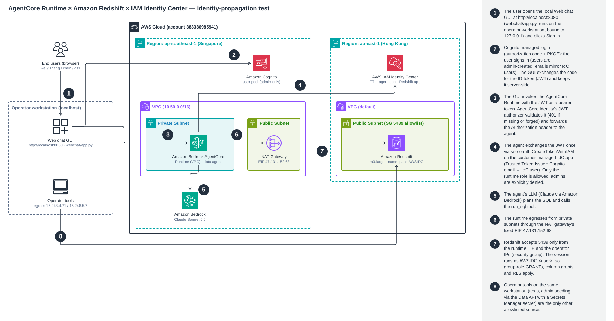

```
 User's browser ──▶ Web chat GUI  http://localhost:8080  (webchat/app.py on the operator workstation, 127.0.0.1 only)
   │  Sign in → Cognito managed login (auth code + PKCE); ID token (JWT) kept server-side by the GUI
   ▼  Authorization: Bearer <JWT>
 AgentCore Runtime  [ap-southeast-1, VPC mode]
   ├─ AgentCore Identity inbound auth: customJWTAuthorizer (Cognito discovery URL, aud = app client)
   ├─ Authorization header forwarded to agent (requestHeaderAllowlist)
   ├─ agent: sso-oauth:CreateTokenWithIAM(JWT)  ──►  IAM Identity Center [ap-east-1]
   │         (once per sign-in, cached in session)    Trusted Token Issuer (Cognito, email → emails.value)
   │                                                  customer-managed app rsidc-data-agent (scope redshift:connect)
   │  IdC access token (token_type=ACCESS_TOKEN)
   ▼  egress via NAT GW, EIP 47.131.152.68
 Redshift ra3.large [ap-east-1], IdC app namespace AWSIDC
   SG 5439 ingress: 47.131.152.68/32 (runtime), 15.248.4.71/32 + 15.248.5.7/32 (workstation) — nothing else
   Session user = AWSIDC:<email>, roles = AWSIDC:<idc-group>  → GRANTs + RLS apply
```
(CLI alternative to the GUI: `tests/chat.py`. Test harness: `tests/validate_matrix.py`.)

Why the design looks like this:
- **No service account to Redshift.** The runtime role has zero Redshift permissions. Every Redshift session is the end user.
- **The token exchange happens in the agent, once.** IdC treats an external JWT as **single-use** (`jti` replay protection). Passing the JWT straight to Redshift (`EXT_JWT`) breaks on the second connection, so the agent exchanges it once for a reusable IdC access token.
- **AgentCore Gateway was not needed.** The agent calls Redshift directly with the user's token, which keeps the identity chain to a single hop.
- **Cross-region by necessity.** The IdC instance lives in ap-east-1, and AgentCore isn't offered there. ap-southeast-1 is the nearest region that has it.

## Prerequisites
- AWS CLI v2, `uv`, Python 3.12 (via uv), `nc`, `zip`; AWS profile `default` with admin rights in 383386985941.
- Existing IdC instance `ssoins-715869a9a6444dc5` (ap-east-1), with users wei/zhang/chen/ds1 in the groups risk-team, marketing-team, platform-team and data-scientists.
- Agent venv: `cd agent && uv venv --python 3.12 .venv && uv pip install --python .venv/bin/python -r requirements.txt requests`
- **Always run steps through `infra/run.sh`.** It loads `infra/00-config.sh` and `infra/state.env`, where resource IDs are saved. Every step is idempotent and safe to re-run.

---

## Step 1: Runtime VPC with a fixed egress IP
`infra/run.sh ./infra/01-runtime-network.sh`

Creates VPC 10.50.0.0/16, a public subnet with an IGW and NAT GW plus EIP, two private subnets (apse1-az1/az2), and an egress-only SG.

**Result:**
```
Runtime NAT EIP: 47.131.152.68
RT_VPC_ID=vpc-040e99e21800a355c  RT_NAT_ID=nat-042a3797afe93a19f  RT_SG_ID=sg-03bd7cebf86c77315
RT_PRIV_SUBNET_1=subnet-0bf130ed318f05d66  RT_PRIV_SUBNET_2=subnet-0a3ac30526d744713
```
**Verify:** `aws ec2 describe-nat-gateways --region ap-southeast-1 --nat-gateway-ids nat-042a3797afe93a19f --query 'NatGateways[0].[State,NatGatewayAddresses[0].PublicIp]'` → `available 47.131.152.68`

<!-- console-shots:start -->
**AWS console (captured from the logged-in browser session):**

*VPC → NAT gateways → rsidc-rt-nat: public NAT, EIP 47.131.152.68 (the runtime's only egress IP)*  
URL at capture (2026-10-05 15:53:06 HKT): <https://ap-southeast-1.console.aws.amazon.com/vpcconsole/home?region=ap-southeast-1#NatGatewayDetails:natGatewayId=nat-042a3797afe93a19f>


<!-- console-shots:end -->

## Step 2: Cognito user pool (end-user IdP)
`infra/run.sh ./infra/02-cognito.sh`

Admin-create-only pool, plus a public app client (USER_PASSWORD_AUTH) and four users whose emails match IdC users. Passwords go to `tests/.users.env` (chmod 600, gitignored).

**Result:**
```
| ds1   | tojackywu@gmail.com           | CONFIRMED |
| zhang | zhang@techfinance.example.com | CONFIRMED |
| chen  | chen@techfinance.example.com  | CONFIRMED |
| wei   | wei@techfinance.example.com   | CONFIRMED |
COGNITO_POOL_ID=ap-southeast-1_kSVpAo5yl  COGNITO_CLIENT_ID=kff7mg63m7d94n6f2euip41na
```
**Verify:** `aws cognito-idp describe-user-pool --region ap-southeast-1 --user-pool-id ap-southeast-1_kSVpAo5yl --query UserPool.AdminCreateUserConfig` → `AllowAdminCreateUserOnly: true`

<!-- console-shots:start -->
**AWS console (captured from the logged-in browser session):**

*Cognito → rsidc-users → Users: 4 admin-created users, emails verified (they mirror IdC users)*  
URL at capture (2026-10-05 15:53:14 HKT): <https://ap-southeast-1.console.aws.amazon.com/cognito/v2/idp/user-pools/ap-southeast-1_kSVpAo5yl/user-management/users?region=ap-southeast-1>

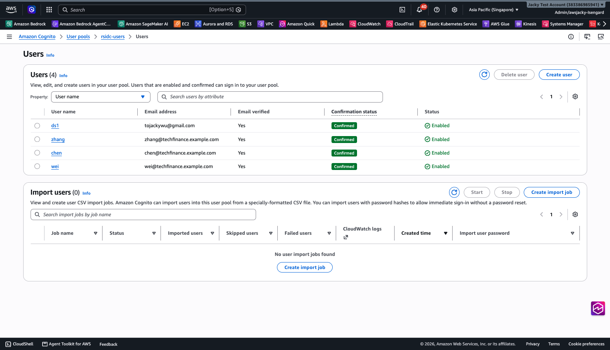

*Cognito → rsidc-users → Sign-up: Self-registration = Disabled (admin-only user creation)*  
URL at capture (2026-10-05 15:53:22 HKT): <https://ap-southeast-1.console.aws.amazon.com/cognito/v2/idp/user-pools/ap-southeast-1_kSVpAo5yl/authentication/sign-up?region=ap-southeast-1>

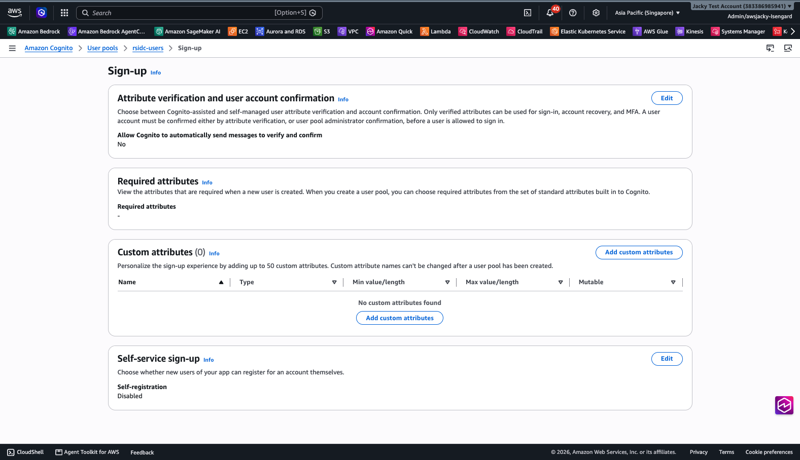

<!-- console-shots:end -->

## Step 3: IdC Trusted Token Issuer + Redshift IdC application
`infra/run.sh ./infra/03-idc-redshift-app.sh`

The TTI trusts Cognito and maps the `email` claim to IdC `emails.value`. It also creates the IAM role for Redshift and the Redshift IdC app (namespace `AWSIDC`), and assigns 4 groups. data-engineers is deliberately not assigned.

**Result:**
```
"ns": "AWSIDC", "status": "Completed",
"sso": "arn:aws:sso::383386985941:application/ssoins-715869a9a6444dc5/apl-7158c218c69d902a",
"tti": [{"TrustedTokenIssuerArn": ".../tti-54429cde-c0b0-70e4-eeec-ba89c6508f18", "AuthorizedAudiencesList": ["kff7mg63m7d94n6f2euip41na"]}]
assignments: 4 groups
```
**Verify:** `aws redshift describe-redshift-idc-applications --region ap-east-1 --query 'RedshiftIdcApplications[].[IdentityNamespace,IdcOnboardStatus]'` → `AWSIDC Completed`

### 3a. Trusted Token Issuer: "IdC trusts JWTs issued by Cognito"
IAM Identity Center does not sign users in here; Cognito does. The **Trusted Token Issuer (TTI)** is the IdC setting that says "*a JWT signed by this Cognito user pool is acceptable proof of who the user is*". It also says how to find the matching IdC user. The TTI is created once at the IdC instance level, and IdC applications then opt in to it.

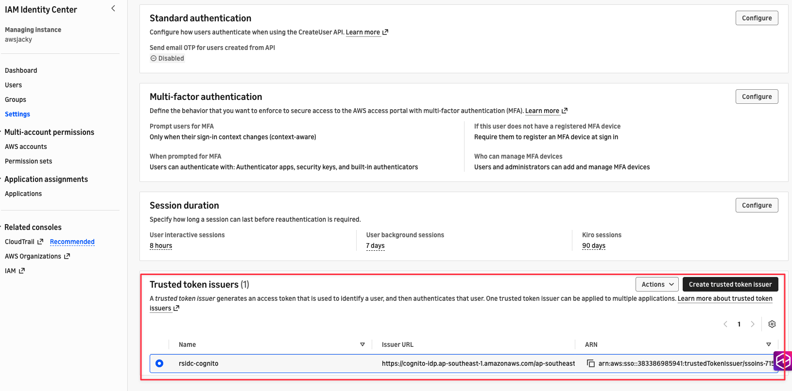

*Console: IAM Identity Center → Settings → Authentication → **Trusted token issuers** → `rsidc-cognito`.*

| Setting | Value | Meaning |
|---|---|---|
| Name | `rsidc-cognito` | |
| Type | `OIDC_JWT` | the issuer produces OIDC JWTs |
| Issuer URL | `https://cognito-idp.ap-southeast-1.amazonaws.com/ap-southeast-1_kSVpAo5yl` | the token's `iss` must equal this exactly |
| JWKS retrieval | `OPEN_ID_DISCOVERY` | IdC fetches Cognito's signing keys from `<issuer>/.well-known/openid-configuration` → `jwks_uri`, and verifies the JWT signature |
| Claim attribute path | `email` | the claim in the JWT that identifies the user |
| Identity store attribute path | `emails.value` | the IdC user attribute that the claim must match |
| ARN | `arn:aws:sso::383386985941:trustedTokenIssuer/ssoins-715869a9a6444dc5/tti-54429cde-c0b0-70e4-eeec-ba89c6508f18` | |

The TTI on its own grants nothing. Each IdC application must list it and say **which audiences** it accepts:

| IdC application | Where the TTI is referenced | Authorized audience (`aud`) |
|---|---|---|
| `rsidc-redshift` (Redshift IdC app, namespace `AWSIDC`) | `AuthorizedTokenIssuerList` (step 3) | `kff7mg63m7d94n6f2euip41na` (OBO Cognito client) |
| `rsidc-data-agent` (customer-managed app used by the agent) | jwt-bearer grant → `AuthorizedTokenIssuers` (step 7) | `kff7mg63m7d94n6f2euip41na` |

**What IdC checks when the agent calls `CreateTokenWithIAM(assertion = Cognito ID token)`:**
1. `iss` equals the TTI issuer URL, and the signature verifies against Cognito's JWKS.
2. `aud` is in the application's authorized audiences.
3. The token is not expired, and its `jti` has not been redeemed before. This is why a JWT is single-use; see history/001.
4. The value of the `email` claim is looked up in the identity store under `emails.value`. It must match **exactly one** IdC user, and that user becomes the session identity.
5. The user, via their groups, must be **assigned** to the application (assignment required).

Example with real values: Cognito user `wei` has `email = wei@techfinance.example.com`. IdC user `wei` has `emails.value = wei@techfinance.example.com`. So Redshift sees `AWSIDC:wei@techfinance.example.com` with the roles of wei's IdC groups.

**Create it (as done in `infra/03-idc-redshift-app.sh`):**
```bash
aws sso-admin create-trusted-token-issuer --region ap-east-1 \
  --instance-arn arn:aws:sso:::instance/ssoins-715869a9a6444dc5 \
  --name rsidc-cognito --trusted-token-issuer-type OIDC_JWT \
  --trusted-token-issuer-configuration "OidcJwtConfiguration={IssuerUrl=https://cognito-idp.ap-southeast-1.amazonaws.com/ap-southeast-1_kSVpAo5yl,ClaimAttributePath=email,IdentityStoreAttributePath=emails.value,JwksRetrievalOption=OPEN_ID_DISCOVERY}"
```

**Verify:**
```bash
infra/run.sh bash -c 'aws sso-admin describe-trusted-token-issuer --region $IDC_REGION --trusted-token-issuer-arn $TTI_ARN'
infra/run.sh bash -c 'aws redshift describe-redshift-idc-applications --region $IDC_REGION --query "RedshiftIdcApplications[0].AuthorizedTokenIssuerList"'
infra/run.sh bash -c 'aws sso-admin get-application-grant --region $IDC_REGION --application-arn $AGENT_IDC_APP_ARN --grant-type urn:ietf:params:oauth:grant-type:jwt-bearer'
```
Actual output (2026-10-05):
```json
"OidcJwtConfiguration": {
  "IssuerUrl": "https://cognito-idp.ap-southeast-1.amazonaws.com/ap-southeast-1_kSVpAo5yl",
  "ClaimAttributePath": "email",
  "IdentityStoreAttributePath": "emails.value",
  "JwksRetrievalOption": "OPEN_ID_DISCOVERY"
}
rsidc-redshift   AuthorizedTokenIssuerList: [{TrustedTokenIssuerArn: …tti-54429cde…, AuthorizedAudiencesList: [kff7mg63m7d94n6f2euip41na]}]
rsidc-data-agent JwtBearer.AuthorizedTokenIssuers: [{TrustedTokenIssuerArn: …tti-54429cde…, AuthorizedAudiences: [kff7mg63m7d94n6f2euip41na]}]
```

**Design notes:**
- The mapping key is **email**, so Cognito users can only be **admin-created**, with a verified email. A self-registered user choosing someone else's email would otherwise be mapped to that IdC user. Self sign-up is disabled on every pool (see Ops below).
- Keep emails unique in the IdC identity store. The TTI needs exactly one match.
- Cognito **access** tokens carry no `email` and no `aud` claim. That's why the agent exchanges the **ID token**. Another client (for example Quick, which sends access tokens) would need a different claim mapping or a pre-token-generation Lambda.
- Only the audiences listed per application are accepted. The 2LO/3LO clients from Part 2 are not listed, so their tokens cannot be exchanged for Redshift access.

<!-- console-shots:start -->
**AWS console (captured from the logged-in browser session):**

*IAM Identity Center → Applications (AWS managed): rsidc-redshift (Redshift IdC application)*  
URL at capture (2026-10-05 15:53:38 HKT): <https://ap-east-1.console.aws.amazon.com/singlesignon/home?region=ap-east-1#/instances/715869a9a6444dc5/applications>


*IAM Identity Center → Settings → **Authentication** tab → Trusted token issuers: rsidc-cognito (click the Authentication tab; the console does not change the URL for tabs)*  
URL at capture (2026-10-05 15:59:32 HKT): <https://ap-east-1.console.aws.amazon.com/singlesignon/home?region=ap-east-1&tab=network-security#/instances/715869a9a6444dc5/settings>

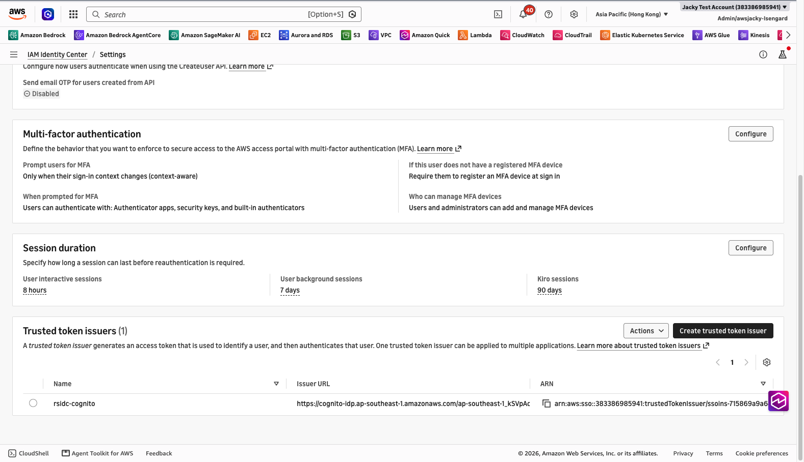

<!-- console-shots:end -->

## Step 4: Redshift cluster, network-restricted
`infra/run.sh ./infra/04-redshift-cluster.sh`

ra3.large single node, encrypted, admin password in Secrets Manager, attached to the IdC app. The SG has one /32 rule per allowed source and no egress rules.

> ⚠️ **Gotcha found here:** the workstation has **two egress IPs**. HTTPS (checkip) left as `15.248.5.7`, but TCP 5439 left as `15.248.4.71`, so the first connection test timed out. `00-config.sh` now detects both, using `portquiz.net:5439` and `checkip`. To override, set `MY_IPS="a.b.c.d e.f.g.h"`.

**Result:**
```
status: available   host: rsidc-cluster.c4lxyavyzchh.ap-east-1.redshift.amazonaws.com
SG ingress 5439: 15.248.5.7/32 (operator), 47.131.152.68/32 (AgentCore NAT EIP), 15.248.4.71/32 (operator)
```
**Verify:** `aws ec2 describe-security-groups --region ap-east-1 --group-ids $RS_SG_ID --query 'SecurityGroups[0].IpPermissions[].IpRanges[].CidrIp'` → exactly those 3 CIDRs and no `0.0.0.0/0`.

<!-- console-shots:start -->
**AWS console (captured from the logged-in browser session):**

*Redshift → rsidc-cluster → Properties: ra3.large, publicly addressable, IdC connection*  
URL at capture (2026-10-05 15:53:47 HKT): <https://ap-east-1.console.aws.amazon.com/redshiftv2/home?region=ap-east-1#/cluster-details?cluster=rsidc-cluster&tab=properties>


*EC2 → Security group rsidc-redshift-sg: exactly 3 inbound /32 rules on 5439 (2 operator IPs + runtime NAT EIP), 0 outbound*  
URL at capture (2026-10-05 15:53:55 HKT): <https://ap-east-1.console.aws.amazon.com/ec2/home?region=ap-east-1#SecurityGroup:groupId=sg-04a28577466e150f5>


<!-- console-shots:end -->

## Step 5: Seed data + grants to IdC group roles
`infra/run.sh agent/.venv/bin/python infra/05-seed-redshift.py`

This runs `infra/sql/01-seed-and-grants.sql` as the admin via the Redshift Data API. The Data API is IAM-authenticated and is used only for admin setup. Expected permission model:

| IdC group (persona) | sales.orders | marketing.campaigns | risk.credit_limits |
|---|---|---|---|
| risk-team (wei) | SELECT, all rows | ✗ | SELECT/INSERT/UPDATE |
| marketing-team (zhang) | SELECT **non-PII columns only**, **APAC rows only (RLS)** | SELECT/UPDATE | ✗ |
| platform-team (chen) | SELECT | SELECT | SELECT (read-only) |
| data-scientists (ds1) | ✗ (no grants at all) | ✗ | ✗ |

**Result:** all 29 statements `[FINISHED]` (see `infra/05.log`).

<!-- data-views:start -->
### Data in Redshift and who can see it (snapshot 2026-10-05)

Cluster `rsidc-cluster` (ap-east-1) → database **`dev`** → 3 user tables, 9 rows. The full data below was read as the admin (`rsadmin`), which bypasses RLS. Values that the matrix UPDATE cases modify (`budget`, `risk_score`) grow by +1 per matrix run.

**dev.marketing.campaigns**

| campaign_id | name | budget | status |
|---|---|---|---|
| 1 | Mid-Autumn Promo | 50004.00 | ACTIVE |
| 2 | Double 11 | 120000.00 | PLANNED |

**dev.risk.credit_limits**

| customer_email | credit_limit | risk_score |
|---|---|---|
| alice@cust.example | 10000.00 | 724 |
| carol@cust.example | 5000.00 | 640 |

**dev.sales.orders**

| order_id | region | customer_email | amount | order_date |
|---|---|---|---|---|
| 1 | APAC | alice@cust.example | 1200.00 | 2026-09-01 |
| 2 | APAC | bob@cust.example | 560.50 | 2026-09-03 |
| 3 | EMEA | carol@cust.example | 980.00 | 2026-09-05 |
| 4 | AMER | dave@cust.example | 2300.00 | 2026-09-07 |
| 5 | EMEA | erin@cust.example | 150.25 | 2026-09-09 |


### What each persona gets back (same SQL, run through the OBO agent as that user)

Regenerate with: `cd tests && ../infra/run.sh ../agent/.venv/bin/python data_views.py && ../infra/run.sh ../agent/.venv/bin/python render_data_views.py`

| Persona (IdC group) | Redshift session user | `SELECT * FROM marketing.campaigns` | `SELECT * FROM risk.credit_limits` | `SELECT * FROM sales.orders` |
|---|---|---|---|---|
| wei (risk-team) | `AWSIDC:wei@techfinance.example.com` | ✗ permission denied for schema marketing | 2/2 rows | 5/5 rows |
| zhang (marketing-team) | `AWSIDC:zhang@techfinance.example.com` | 2/2 rows | ✗ permission denied for schema risk | 2/5 rows, columns: order_id, region, amount, order_date (hidden: customer_email) |
| chen (platform-team) | `AWSIDC:chen@techfinance.example.com` | 2/2 rows | 2/2 rows | 5/5 rows |
| ds1 (data-scientists) | `AWSIDC:tojackywu@gmail.com` | ✗ permission denied for schema marketing | ✗ permission denied for schema risk | ✗ permission denied for schema sales |


**zhang: `SELECT * FROM sales.orders`** (RLS keeps only the APAC rows; the column grant **silently drops `customer_email`** from `SELECT *`; naming the column explicitly returns `42501 permission denied`)

| order_id | region | amount | order_date |
|---|---|---|---|
| 1 | APAC | 1200.00 | 2026-09-01 |
| 2 | APAC | 560.50 | 2026-09-03 |

<!-- data-views:end -->

## Step 6: Runtime execution role (no Redshift permissions)
`infra/run.sh ./infra/06-runtime-role.sh`

Grants only Bedrock InvokeModel (anthropic models), logs/xray, workload identity, and S3 read for the code bundle. See `infra/policies/agent-runtime-permissions.json`.
**Verify:** `aws iam list-role-policies --role-name rsidc-agent-runtime-role` → `agent-runtime`, `idc-token-exchange` (the second is added in step 7). Neither contains `redshift:*`.

<!-- console-shots:start -->
**AWS console (captured from the logged-in browser session):**

*IAM → rsidc-agent-runtime-role → Permissions (expanded): Bedrock, logs, workload identity, CreateTokenWithIAM on one IdC app; no redshift:**  
URL at capture (2026-10-05 16:01:15 HKT): <https://us-east-1.console.aws.amazon.com/iam/home#/roles/details/rsidc-agent-runtime-role?section=permissions>

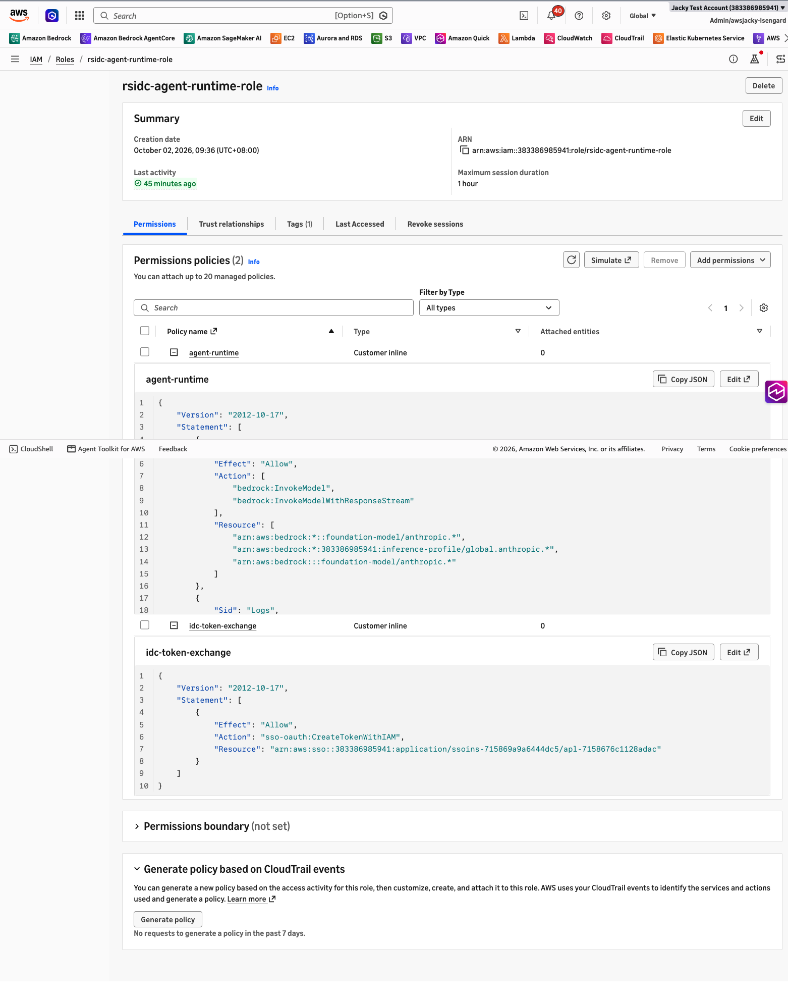

<!-- console-shots:end -->

## Step 7: Customer-managed IdC app for the agent token exchange
`infra/run.sh ./infra/07-idc-agent-app.sh`

The app `rsidc-data-agent` gets:
- a jwt-bearer grant trusting the Cognito TTI with audience = client id,
- scope `redshift:connect`,
- assignment required (4 groups),
- an ActorPolicy that **allows only the runtime role and explicitly denies every other principal**.

The runtime role gets `sso-oauth:CreateTokenWithIAM` on this app only.

**Result:**
```
Scopes: ["redshift:connect"]   Grant: AuthorizedTokenIssuers=[tti-54429cde..., aud kff7mg63m7d94n6f2euip41na]   Assignments: 4
ActorPolicy: Allow (runtime role) / Deny DenyEveryoneElseIncludingAdmins
AGENT_IDC_APP_ARN=arn:aws:sso::383386985941:application/ssoins-715869a9a6444dc5/apl-7158676c1128adac
```

<!-- console-shots:start -->
**AWS console (captured from the logged-in browser session):**

*IAM Identity Center → Applications → Customer managed → rsidc-data-agent: TTI authentication Configured, 4 groups assigned, trusted for AWS Redshift (1 access scope)*  
URL at capture (2026-10-05 15:58:20 HKT): <https://ap-east-1.console.aws.amazon.com/singlesignon/home?region=ap-east-1#/instances/715869a9a6444dc5/applications/ins-7158676c1128adac>

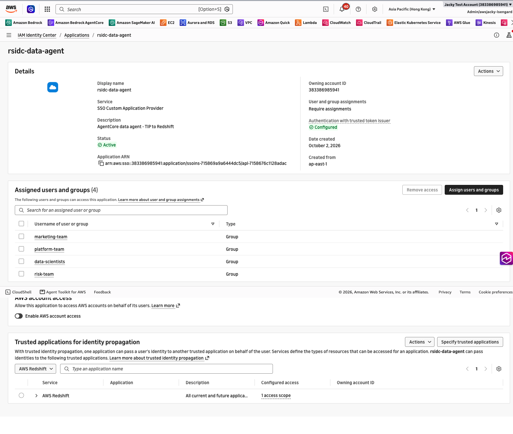

<!-- console-shots:end -->

## Step 8: Deploy the agent to AgentCore Runtime
`infra/run.sh ./infra/08-deploy-runtime.sh`

Direct code deploy: a linux/arm64 zip uploaded to S3, PYTHON_3_12, entry point `main.py`. VPC mode, Cognito JWT authorizer, and the `Authorization` header forwarded to the agent.

**Result:**
```
"status": "READY", "net": "VPC",
"auth": {"customJWTAuthorizer": {"discoveryUrl": "https://cognito-idp.ap-southeast-1.amazonaws.com/ap-southeast-1_kSVpAo5yl/.well-known/openid-configuration", "allowedAudience": ["kff7mg63m7d94n6f2euip41na"]}},
"headers": {"requestHeaderAllowlist": ["Authorization"]}
RT_ARN=arn:aws:bedrock-agentcore:ap-southeast-1:383386985941:runtime/rsidc_data_agent-BoemCIApSW
```
Agent payloads: `{"sql": "..."}` runs exactly that SQL as the caller (deterministic tests). `{"prompt": "..."}` uses the Claude agent (`global.anthropic.claude-sonnet-5-5`) with a `run_sql` tool.

<!-- console-shots:start -->
**AWS console (captured from the logged-in browser session):**

*AgentCore → Runtime → rsidc_data_agent → Version 3: Inbound Auth = JWT (Cognito discovery, audience kff7mg63m7d94n6f2euip41na), VPC mode, env vars*  
URL at capture (2026-10-05 15:54:12 HKT): <https://ap-southeast-1.console.aws.amazon.com/bedrock-agentcore/agents/rsidc_data_agent-BoemCIApSW/version/3?region=ap-southeast-1>


<!-- console-shots:end -->

---

## Step 9: Validate the access-control matrix through the agent
`cd tests && ../infra/run.sh ../agent/.venv/bin/python validate_matrix.py`

A DENY only counts as PASS when Redshift itself refuses the statement (`42501 permission denied`). A connection or authentication failure counts as FAIL.

**Result** (`tests/results-matrix.txt`):
```
PASS | wei   | whoami                        | ALLOW | [['AWSIDC:wei@techfinance.example.com']]
PASS | wei   | read risk                     | ALLOW | rows=2
PASS | wei   | update risk                   | ALLOW | rowcount=1
PASS | wei   | read sales (all regions)      | ALLOW | rows=5
PASS | wei   | read marketing                | DENY  | 42501 permission denied for schema marketing
PASS | zhang | whoami                        | ALLOW | [['AWSIDC:zhang@techfinance.example.com']]
PASS | zhang | update marketing              | ALLOW | rowcount=1
PASS | zhang | sales non-PII cols (RLS APAC) | ALLOW | rows=2          ← RLS: only 2 APAC of 5 rows
PASS | zhang | sales PII column              | DENY  | 42501 permission denied for relation orders  ← column-level grant
PASS | zhang | read risk                     | DENY  | 42501 permission denied for schema risk
PASS | chen  | read risk                     | ALLOW | rows=2
PASS | chen  | read sales (all regions)      | ALLOW | rows=5
PASS | chen  | update risk (read-only team)  | DENY  | 42501 permission denied for relation credit_limits
PASS | chen  | privilege escalation attempt  | DENY  | 42501 permission denied for relation campaigns  (GRANT)
PASS | ds1   | whoami (authenticated)        | ALLOW | [['AWSIDC:tojackywu@gmail.com']]
PASS | ds1   | read sales (no grants)        | DENY  | 42501 permission denied for schema sales
16/16 cases matched expectation
```

<!-- console-shots:start -->
**AWS console (captured from the logged-in browser session):**

*Cognito → rsidc-users → App clients: OBO client, rsidc-2lo-agent, rsidc-3lo-agent*  
URL at capture (2026-10-05 15:54:20 HKT): <https://ap-southeast-1.console.aws.amazon.com/cognito/v2/idp/user-pools/ap-southeast-1_kSVpAo5yl/applications/app-clients?region=ap-southeast-1>


*Cognito → rsidc-users → Domain: rsidc-383386985941 with Managed login (v2)*  
URL at capture (2026-10-05 15:54:28 HKT): <https://ap-southeast-1.console.aws.amazon.com/cognito/v2/idp/user-pools/ap-southeast-1_kSVpAo5yl/branding/domain?region=ap-southeast-1>

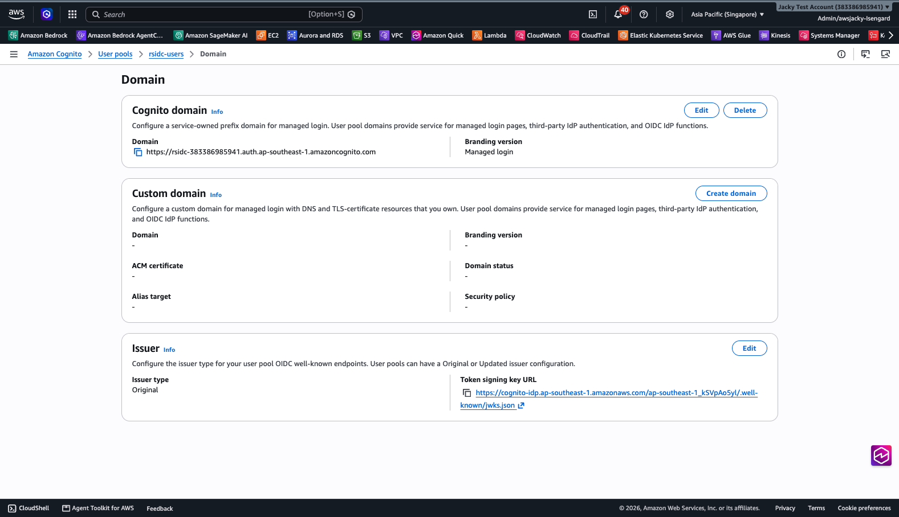

<!-- console-shots:end -->

## Step 10: Negative and security tests
`cd tests && ../infra/run.sh ../agent/.venv/bin/python negative_tests.py` (output in `tests/results-negative.txt`)

| # | Test | Result |
|---|---|---|
| N1 | No `Authorization` header | **HTTP 401** `Missing Authentication Token` (rejected by AgentCore Identity before the agent code runs) |
| N2 | Forged JWT (zhang's token with the email changed to chen) | **HTTP 401** `Invalid Signature for bearerToken` |
| N3 | Same JWT reused in a **new** runtime session | `InvalidGrantException: JWT is already redeemed`. IdC enforces one use per JWT, so a new conversation needs a fresh sign-in or refreshed token. |
| N4a | LLM agent: zhang asks for customer_email in all regions | The agent returns only the 2 APAC rows and says the email column isn't visible to the user |
| N4b | LLM agent: prompt injection asking it to run `GRANT ...` and read risk | The agent refuses the GRANT, and the read fails with `42501 permission denied for schema risk`. Even if the LLM obeyed, Redshift would deny it (see the chen escalation case). |

`infra/run.sh tests/network_tests.sh` (output in `tests/results-network.txt`):

| # | Test | Result |
|---|---|---|
| NET1 | Source IPs Redshift saw for `AWSIDC:*` users (`stl_connection_log`) | Only `15.248.4.71` (workstation) and `47.131.152.68` (runtime NAT EIP) |
| NET2 | Workstation → 5439 with its rule present | `succeeded` |
| NET3 | Workstation rules revoked | `Operation timed out` |
| NET4 | Runtime while the workstation is blocked | HTTP 200, `AWSIDC:chen@...` (the runtime path is independent) |
| NET5 | Workstation rules restored | `succeeded`. The SG is back to the 3 CIDRs. |
| X1 | Admin IAM user `jacky` calls CreateTokenWithIAM with wei's JWT | Before the fix: **succeeded** (finding). After the explicit Deny: **AccessDeniedException** |
| X2 | Runtime role exchange after the fix | HTTP 200, `AWSIDC:wei@...` |

<!-- console-shots:start -->
**AWS console (captured from the logged-in browser session):**

*AgentCore → Identity: Outbound Auth providers rsidc-2lo-cognito and rsidc-3lo-cognito (Custom OAuth2)*  
URL at capture (2026-10-05 15:54:36 HKT): <https://ap-southeast-1.console.aws.amazon.com/bedrock-agentcore/identity?region=ap-southeast-1>


*AgentCore → Identity → rsidc-2lo-cognito: Custom OAuth2, client 3lsr6jpphlql4hb8n1ge6a8sjp, Cognito discovery URL, secret in AgentCore-managed Secrets Manager; M2M token fetches*  
URL at capture (2026-10-05 15:54:45 HKT): <https://ap-southeast-1.console.aws.amazon.com/bedrock-agentcore/identity/rsidc-2lo-cognito?region=ap-southeast-1>

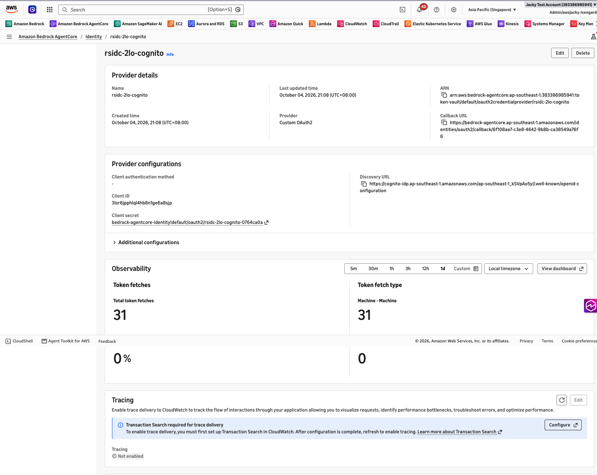

<!-- console-shots:end -->

## Key findings
1. **Access control is enforced by Redshift on the real IdC identity**, not by the agent. Users show up as `AWSIDC:<email>` and groups as `AWSIDC:<group>` roles. Schema, table and column grants and RLS all apply through the agent exactly as they would for a direct user.
2. **An external JWT is single-use at IdC.** The direct `EXT_JWT` approach failed on the second connection with `Token credentials expired or invalid`. The fix is to exchange once per sign-in (`CreateTokenWithIAM`) and reuse the IdC access token for its lifetime of about 1 hour. Because the cache is per runtime session (one microVM each), a new session needs a fresh user token.
3. **The IdC app ActorPolicy alone does not stop same-account admins.** An IAM principal with `sso-oauth:*` could exchange a user's JWT. The fix is an explicit `Deny` for every principal except the runtime role. An SCP is recommended in addition.
4. **Authenticated is not authorized.** ds1 can sign in (the group is assigned to the app) but has no grants, so every data access is denied.
5. **Column grants silently trim `SELECT *`.** zhang's `SELECT * FROM sales.orders` returns 4 columns with no error; `customer_email` is just omitted. Only naming the column explicitly is denied (42501).
6. **Metadata is visible.** `svv_tables` lists tables a user can't read (zhang sees `risk.credit_limits` listed). Turn on Redshift metadata security if table names are sensitive.
7. **Corporate networks can use different egress IPs per port.** Detect the IP that actually carries 5439 traffic before allowlisting it.

## Cost (approximate, while running)
| Resource | ~USD/hour |
|---|---|
| Redshift ra3.large ×1 (ap-east-1) | ~0.65 |
| NAT Gateway + EIP (ap-southeast-1) | ~0.065 + data |
| AgentCore Runtime | consumption only (pennies for these tests) |
| Bedrock (Claude) | per token (N4 tests only) |
| Part 2: Gateway, Lambda, 2nd runtime, credential providers | consumption only (≈0 at test volume) |
| Cognito, IdC, S3, Secrets Manager | ≈0 |

**About $0.72/hour, or roughly $17/day.** Tear down when you're done.

## Teardown
`infra/run.sh ./infra/99-teardown.sh`. It asks you to type `delete rsidc`, then deletes everything from steps 1–8 in reverse order, including the Redshift cluster **without a final snapshot**. The pre-existing IdC instance, users and groups are never touched.


---

# Part 2: 2LO and 3LO test cases (added 2026-10-04)

Goal: compare the other AgentCore Identity outbound patterns with OBO on the same Redshift data. The OBO runtime (`rsidc_data_agent`, version 3) and its tests are **not modified**; a **separate** runtime is used.

**2LO architecture** (the agent authenticates as itself → Gateway → service account):

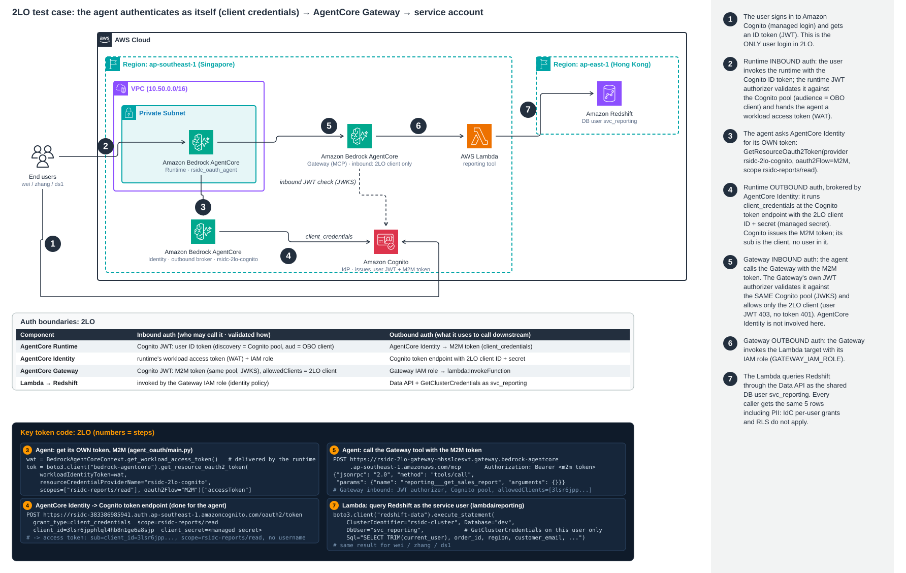

**3LO architecture** (the user consents once → Token Vault, session binding by the app):

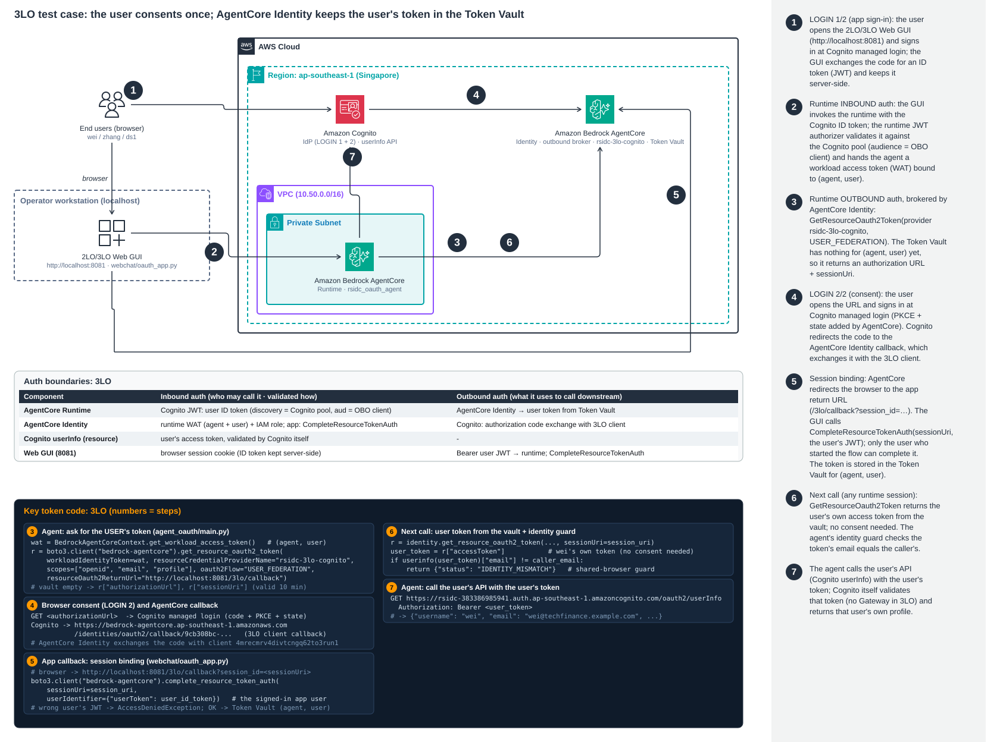

**Who authenticates what (2LO / 3LO):**

| Component | Inbound auth (who may call it, validated how) | Outbound auth (what it uses downstream) |
|---|---|---|
| AgentCore Runtime `rsidc_oauth_agent` | **Cognito JWT**: the user's ID token (discovery = Cognito pool, audience = OBO client) | **AgentCore Identity**: 2LO `rsidc-2lo-cognito` (M2M) / 3LO `rsidc-3lo-cognito` (Token Vault) |
| AgentCore Identity | The runtime's workload access token + IAM role; for 3LO, the app's `CompleteResourceTokenAuth` | Cognito token endpoint (client_credentials / authorization code) |
| AgentCore Gateway (2LO) | **Cognito JWT**: the M2M token from the same pool (JWKS), allowedClients = 2LO client. **Not** AgentCore Identity. | Gateway IAM role (`GATEWAY_IAM_ROLE`) → Lambda |
| Cognito `userInfo` (3LO) | The user's access token, validated by Cognito itself | - |

## Step 9: Cognito OAuth clients (same pool, OBO client untouched)
`infra/run.sh ./infra/09-cognito-oauth-clients.sh`

Creates:
- A hosted login domain, `rsidc-383386985941`, on **managed login v2**. v2 is required for `prompt=login`; the classic v1 hosted UI ignores it.
- Resource server `rsidc-reports` with scope `read`.
- `rsidc-2lo-agent`: confidential client, `client_credentials` only.
- `rsidc-3lo-agent`: confidential client, authorization `code` only, scopes `openid email profile`.

**Result:**
```
rsidc-2lo-agent  client_credentials  rsidc-reports/read
rsidc-3lo-agent  code                email openid profile
authorization_endpoint https://rsidc-383386985941.auth.ap-southeast-1.amazoncognito.com/oauth2/authorize
ManagedLoginVersion 2, ACTIVE
```

## Step 10: AgentCore Identity credential providers
`infra/run.sh agent/.venv/bin/python infra/10-credential-providers.py`

Creates two `CustomOauth2` providers backed by Cognito discovery. Client secrets go straight into the AgentCore Identity vault and are never printed. The script then sets the 3LO client's callback to the provider's AgentCore callback URL, copying the client's full configuration because `UpdateUserPoolClient` resets omitted fields.

**Result:**
```
rsidc-2lo-cognito  arn:...:token-vault/default/oauth2credentialprovider/rsidc-2lo-cognito
rsidc-3lo-cognito  callbackUrl=https://bedrock-agentcore.ap-southeast-1.amazonaws.com/identities/oauth2/callback/9cb308bc-...
3LO client callback -> [that callbackUrl]
```

## Step 11: 2LO downstream (AgentCore Gateway → Lambda → Redshift service user)
`infra/run.sh ./infra/11-2lo-gateway.sh`

Creates:
- DB user `svc_reporting` with SELECT on `sales.orders`, all rows (`infra/sql/02-svc-reporting.sql`).
- Lambda `rsidc-reporting`, which uses the Redshift Data API with `GetClusterCredentials` scoped to `dbuser:rsidc-cluster/svc_reporting`.
- Gateway `rsidc-2lo-gateway` (MCP, CUSTOM_JWT, **allowedClients = 2LO client only**) with target `reporting`, authenticated by the Gateway IAM role.

**Result:**
```
gateway READY  https://rsidc-2lo-gateway-mhss1cesvt.gateway.bedrock-agentcore.ap-southeast-1.amazonaws.com/mcp
allowedClients [3lsr6jpphlql4hb8n1ge6a8sjp]   target reporting READY
```

<!-- console-shots:start -->
**AWS console (captured from the logged-in browser session):**

*AgentCore → Gateways → rsidc-2lo-gateway: MCP gateway, IAM role rsidc-gateway-role, target 'reporting' (Lambda)*  
URL at capture (2026-10-05 15:57:23 HKT): <https://ap-southeast-1.console.aws.amazon.com/bedrock-agentcore/toolsAndGateways/rsidc-2lo-gateway-mhss1cesvt>

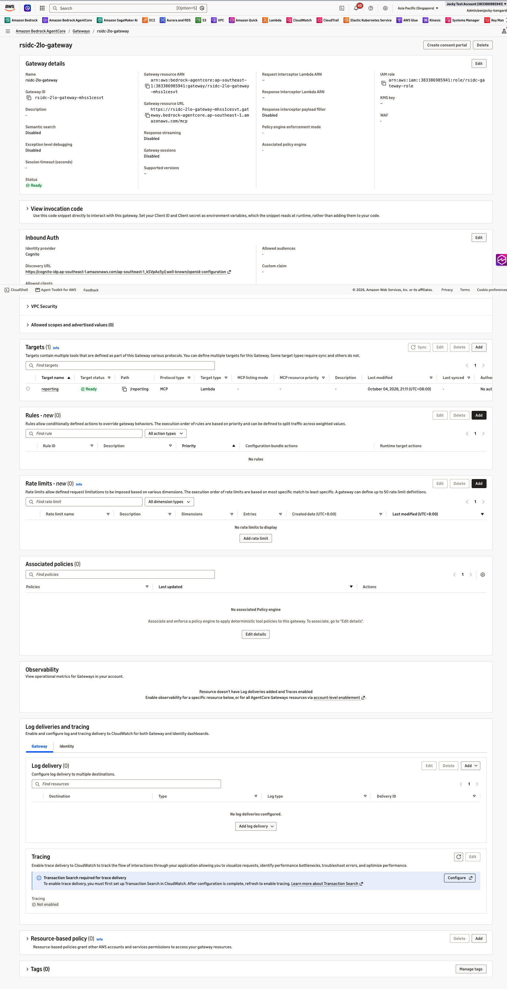

*AgentCore → Gateways → rsidc-2lo-gateway → Inbound Auth: Cognito, Allowed clients = 3lsr6jpphlql4hb8n1ge6a8sjp (2LO client only)*  
URL at capture (2026-10-05 15:59:43 HKT): <https://ap-southeast-1.console.aws.amazon.com/bedrock-agentcore/toolsAndGateways/rsidc-2lo-gateway-mhss1cesvt?region=ap-southeast-1>

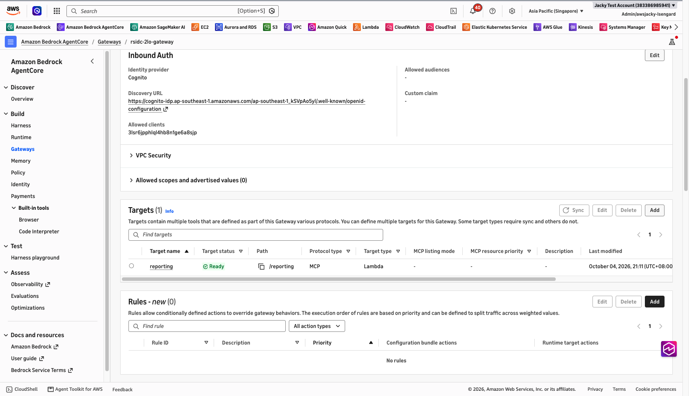

*Lambda → rsidc-reporting → Configuration: Gateway target that queries Redshift as svc_reporting*  
URL at capture (2026-10-05 15:55:02 HKT): <https://ap-southeast-1.console.aws.amazon.com/lambda/home?region=ap-southeast-1#/functions/rsidc-reporting?tab=configure>


<!-- console-shots:end -->

## Step 12: Separate OAuth agent runtime
`infra/run.sh ./infra/12-deploy-oauth-runtime.sh`

Deploys `rsidc_oauth_agent` (code in `agent_oauth/`):
- Same Cognito JWT inbound auth and VPC as the OBO runtime; the `Authorization` header is forwarded.
- Its own role, which can only call `GetResourceOauth2Token` on the two providers and read their client secrets. It has no Redshift, IdC or Bedrock model access.
- Its workload identity allows a single 3LO return URL, `http://localhost:8765/callback` (the test's stand-in for the app callback page).

**Result:** `status READY`, `version 4`, `returnUrls ["http://localhost:8765/callback"]`.

<!-- console-shots:start -->
**AWS console (captured from the logged-in browser session):**

*AgentCore → Runtime → rsidc_oauth_agent → Version 4: separate runtime for 2LO/3LO (JWT inbound, VPC, env CP_2LO / CP_3LO / GW_URL)*  
URL at capture (2026-10-05 15:55:10 HKT): <https://ap-southeast-1.console.aws.amazon.com/bedrock-agentcore/agents/rsidc_oauth_agent-4lxrH9AmnT/version/4?region=ap-southeast-1>

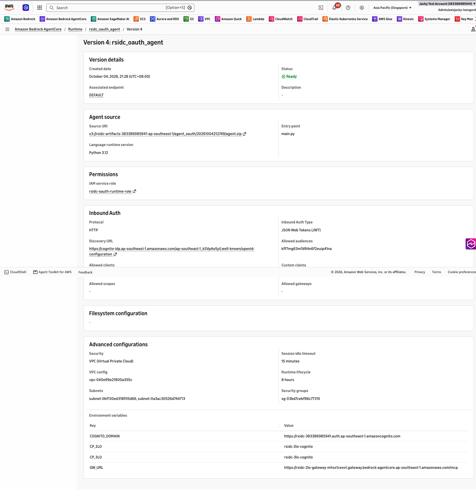

*IAM → rsidc-oauth-runtime-role → oauth-runtime (expanded): GetResourceOauth2Token on token-vault + both credential providers + its workload identity; this is what authorizes the runtime to use rsidc-2lo-cognito*  
URL at capture (2026-10-05 16:01:27 HKT): <https://us-east-1.console.aws.amazon.com/iam/home#/roles/details/rsidc-oauth-runtime-role?section=permissions>

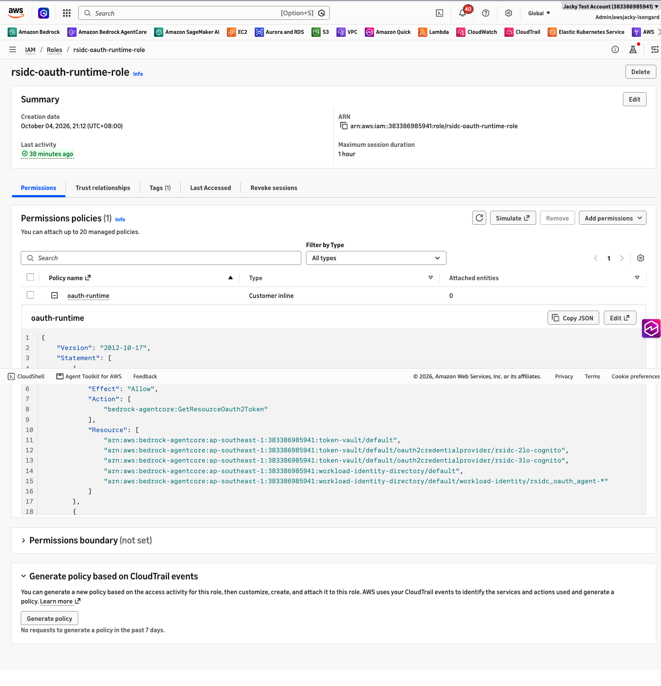

<!-- console-shots:end -->

## Step 13: Run the 2LO/3LO suite
`cd tests && ../infra/run.sh ../agent/.venv/bin/python oauth_tests.py` (output in `tests/results-oauth.txt`)

How the 3LO consent is automated: `agent-browser` (headless Chrome) plays the user and signs in on Cognito managed login. A local listener on `:8765` receives the return-URL redirect, and the test then calls `CompleteResourceTokenAuth` with the user's JWT, the app's session-binding step. Vault-state scenarios use **admin-created throwaway Cognito users**, deleted at the end, so every run starts with empty vault slots.

**Result: 18/18 asserted cases matched, plus 1 documented observation**
```
PASS 2LO as wei / zhang / ds1: 5 rows each, redshift_user=svc_reporting, PII visible; token sub = 2LO client id (no user)
PASS 2LO Gateway with no token -> 401; with a USER id token -> 403 (allowedClients)
PASS 3LO wei first call -> CONSENT_REQUIRED (authorizationUrl + sessionUri)
PASS 3LO wei signs in at Cognito -> redirected to return URL; CompleteResourceTokenAuth(wei JWT) OK
PASS 3LO wei second call (new runtime session) -> TOKEN_FROM_VAULT, userinfo username=wei
PASS 3LO zhang -> CONSENT_REQUIRED (wei's vault token not reused)
PASS 3LO zhang's session completed with WEI's JWT -> AccessDeniedException (session binding)
PASS 3LO zhang's session completed with zhang's JWT -> OK; zhang gets zhang's token; wei still gets wei's
PASS 3LO shared browser (signed in as wei) consents for temp user A -> agent guard returns IDENTITY_MISMATCH
PASS 3LO recovery: forced re-consent by A in a clean browser -> A's own token
PASS 3LO prompt=login forces the Cognito login form despite an existing session
OBSERVED 3LO with prompt=login sent via customParameters: consent + CompleteResourceTokenAuth OK, but no token stored (CONSENT_REQUIRED)
PASS 3LO control: fresh user C, no prompt=login -> token stored
```
**OBO regression after Part 2:** `validate_matrix.py` still passes 16/16, `negative_tests.py` is unchanged, and the OBO runtime is still at version 3.

## Comparison on the same Redshift data
| Pattern | Whose identity reaches the resource | zhang (marketing) sees | ds1 (no grants) sees |
|---|---|---|---|
| **OBO** (Part 1) | the end user (`AWSIDC:zhang@…`) | 2 APAC rows, PII column denied | denied (42501) |
| **2LO** | the agent / service (`svc_reporting`) | all 5 rows **with PII** | all 5 rows **with PII** |
| **3LO** | the end user at the *resource's* IdP (Cognito userInfo) | own profile only | own profile only |

## Part 2 findings
1. **2LO bypasses per-user data controls by design.** Use it only for data every caller may see, and authorize at the agent/tool level (Gateway allowedClients and scopes).
2. **The 3LO Token Vault is isolated per agent and user, and session binding works.** Completing another user's session is rejected.
3. **Shared-browser risk:** if the consent URL is opened in a browser that is already signed in to the IdP as someone else, *that person's* token is stored for the caller. Session binding checks the app user, not the IdP user. **Mitigation that was verified:** the agent compares the vault token's identity with the inbound caller and refuses on mismatch; a forced re-consent in a clean browser then recovers.
4. **`prompt=login`:** Cognito managed login v2 honours it, and the login form is shown. But when it was passed through AgentCore Identity `customParameters`, no token was stored after consent. This should be raised with the service team before relying on it.
5. **The Data API is an IAM path, not a network path.** The 2LO Lambda's Data API calls are not governed by the Redshift security group. Scope `GetClusterCredentials` to one DB user, as done here, and consider `aws:SourceVpce` or IP conditions.

## Teardown (updated)
`infra/run.sh ./infra/99-teardown.sh` now also removes the OAuth runtime, Gateway and target, Lambda, credential providers, the three new IAM roles and the Cognito domain.

## Web GUI to test as an end user
1. One-time: `infra/run.sh agent/.venv/bin/python infra/13-web-login-client.py`. This adds Cognito managed login (code + PKCE, callback `http://localhost:8080/callback`) to the **existing** OBO client. Only the OAuth fields change; `USER_PASSWORD_AUTH`, the audience and the token lifetimes are untouched.
2. Start the GUI with `infra/run.sh agent/.venv/bin/python webchat/app.py`, then open http://localhost:8080.
3. Choose **Sign in** and use wei / zhang / chen / ds1 with the password from `tests/.users.env`. Then chat in natural language, or type `SQL: …` to run an exact statement as that user. **Sign out** switches users.

**Result (2026-10-05, headless Chrome):**
- wei: `SELECT * FROM sales.orders` returns 5 rows including `customer_email`, and the agent reports `AWSIDC:wei@techfinance.example.com`.
- After sign-out, zhang: the same query returns 2 APAC rows without `customer_email`, and `SELECT customer_email` is denied by Redshift (42501).

## Web GUI for 2LO / 3LO (port 8081)
1. One-time setup:
   - `infra/run.sh agent/.venv/bin/python infra/13-web-login-client.py` adds the `http://localhost:8081/callback` login callback.
   - The OAuth workload identity return URLs must include `http://localhost:8081/3lo/callback`; `infra/12-deploy-oauth-runtime.sh` sets both.
2. Start it with `infra/run.sh agent/.venv/bin/python webchat/oauth_app.py`, then open http://localhost:8081 and sign in (login 1).
3. **2LO**: *Run sales report via Gateway*. **3LO**: *Connect my profile*. The first time this goes through login 2 (consent), then session binding, then the token is read from the vault. *Check vault only* reads the vault without redirecting.

**Result (2026-10-05, headless Chrome, zhang):**
- **2LO:** the token claims are `sub=client_id=3lsr6jpphlql4hb8n1ge6a8sjp` and `scope=rsidc-reports/read`, with no user. The Redshift user is `svc_reporting`, and all 5 rows including `customer_email` come back.
- **3LO** (force re-consent):
  - `CompleteResourceTokenAuth` returns OK, and the session URI matches the pending one.
  - The vault token is zhang's own: `username=zhang`, `client_id=4mrecmrv…` (the 3LO client). `userInfo` returns zhang's profile.
  - The identity guard passed.
- The OBO GUI on 8080 still works unchanged.

## Animated walkthrough
`open docs/flow.html` (rebuild after re-rendering diagrams: `python3 docs/build_flow.py`). Tabs OBO / 2LO / 3LO step through every login, token hop and check described above. Verified in headless Chrome: all three tabs run with no JS errors.

## Ops: enforce admin-only user creation on ALL Cognito user pools
`agent/.venv/bin/python infra/ops/cognito-disable-self-signup.py [--dry-run]`

The script scans every region and sets `AllowAdminCreateUserOnly=true` wherever self sign-up is still allowed. `UpdateUserPool` resets any omitted setting to its default, so the script copies each pool's full config back and prints a before/after diff.

**Result (2026-10-02):** 41 pools scanned. 6 still allowed self sign-up, all in us-east-1 with 0 users: `67YaKCmhR`, `8KbkOcNzT`, `JA2ECDabY`, `MAuafT7PT`, `UajACnw7W`, `hCgDYq4vq`. Each diff showed a single change:
`{"AdminCreateUserConfig.AllowAdminCreateUserOnly": [false, true]}`

**Verify:**
- `--dry-run` reports 0 pools remaining.
- A `SignUp` call against `us-east-1_67YaKCmhR` (with a valid SECRET_HASH) and against `rsidc-users` both fail with `NotAuthorizedException: SignUp is not permitted for this user pool`.

## Step 14: deploy the web GUIs to AWS (Lambda Function URLs, IP-allowlisted)
**Purpose:** let you use the OBO GUI and the 2LO/3LO GUI without running anything locally. Function URLs provide HTTPS, which Cognito requires for any callback that isn't localhost. There's no EC2, ALB or S3.
```bash
infra/run.sh bash infra/14-deploy-webchat.sh            # optional: WEB_ALLOWED_IPS="1.2.3.4/32 2400:db8::/64"
```
**What it creates or changes:**
- IAM role `rsidc-webchat-role` (logs, plus `CompleteResourceTokenAuth` for the 3LO binding);
- Lambda functions `rsidc-webchat-obo` and `rsidc-webchat-oauth` (python3.12, arm64, reserved concurrency 1, Function URL with AuthType NONE, app-level source-IP allowlist);
- the Function URL callback and logout URLs, added to the OBO Cognito client (through step 13);
- `<oauth-url>/3lo/callback`, added to the OAuth workload identity return URLs.

**Actual result (2026-10-06):**
```
allowlisted IPs: 63.218.115.74/32 2400:8800:102:2::/64
OBO GUI:     https://e635jo6ewg4nrmyklrjy3qsymq0cbjbo.lambda-url.ap-southeast-1.on.aws
2LO/3LO GUI: https://2swszkbddcrowwcmgqzn3mw7ca0bpjia.lambda-url.ap-southeast-1.on.aws
```
The first deploy allowlisted IPv4 only, and the browser got `403 forbidden: 2400:8800:102:2:… is not allowlisted`. The Function URL is dual-stack, so the client connected over IPv6. The fix was to allow CIDRs and add the IPv6 /64.

**How you can verify:**
```bash
source infra/state.env
curl -s -o /dev/null -w "%{http_code}\n" $WEB_OBO_URL/        # 200 from an allowlisted IP
curl -s -o /dev/null -w "%{http_code}\n" $WEB_OAUTH_URL/      # 200
echo '{"rawPath":"/","headers":{},"requestContext":{"http":{"method":"GET","sourceIp":"9.9.9.9"}}}' > /tmp/ev.json
aws lambda invoke --region ap-southeast-1 --function-name rsidc-webchat-obo --cli-binary-format raw-in-base64-out --payload file:///tmp/ev.json /tmp/o.json; cat /tmp/o.json   # 403 not allowlisted
```
Then open the OBO URL in a browser and sign in as wei/zhang/chen/ds1 (passwords in `tests/.users.env`).
**Teardown:**
```bash
aws lambda delete-function --function-name rsidc-webchat-obo --region ap-southeast-1
aws lambda delete-function --function-name rsidc-webchat-oauth --region ap-southeast-1
```
Also delete the role `rsidc-webchat-role`.
**Cost:** effectively $0 (Lambda pay-per-request; no idle charge).
