# Review pack: AgentCore Runtime × Redshift × IAM Identity Center (OBO / 2LO / 3LO)

Generated 2026-10-05 16:38 HKT · account `383386985941` · 43 resources · 40 console screenshots · verification **29 PASS / 0 FAIL**

All resources were deployed by the numbered, idempotent scripts in `infra/` (01 → 13), in this order. For every step this pack lists what the script created, an AWS console screenshot per resource (exact URL and capture time shown under each image; open the URL to validate), and read-only verification commands run when the pack was built, with the expected pattern and the actual output. Functional test results (OBO 16/16 matrix, 2LO/3LO 18/18) are in `RUNBOOK.md` and `tests/results-*.txt`.

## Summary (deployment order)

| Step | What was deployed | Resources | Screenshots | Checks |
|---|---|---|---|---|
| 1 | Runtime VPC with a fixed egress IP (ap-southeast-1) | 10 | 10 | 3 PASS |
| 2 | Cognito user pool (end-user IdP, admin-only users) | 3 | 3 | 2 PASS |
| 3 | IdC Trusted Token Issuer + Redshift IdC application | 4 | 4 | 2 PASS |
| 4 | Redshift cluster, network-restricted (ap-east-1) | 4 | 3 | 2 PASS |
| 5 | Seed data + grants to IdC group roles (SQL) | 2 | 0 | 2 PASS |
| 6 | OBO runtime execution role (no Redshift permissions) | 1 | 1 | 1 PASS |
| 7 | IdC customer-managed app for the agent's token exchange | 1 | 1 | 3 PASS |
| 8 | OBO data agent on AgentCore Runtime | 2 | 2 | 2 PASS |
| 9 | Cognito OAuth clients for 2LO / 3LO (same pool) | 4 | 5 | 3 PASS |
| 10 | AgentCore Identity credential providers | 2 | 3 | 2 PASS |
| 11 | 2LO downstream: Gateway → Lambda → Redshift service user | 6 | 5 | 3 PASS |
| 12 | Separate OAuth agent runtime (2LO / 3LO) | 3 | 2 | 3 PASS |
| 13 | Browser sign-in for the local web GUIs | 1 | 1 | 1 PASS |

## Step 1: Runtime VPC with a fixed egress IP (ap-southeast-1)

Private subnets for the AgentCore Runtime ENIs; all egress goes through one NAT gateway with an Elastic IP, so Redshift can allowlist exactly one IP for the agent.

**IaC / script:** `infra/01-runtime-network.sh`  
**Deploy command:** `infra/run.sh ./infra/01-runtime-network.sh`

**Deployed resources**

| Type | ID / ARN | Name |
|---|---|---|
| AWS::EC2::VPC | `vpc-040e99e21800a355c` | rsidc-rt-vpc 10.50.0.0/16 |
| AWS::EC2::InternetGateway | `igw-058dcc1a883a5afb2` | rsidc-rt-igw |
| AWS::EC2::Subnet | `subnet-0fd4195de9bdffba9` | public 10.50.0.0/24 |
| AWS::EC2::Subnet | `subnet-0bf130ed318f05d66` | private 10.50.1.0/24 |
| AWS::EC2::Subnet | `subnet-0a3ac30526d744713` | private 10.50.2.0/24 |
| AWS::EC2::RouteTable | `rtb-0f37a8edf400fa73c` | public → IGW |
| AWS::EC2::RouteTable | `rtb-0316eeecb91a0b588` | private → NAT |
| AWS::EC2::EIP | `eipalloc-08e9ba07612e963ca` | 47.131.152.68 |
| AWS::EC2::NatGateway | `nat-042a3797afe93a19f` | rsidc-rt-nat |
| AWS::EC2::SecurityGroup | `sg-03bd7cebf86c77315` | rsidc-runtime-sg (egress only) |

**Console: VPC rsidc-rt-vpc 10.50.0.0/16 (runtime network)**  
URL at capture (2026-10-05 16:13:03 HKT): <https://ap-southeast-1.console.aws.amazon.com/vpcconsole/home?region=ap-southeast-1#VpcDetails:VpcId=vpc-040e99e21800a355c>

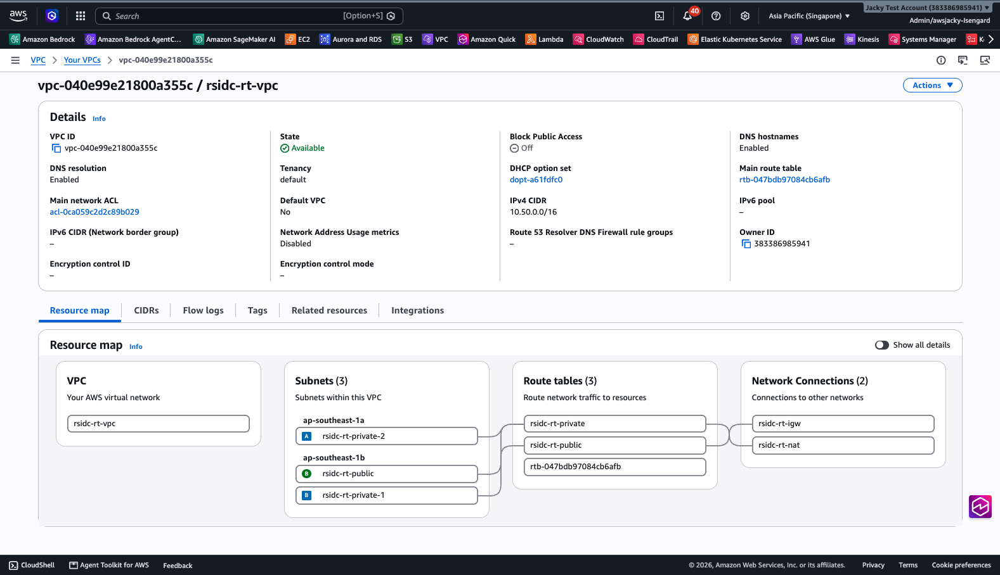

**Console: Internet gateway attached to rsidc-rt-vpc**  
URL at capture (2026-10-05 16:13:10 HKT): <https://ap-southeast-1.console.aws.amazon.com/vpcconsole/home?region=ap-southeast-1#InternetGateway:internetGatewayId=igw-058dcc1a883a5afb2>

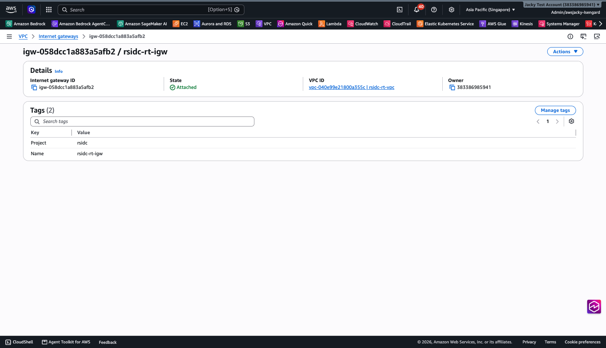

**Console: Public subnet 10.50.0.0/24 (apse1-az1) for the NAT gateway**  
URL at capture (2026-10-05 16:13:17 HKT): <https://ap-southeast-1.console.aws.amazon.com/vpcconsole/home?region=ap-southeast-1#SubnetDetails:subnetId=subnet-0fd4195de9bdffba9>

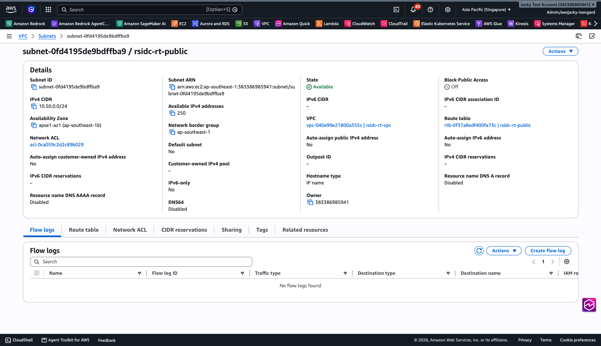

**Console: Private subnet 1 10.50.1.0/24 (apse1-az1) for runtime ENIs**  
URL at capture (2026-10-05 16:13:25 HKT): <https://ap-southeast-1.console.aws.amazon.com/vpcconsole/home?region=ap-southeast-1#SubnetDetails:subnetId=subnet-0bf130ed318f05d66>

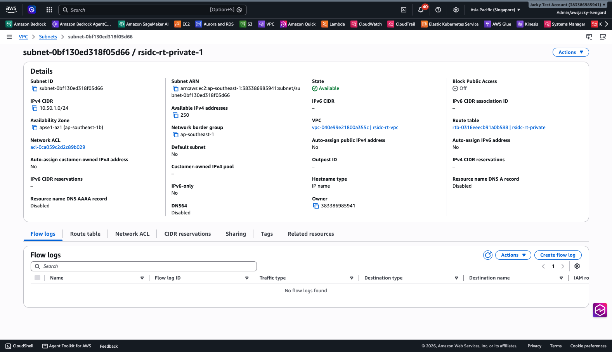

**Console: Private subnet 2 10.50.2.0/24 (apse1-az2) for runtime ENIs**  
URL at capture (2026-10-05 16:13:32 HKT): <https://ap-southeast-1.console.aws.amazon.com/vpcconsole/home?region=ap-southeast-1#SubnetDetails:subnetId=subnet-0a3ac30526d744713>


**Console: Public route table: 0.0.0.0/0 → internet gateway**  
URL at capture (2026-10-05 16:13:44 HKT): <https://ap-southeast-1.console.aws.amazon.com/vpcconsole/home?region=ap-southeast-1#RouteTableDetails:RouteTableId=rtb-0f37a8edf400fa73c>

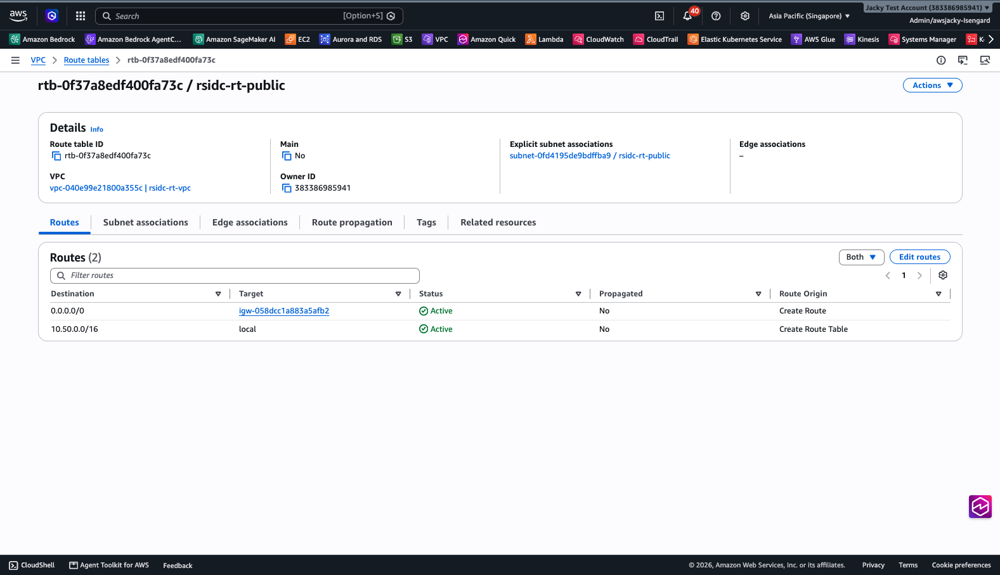

**Console: Private route table: 0.0.0.0/0 → NAT gateway**  
URL at capture (2026-10-05 16:13:56 HKT): <https://ap-southeast-1.console.aws.amazon.com/vpcconsole/home?region=ap-southeast-1#RouteTableDetails:RouteTableId=rtb-0316eeecb91a0b588>

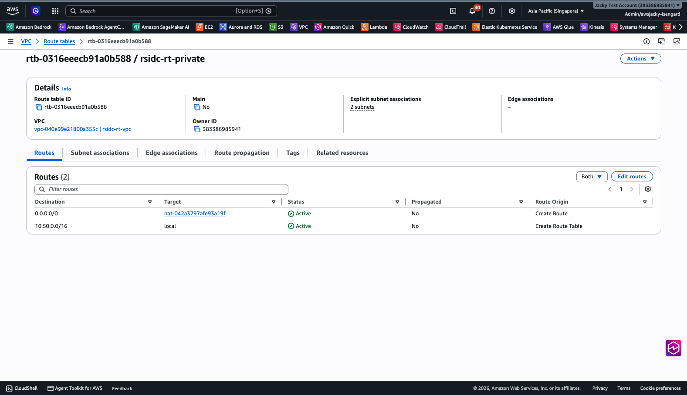

**Console: Elastic IP 47.131.152.68 (the runtime's only egress IP)**  
URL at capture (2026-10-05 16:14:06 HKT): <https://ap-southeast-1.console.aws.amazon.com/ec2/home?region=ap-southeast-1#ElasticIpDetails:AllocationId=eipalloc-08e9ba07612e963ca>

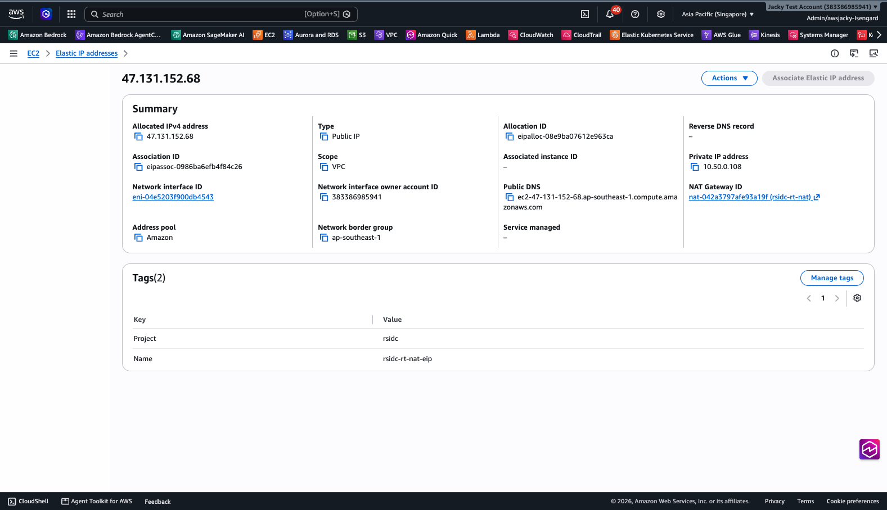

**Console: NAT gateway rsidc-rt-nat (public, EIP 47.131.152.68)**  
URL at capture (2026-10-05 16:14:14 HKT): <https://ap-southeast-1.console.aws.amazon.com/vpcconsole/home?region=ap-southeast-1#NatGatewayDetails:natGatewayId=nat-042a3797afe93a19f>

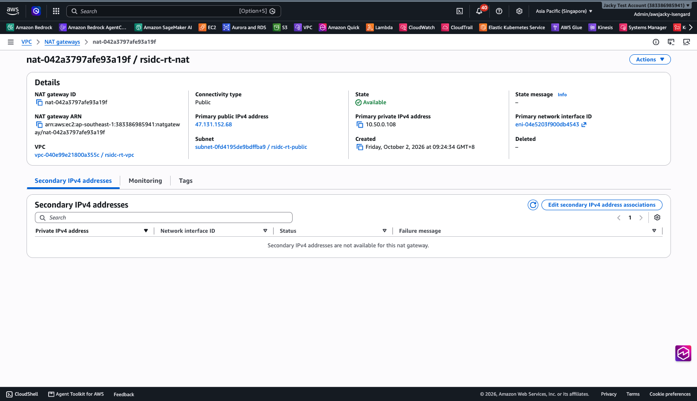

**Console: Runtime security group: no inbound rules (egress only)**  
URL at capture (2026-10-05 16:14:22 HKT): <https://ap-southeast-1.console.aws.amazon.com/ec2/home?region=ap-southeast-1#SecurityGroup:groupId=sg-03bd7cebf86c77315>

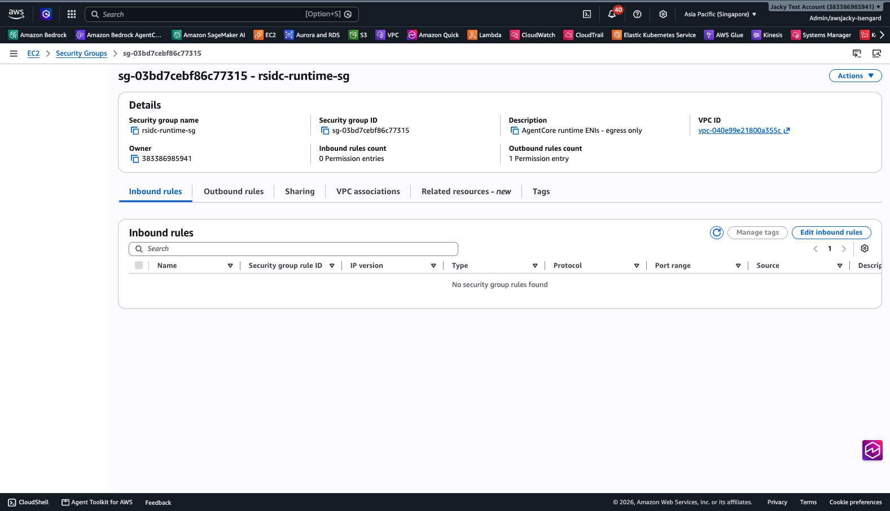

**Verification**

| Check | Command | Expected (regex) | Result |
|---|---|---|---|
| NAT available with the EIP | `aws ec2 describe-nat-gateways --region $RT_REGION --nat-gateway-ids $RT_NAT_ID --query 'NatGateways[0].[State,NatGatewayAddresses[0].PublicIp]' --output text` | `available\s+47\.131\.152\.68` | **PASS** |
| private subnets route to NAT | `aws ec2 describe-route-tables --region $RT_REGION --route-table-ids $RT_PRIV_RTB --query 'RouteTables[0].Routes[?DestinationCidrBlock==`0.0.0.0/0`].NatGatewayId' --output text` | `nat-042a3797afe93a19f` | **PASS** |
| runtime SG has no inbound rules | `aws ec2 describe-security-groups --region $RT_REGION --group-ids $RT_SG_ID --query 'length(SecurityGroups[0].IpPermissions)'` | `^0$` | **PASS** |

<details><summary>Actual output: NAT available with the EIP</summary>

```
available	47.131.152.68
```
</details>

<details><summary>Actual output: private subnets route to NAT</summary>

```
nat-042a3797afe93a19f
```
</details>

<details><summary>Actual output: runtime SG has no inbound rules</summary>

```
0
```
</details>

## Step 2: Cognito user pool (end-user IdP, admin-only users)

Cognito issues the users' ID tokens (JWT). Users are admin-created with emails that mirror IAM Identity Center users; self sign-up is disabled because email is the identity mapping key.

**IaC / script:** `infra/02-cognito.sh`  
**Deploy command:** `infra/run.sh ./infra/02-cognito.sh`

**Deployed resources**

| Type | ID / ARN | Name |
|---|---|---|
| AWS::Cognito::UserPool | `ap-southeast-1_kSVpAo5yl` | rsidc-users |
| AWS::Cognito::UserPoolClient | `kff7mg63m7d94n6f2euip41na` | rsidc-agent-client (OBO) |
| AWS::Cognito::UserPoolUser | `wei, zhang, chen, ds1` | test personas |

**Console: Cognito pool rsidc-users: 4 admin-created users, verified emails**  
URL at capture (2026-10-05 16:14:31 HKT): <https://ap-southeast-1.console.aws.amazon.com/cognito/v2/idp/user-pools/ap-southeast-1_kSVpAo5yl/user-management/users?region=ap-southeast-1>

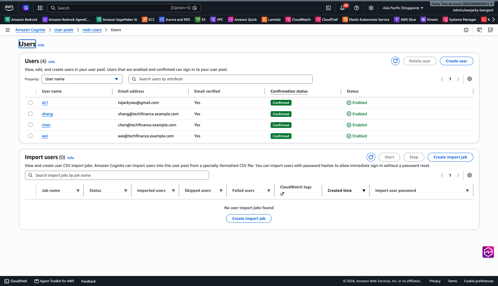

**Console: Self-registration = Disabled (admin-only user creation)**  
URL at capture (2026-10-05 16:14:39 HKT): <https://ap-southeast-1.console.aws.amazon.com/cognito/v2/idp/user-pools/ap-southeast-1_kSVpAo5yl/authentication/sign-up?region=ap-southeast-1>

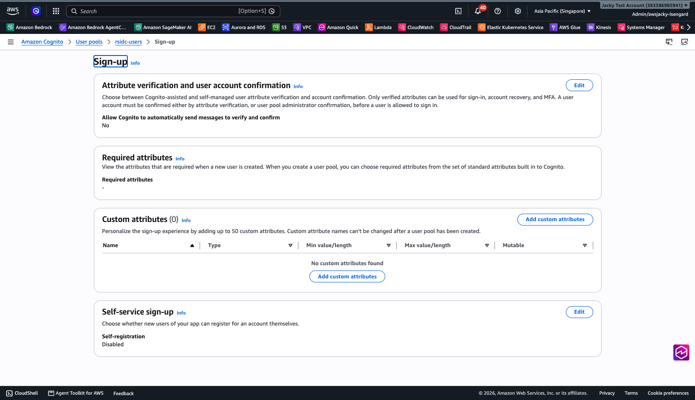

**Console: OBO app client rsidc-agent-client (public, USER_PASSWORD_AUTH; its ID is the JWT audience)**  
URL at capture (2026-10-05 16:14:47 HKT): <https://ap-southeast-1.console.aws.amazon.com/cognito/v2/idp/user-pools/ap-southeast-1_kSVpAo5yl/applications/app-clients/kff7mg63m7d94n6f2euip41na/quick-setup-guide?region=ap-southeast-1>

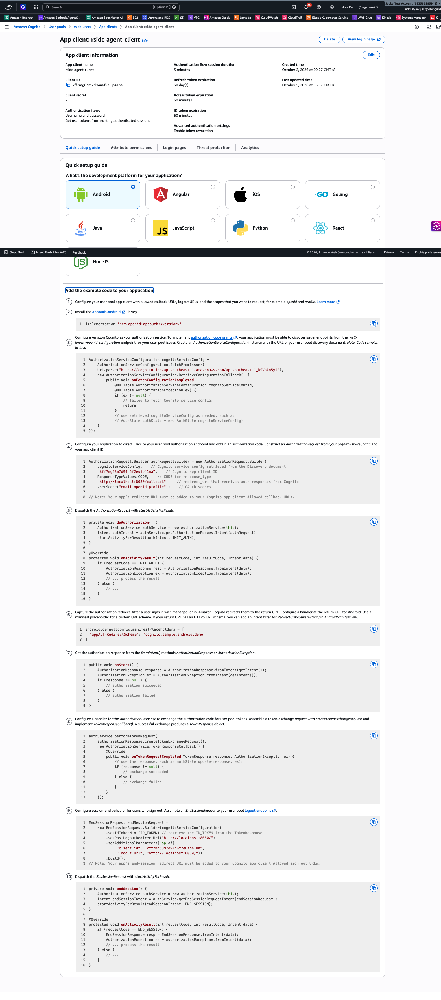

**Verification**

| Check | Command | Expected (regex) | Result |
|---|---|---|---|
| admin-only user creation | `aws cognito-idp describe-user-pool --region $RT_REGION --user-pool-id $COGNITO_POOL_ID --query UserPool.AdminCreateUserConfig.AllowAdminCreateUserOnly` | `true` | **PASS** |
| 4 confirmed users | `aws cognito-idp list-users --region $RT_REGION --user-pool-id $COGNITO_POOL_ID --query 'length(Users[?UserStatus==`CONFIRMED`])'` | `^4$` | **PASS** |

<details><summary>Actual output: admin-only user creation</summary>

```
true
```
</details>

<details><summary>Actual output: 4 confirmed users</summary>

```
4
```
</details>

## Step 3: IdC Trusted Token Issuer + Redshift IdC application

The TTI tells IAM Identity Center to trust JWTs signed by the Cognito pool and maps the `email` claim to the IdC user's `emails.value`. The Redshift IdC application (namespace AWSIDC) accepts that TTI for audience = the OBO client.

**IaC / script:** `infra/03-idc-redshift-app.sh`  
**Deploy command:** `infra/run.sh ./infra/03-idc-redshift-app.sh`

**Deployed resources**

| Type | ID / ARN | Name |
|---|---|---|
| AWS::SSO::TrustedTokenIssuer | `arn:aws:sso::383386985941:trustedTokenIssuer/ssoins-715869a9a6444dc5/tti-54429cde-c0b0-70e4-eeec-ba89c6508f18` | rsidc-cognito |
| AWS::IAM::Role | `arn:aws:iam::383386985941:role/rsidc-redshift-idc-role` | rsidc-redshift-idc-role |
| AWS::Redshift::IdcApplication | `arn:aws:redshift:ap-east-1:383386985941:redshiftidcapplication:291c5e1f-f78a-45ef-9312-a430cdf65fbb` | rsidc-redshift (AWSIDC) |
| AWS::SSO::Application | `arn:aws:sso::383386985941:application/ssoins-715869a9a6444dc5/apl-7158c218c69d902a` | IdC-managed app for Redshift |

**Console: IdC Settings → Authentication → Trusted token issuer rsidc-cognito (Cognito issuer, email → emails.value)**  
URL at capture (2026-10-05 16:15:02 HKT): <https://ap-east-1.console.aws.amazon.com/singlesignon/home?region=ap-east-1&tab=network-security#/instances/715869a9a6444dc5/settings>

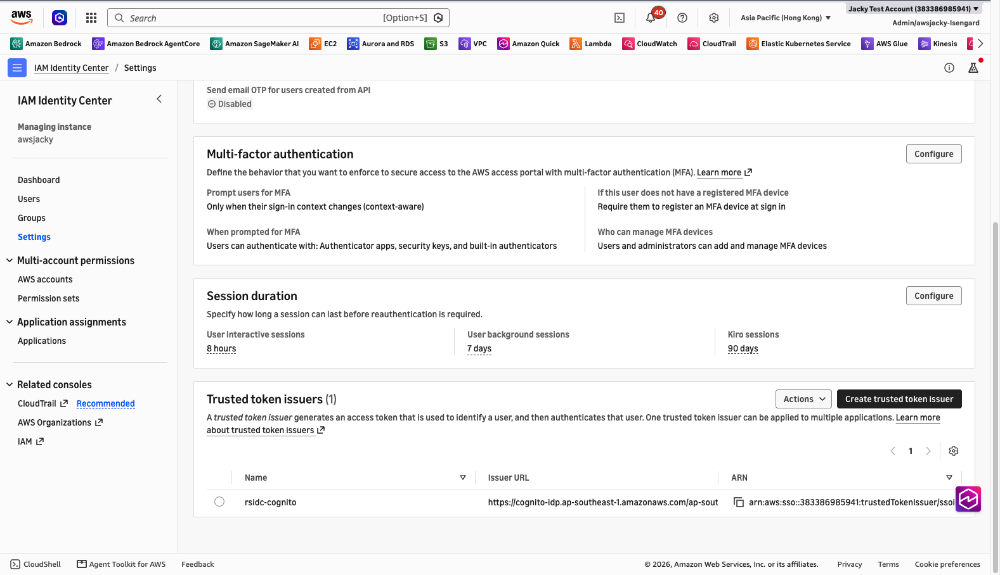

**Console: IAM role used by the Redshift IdC application**  
URL at capture (2026-10-05 16:15:15 HKT): <https://us-east-1.console.aws.amazon.com/iam/home#/roles/details/rsidc-redshift-idc-role?section=permissions>

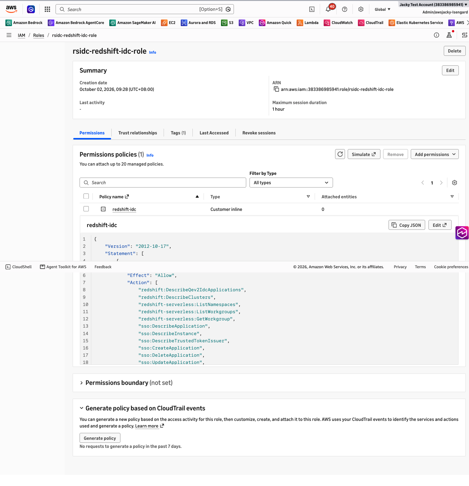

**Console: IdC → Applications (AWS managed): rsidc-redshift**  
URL at capture (2026-10-05 16:15:23 HKT): <https://ap-east-1.console.aws.amazon.com/singlesignon/home?region=ap-east-1#/instances/715869a9a6444dc5/applications>

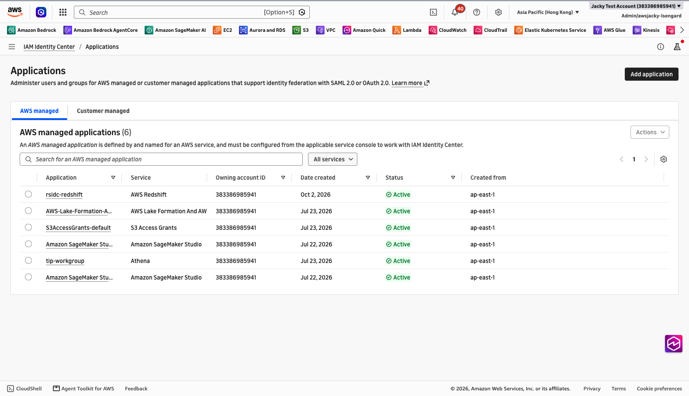

**Console: Redshift → IAM Identity Center connections: rsidc-redshift (namespace AWSIDC, token issuer = Cognito TTI)**  
URL at capture (2026-10-05 16:25:21 HKT): <https://ap-east-1.console.aws.amazon.com/redshiftv2/home?region=ap-east-1#/iam-idc-integration>

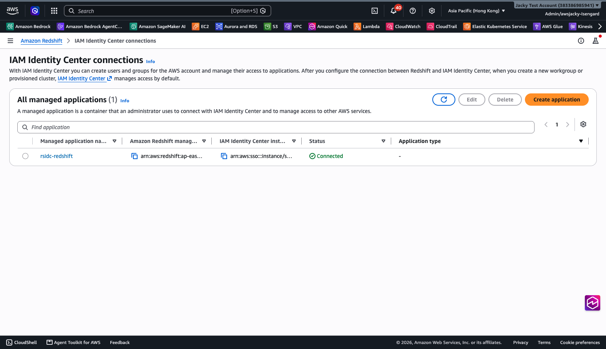

**Verification**

| Check | Command | Expected (regex) | Result |
|---|---|---|---|
| TTI issuer + claim mapping | `aws sso-admin describe-trusted-token-issuer --region $IDC_REGION --trusted-token-issuer-arn $TTI_ARN --query TrustedTokenIssuerConfiguration.OidcJwtConfiguration` | `ap-southeast-1_kSVpAo5yl.*"ClaimAttributePath": "email".*"emails.value"` | **PASS** |
| Redshift IdC app trusts the TTI for the OBO audience | `aws redshift describe-redshift-idc-applications --region $IDC_REGION --redshift-idc-application-arn $REDSHIFT_IDC_APP_ARN --query 'RedshiftIdcApplications[0].[IdentityNamespace,IdcOnboardStatus,AuthorizedTokenIssuerList[0].AuthorizedAudiencesList[0]]' --output text` | `AWSIDC\s+Completed\s+kff7mg63m7d94n6f2euip41na` | **PASS** |

<details><summary>Actual output: TTI issuer + claim mapping</summary>

```
{
    "IssuerUrl": "https://cognito-idp.ap-southeast-1.amazonaws.com/ap-southeast-1_kSVpAo5yl",
    "ClaimAttributePath": "email",
    "IdentityStoreAttributePath": "emails.value",
    "JwksRetrievalOption": "OPEN_ID_DISCOVERY"
}
```
</details>

<details><summary>Actual output: Redshift IdC app trusts the TTI for the OBO audience</summary>

```
AWSIDC	Completed	kff7mg63m7d94n6f2euip41na
```
</details>

## Step 4: Redshift cluster, network-restricted (ap-east-1)

ra3.large single node attached to the IdC application. Port 5439 is open only to the operator workstation egress IPs and the runtime NAT EIP; no egress rules. The admin password is managed by Secrets Manager.

**IaC / script:** `infra/04-redshift-cluster.sh`  
**Deploy command:** `infra/run.sh ./infra/04-redshift-cluster.sh`

**Deployed resources**

| Type | ID / ARN | Name |
|---|---|---|
| AWS::EC2::SecurityGroup | `sg-04a28577466e150f5` | rsidc-redshift-sg |
| AWS::Redshift::ClusterSubnetGroup | `rsidc-subnets` | default VPC subnets |
| AWS::Redshift::Cluster | `rsidc-cluster` | rsidc-cluster.c4lxyavyzchh.ap-east-1.redshift.amazonaws.com |
| AWS::SecretsManager::Secret | `arn:aws:secretsmanager:ap-east-1:383386985941:secret:redshift!rsidc-cluster-rsadmin-JJNks2` | managed admin password |

**Console: Redshift security group: exactly 3 inbound /32 on 5439, 0 outbound**  
URL at capture (2026-10-05 16:15:41 HKT): <https://ap-east-1.console.aws.amazon.com/ec2/home?region=ap-east-1#SecurityGroup:groupId=sg-04a28577466e150f5>

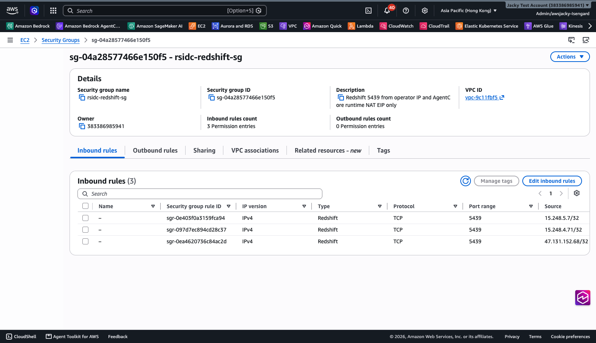

**Console: Redshift cluster rsidc-cluster (ra3.large, encrypted, IdC connection)**  
URL at capture (2026-10-05 16:15:50 HKT): <https://ap-east-1.console.aws.amazon.com/redshiftv2/home?region=ap-east-1#/cluster-details?cluster=rsidc-cluster&tab=properties>

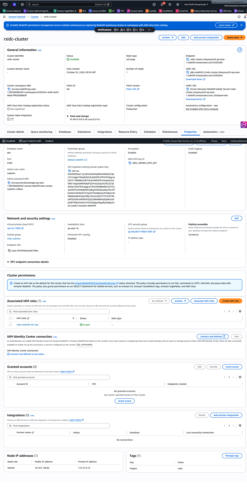

**Console: Admin password managed by Secrets Manager (value not shown)**  
URL at capture (2026-10-05 16:16:01 HKT): <https://ap-east-1.console.aws.amazon.com/secretsmanager/secret?name=redshift%21rsidc-cluster-rsadmin&region=ap-east-1#>

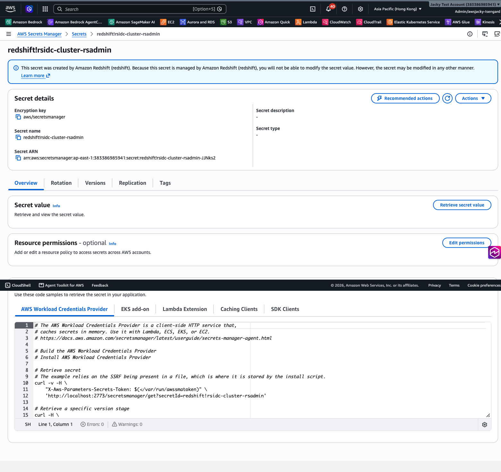

**Verification**

| Check | Command | Expected (regex) | Result |
|---|---|---|---|
| SG ingress = 3 × /32 on 5439, no 0.0.0.0/0 | `aws ec2 describe-security-groups --region $IDC_REGION --group-ids $RS_SG_ID --query 'SecurityGroups[0].IpPermissions[].IpRanges[].CidrIp' --output text \| tr '\t' '\n' \| sort \| tr '\n' ' '` | `^15\.248\.4\.71/32 15\.248\.5\.7/32 47\.131\.152\.68/32\s*$` | **PASS** |
| cluster available, encrypted, IdC-attached | `aws redshift describe-clusters --region $IDC_REGION --cluster-identifier rsidc-cluster --query 'Clusters[0].[ClusterStatus,NodeType,Encrypted,length(IamRoles)]' --output text` | `available\s+ra3.large\s+True\s+1` | **PASS** |

<details><summary>Actual output: SG ingress = 3 × /32 on 5439, no 0.0.0.0/0</summary>

```
15.248.4.71/32 15.248.5.7/32 47.131.152.68/32
```
</details>

<details><summary>Actual output: cluster available, encrypted, IdC-attached</summary>

```
available	ra3.large	True	1
```
</details>

## Step 5: Seed data + grants to IdC group roles (SQL)

Tables in `dev` (sales.orders, marketing.campaigns, risk.credit_limits), roles `AWSIDC:<group>`, table/column grants and RLS. No console page; verified with the Redshift Data API (read-only SELECT).

**IaC / script:** `infra/sql/01-seed-and-grants.sql`  
**Deploy command:** `infra/run.sh agent/.venv/bin/python infra/05-seed-redshift.py`

**Deployed resources**

| Type | ID / ARN | Name |
|---|---|---|
| Redshift schema/table | `dev.sales.orders / dev.marketing.campaigns / dev.risk.credit_limits` | 5 + 2 + 2 rows |
| Redshift role | `AWSIDC:risk-team, marketing-team, platform-team, data-scientists` | grants + RLS |

**Verification**

| Check | Command | Expected (regex) | Result |
|---|---|---|---|
| IdC group roles exist | `agent/.venv/bin/python -c "import os,time,boto3;c=boto3.Session(profile_name='default').client('redshift-data',region_name=os.environ['IDC_REGION']);i=c.execute_statement(ClusterIdentifier='rsidc-cluster',Database='dev',SecretArn=os.environ['REDSHIFT_ADMIN_SECRET_ARN'],Sql=\"SELECT role_name FROM svv_roles WHERE role_name LIKE 'AWSIDC:%' ORDER BY 1\")['Id']
while c.describe_statement(Id=i)['Status'] not in ('FINISHED','FAILED'): time.sleep(.5)
print(' '.join(r[0]['stringValue'] for r in c.get_statement_result(Id=i)['Records']))"` | `AWSIDC:data-scientists AWSIDC:marketing-team AWSIDC:platform-team AWSIDC:risk-team` | **PASS** |
| RLS enabled on sales.orders | `agent/.venv/bin/python -c "import os,time,boto3;c=boto3.Session(profile_name='default').client('redshift-data',region_name=os.environ['IDC_REGION']);i=c.execute_statement(ClusterIdentifier='rsidc-cluster',Database='dev',SecretArn=os.environ['REDSHIFT_ADMIN_SECRET_ARN'],Sql=\"SELECT relschema, relname, is_rls_on FROM svv_rls_relation WHERE relname='orders'\")['Id']
while c.describe_statement(Id=i)['Status'] not in ('FINISHED','FAILED'): time.sleep(.5)
print(c.get_statement_result(Id=i)['Records'])"` | `'sales'.*'orders'.*'stringValue': 't'` | **PASS** |

<details><summary>Actual output: IdC group roles exist</summary>

```
AWSIDC:data-scientists AWSIDC:marketing-team AWSIDC:platform-team AWSIDC:risk-team
```
</details>

<details><summary>Actual output: RLS enabled on sales.orders</summary>

```
[[{'stringValue': 'sales'}, {'stringValue': 'orders'}, {'stringValue': 't'}]]
```
</details>

## Step 6: OBO runtime execution role (no Redshift permissions)

Role assumed by the OBO runtime. It can call Bedrock, write logs, use its workload identity, and (added in step 7) exchange tokens at one IdC application. It has no `redshift:*` permission.

**IaC / script:** `infra/06-runtime-role.sh + infra/policies/agent-runtime-permissions.json`  
**Deploy command:** `infra/run.sh ./infra/06-runtime-role.sh`

**Deployed resources**

| Type | ID / ARN | Name |
|---|---|---|
| AWS::IAM::Role | `arn:aws:iam::383386985941:role/rsidc-agent-runtime-role` | rsidc-agent-runtime-role |

**Console: OBO runtime role: Bedrock, logs, workload identity, CreateTokenWithIAM on one IdC app; no redshift:***  
URL at capture (2026-10-05 16:16:14 HKT): <https://us-east-1.console.aws.amazon.com/iam/home#/roles/details/rsidc-agent-runtime-role?section=permissions>

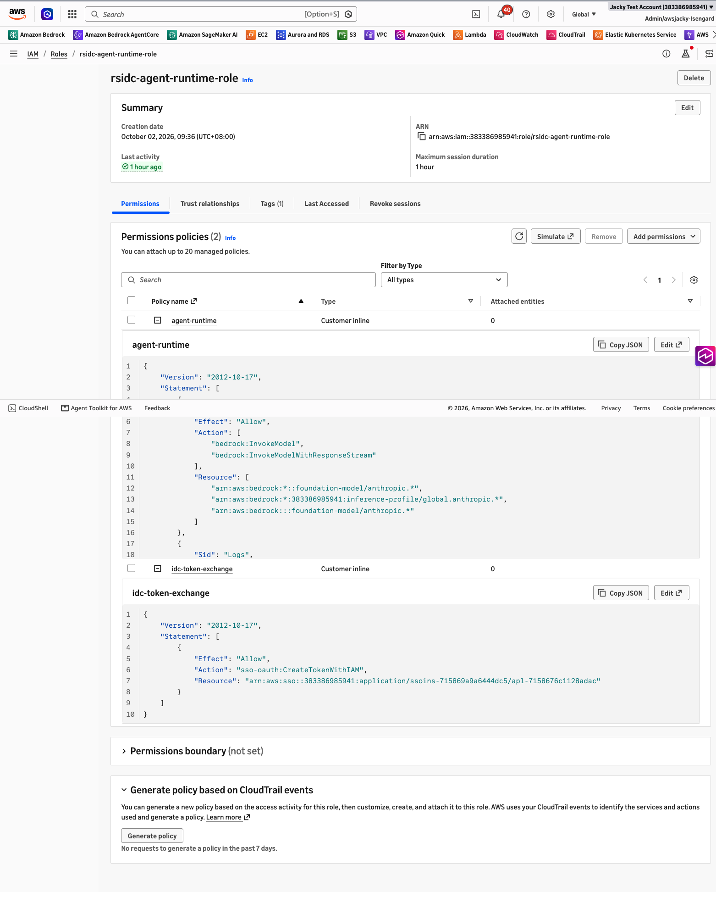

**Verification**

| Check | Command | Expected (regex) | Result |
|---|---|---|---|
| no redshift actions in any inline policy | `for p in $(aws iam list-role-policies --role-name rsidc-agent-runtime-role --query PolicyNames --output text); do aws iam get-role-policy --role-name rsidc-agent-runtime-role --policy-name $p --query PolicyDocument; done \| grep -c 'redshift:' ; true` | `^0$` | **PASS** |

<details><summary>Actual output: no redshift actions in any inline policy</summary>

```
0
```
</details>

## Step 7: IdC customer-managed app for the agent's token exchange

`rsidc-data-agent` has a jwt-bearer grant trusting the Cognito TTI (audience = OBO client), scope `redshift:connect`, required group assignment, and an ActorPolicy that allows only the OBO runtime role and explicitly denies every other principal.

**IaC / script:** `infra/07-idc-agent-app.sh`  
**Deploy command:** `infra/run.sh ./infra/07-idc-agent-app.sh`

**Deployed resources**

| Type | ID / ARN | Name |
|---|---|---|
| AWS::SSO::Application | `arn:aws:sso::383386985941:application/ssoins-715869a9a6444dc5/apl-7158676c1128adac` | rsidc-data-agent |

**Console: IdC customer-managed app rsidc-data-agent: TTI configured, 4 groups, trusted for AWS Redshift**  
URL at capture (2026-10-05 16:16:34 HKT): <https://ap-east-1.console.aws.amazon.com/singlesignon/home?region=ap-east-1#/instances/715869a9a6444dc5/applications/ins-7158676c1128adac>

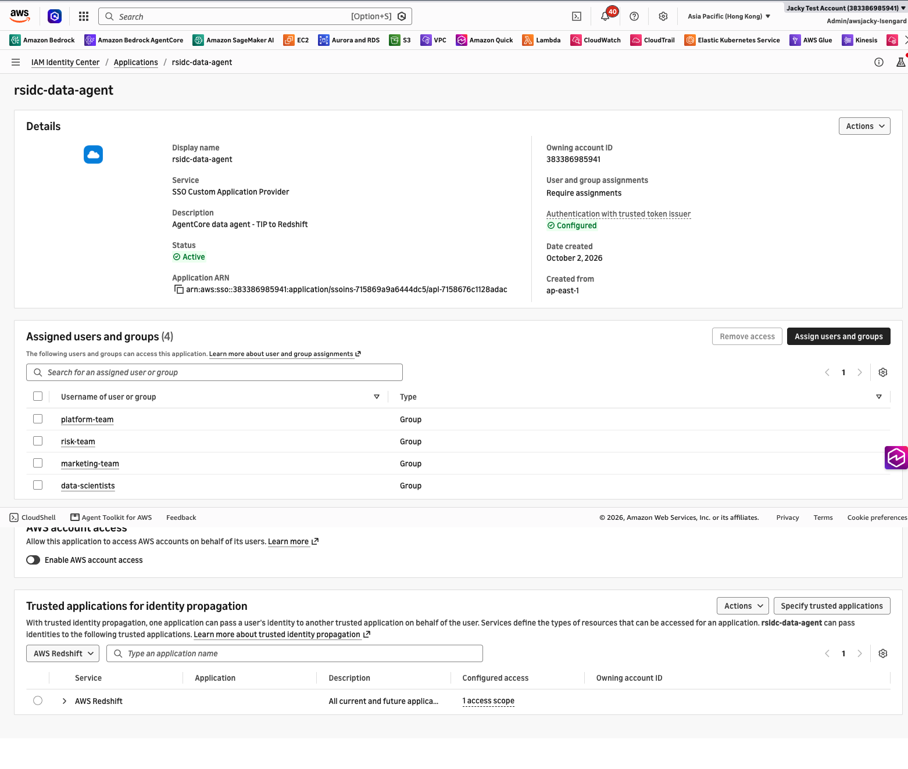

**Verification**

| Check | Command | Expected (regex) | Result |
|---|---|---|---|
| jwt-bearer grant → Cognito TTI, OBO audience | `aws sso-admin get-application-grant --region $IDC_REGION --application-arn $AGENT_IDC_APP_ARN --grant-type urn:ietf:params:oauth:grant-type:jwt-bearer --query 'Grant.JwtBearer.AuthorizedTokenIssuers[0].AuthorizedAudiences[0]' --output text` | `kff7mg63m7d94n6f2euip41na` | **PASS** |
| ActorPolicy: Allow runtime role + Deny everyone else | `aws sso-admin get-application-authentication-method --region $IDC_REGION --application-arn $AGENT_IDC_APP_ARN --authentication-method-type IAM --query 'AuthenticationMethod.Iam.ActorPolicy.Statement[].[Effect,Sid]' --output text` | `Allow.*Deny\s+DenyEveryoneElseIncludingAdmins` | **PASS** |
| scope redshift:connect | `aws sso-admin list-application-access-scopes --region $IDC_REGION --application-arn $AGENT_IDC_APP_ARN --query 'Scopes[].Scope' --output text` | `redshift:connect` | **PASS** |

<details><summary>Actual output: jwt-bearer grant → Cognito TTI, OBO audience</summary>

```
kff7mg63m7d94n6f2euip41na
```
</details>

<details><summary>Actual output: ActorPolicy: Allow runtime role + Deny everyone else</summary>

```
Allow	None
Deny	DenyEveryoneElseIncludingAdmins
```
</details>

<details><summary>Actual output: scope redshift:connect</summary>

```
redshift:connect
```
</details>

## Step 8: OBO data agent on AgentCore Runtime

Direct code deploy (zip in S3). VPC mode in the private subnets, JWT inbound auth (Cognito discovery, audience = OBO client), Authorization header forwarded to the agent.

**IaC / script:** `infra/08-deploy-runtime.sh + agent/`  
**Deploy command:** `infra/run.sh ./infra/08-deploy-runtime.sh`

**Deployed resources**

| Type | ID / ARN | Name |
|---|---|---|
| AWS::S3::Bucket | `rsidc-artifacts-383386985941-ap-southeast-1` | code bundles |
| AWS::BedrockAgentCore::Runtime | `arn:aws:bedrock-agentcore:ap-southeast-1:383386985941:runtime/rsidc_data_agent-BoemCIApSW` | rsidc_data_agent (v3) |

**Console: S3 bucket with the runtime code bundles (agent/, agent_oauth/)**  
URL at capture (2026-10-05 16:16:44 HKT): <https://ap-southeast-1.console.aws.amazon.com/s3/buckets/rsidc-artifacts-383386985941-ap-southeast-1?tab=objects&region=ap-southeast-1>

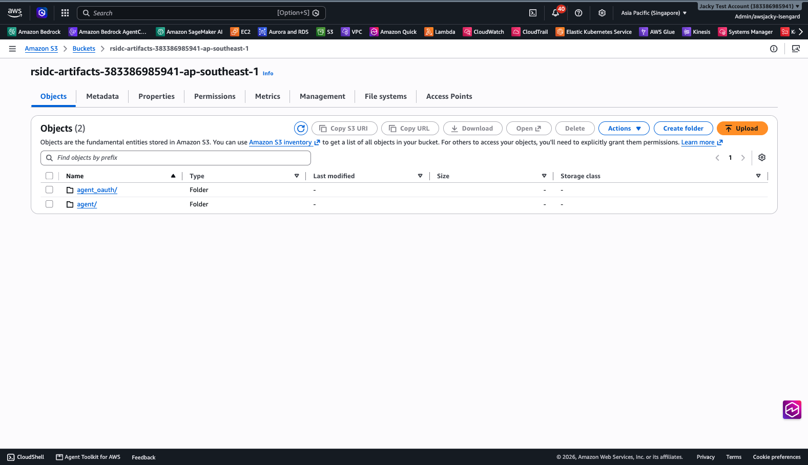

**Console: OBO runtime rsidc_data_agent v3: JWT inbound (aud kff7mg63…), VPC, env vars**  
URL at capture (2026-10-05 16:16:52 HKT): <https://ap-southeast-1.console.aws.amazon.com/bedrock-agentcore/agents/rsidc_data_agent-BoemCIApSW/version/3?region=ap-southeast-1>

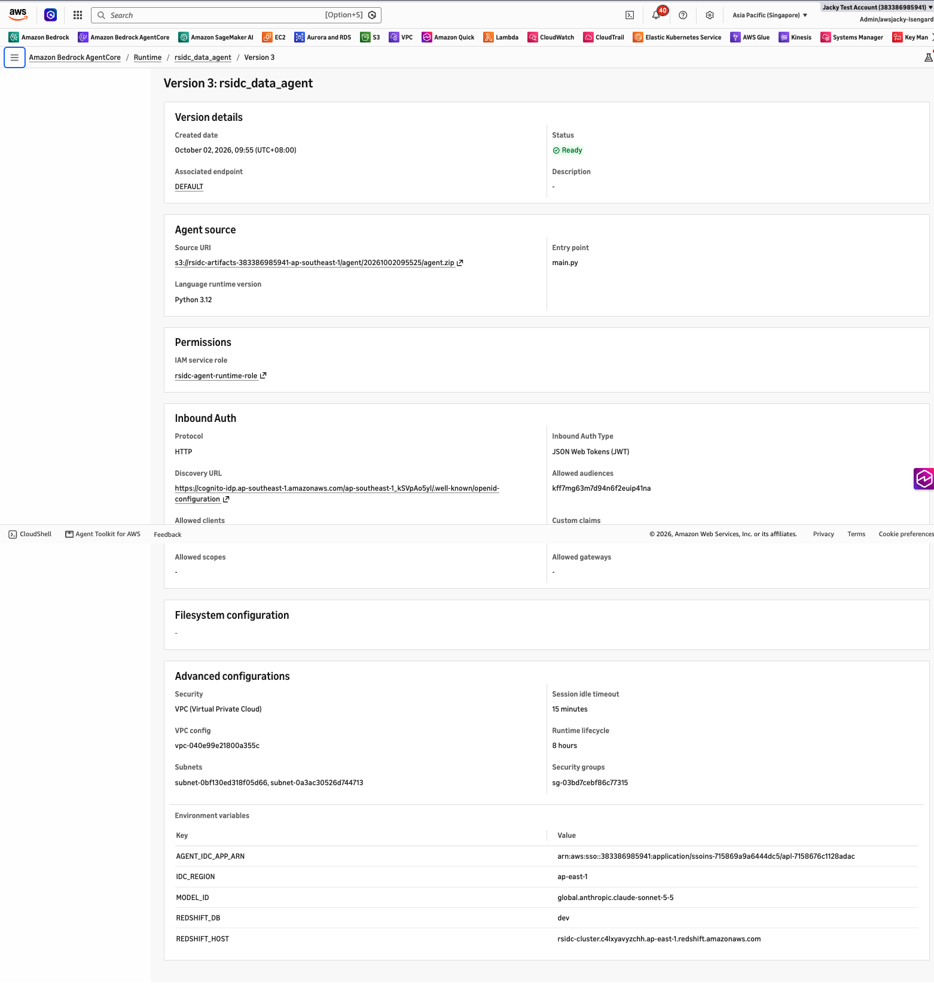

**Verification**

| Check | Command | Expected (regex) | Result |
|---|---|---|---|
| runtime READY, VPC, JWT audience, header allowlist | `aws bedrock-agentcore-control get-agent-runtime --region $RT_REGION --agent-runtime-id $RT_ID --query '[status,agentRuntimeVersion,networkConfiguration.networkMode,authorizerConfiguration.customJWTAuthorizer.allowedAudience[0],requestHeaderConfiguration.requestHeaderAllowlist[0]]' --output text` | `READY\s+3\s+VPC\s+kff7mg63m7d94n6f2euip41na\s+Authorization` | **PASS** |
| bucket blocks public access | `aws s3api get-public-access-block --bucket rsidc-artifacts-383386985941-ap-southeast-1 --query 'PublicAccessBlockConfiguration.[BlockPublicAcls,BlockPublicPolicy,IgnorePublicAcls,RestrictPublicBuckets]' --output text` | `True\s+True\s+True\s+True` | **PASS** |

<details><summary>Actual output: runtime READY, VPC, JWT audience, header allowlist</summary>

```
READY	3	VPC	kff7mg63m7d94n6f2euip41na	Authorization
```
</details>

<details><summary>Actual output: bucket blocks public access</summary>

```
True	True	True	True
```
</details>

## Step 9: Cognito OAuth clients for 2LO / 3LO (same pool)

Managed login domain (v2), resource server `rsidc-reports/read`, a confidential client_credentials client (2LO) and a confidential authorization-code client (3LO). The OBO client is unchanged here.

**IaC / script:** `infra/09-cognito-oauth-clients.sh`  
**Deploy command:** `infra/run.sh ./infra/09-cognito-oauth-clients.sh`

**Deployed resources**

| Type | ID / ARN | Name |
|---|---|---|
| AWS::Cognito::UserPoolDomain | `rsidc-383386985941` | managed login v2 |
| AWS::Cognito::UserPoolResourceServer | `rsidc-reports` | scope read |
| AWS::Cognito::UserPoolClient | `3lsr6jpphlql4hb8n1ge6a8sjp` | rsidc-2lo-agent |
| AWS::Cognito::UserPoolClient | `4mrecmrv4divtcngq62to3run1` | rsidc-3lo-agent |

**Console: Cognito managed login domain rsidc-383386985941 (Managed login v2)**  
URL at capture (2026-10-05 16:17:00 HKT): <https://ap-southeast-1.console.aws.amazon.com/cognito/v2/idp/user-pools/ap-southeast-1_kSVpAo5yl/branding/domain?region=ap-southeast-1>

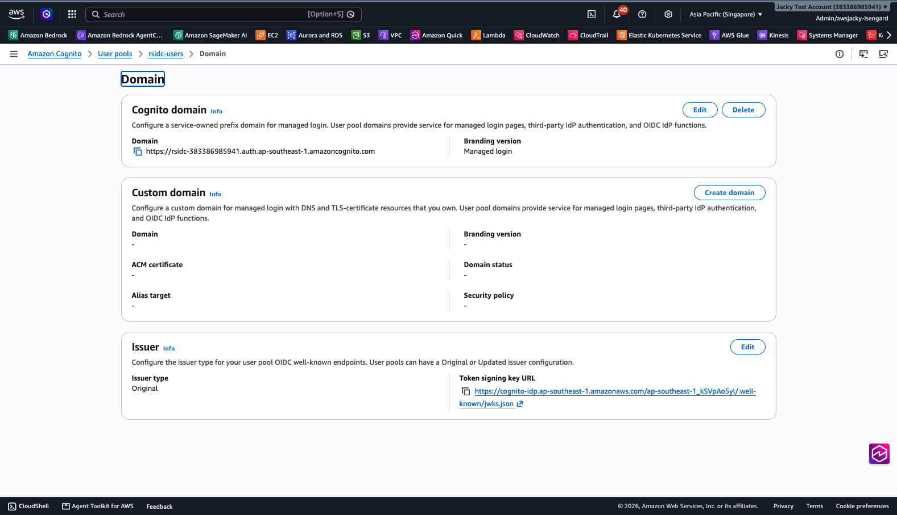

**Console: Resource server rsidc-reports (scope read) for 2LO**  
URL at capture (2026-10-05 16:17:08 HKT): <https://ap-southeast-1.console.aws.amazon.com/cognito/v2/idp/user-pools/ap-southeast-1_kSVpAo5yl/applications/resource-servers?region=ap-southeast-1>

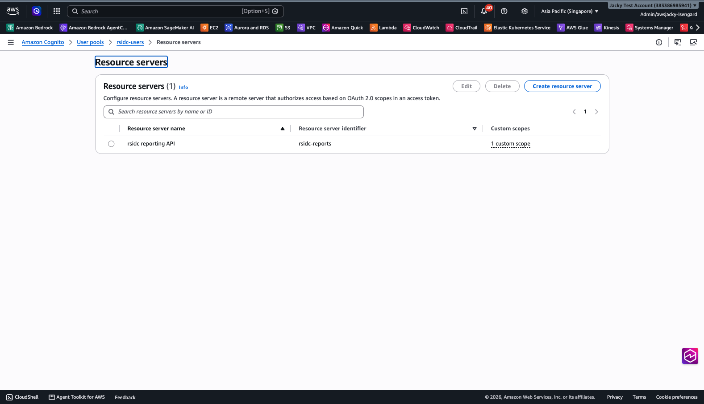

**Console: App clients: OBO client, rsidc-2lo-agent, rsidc-3lo-agent**  
URL at capture (2026-10-05 16:17:16 HKT): <https://ap-southeast-1.console.aws.amazon.com/cognito/v2/idp/user-pools/ap-southeast-1_kSVpAo5yl/applications/app-clients?region=ap-southeast-1>

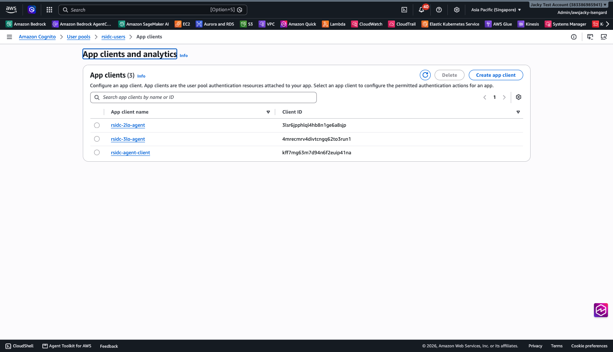

**Console: 2LO client: client_credentials, scope rsidc-reports/read**  
URL at capture (2026-10-05 16:17:24 HKT): <https://ap-southeast-1.console.aws.amazon.com/cognito/v2/idp/user-pools/ap-southeast-1_kSVpAo5yl/applications/app-clients/3lsr6jpphlql4hb8n1ge6a8sjp/quick-setup-guide?region=ap-southeast-1>

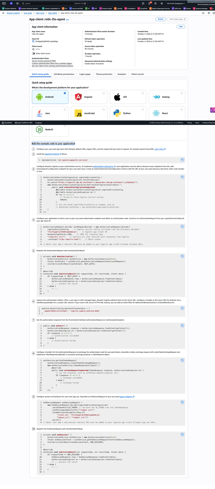

**Console: 3LO client: authorization code, callback = AgentCore Identity callback URL**  
URL at capture (2026-10-05 16:17:33 HKT): <https://ap-southeast-1.console.aws.amazon.com/cognito/v2/idp/user-pools/ap-southeast-1_kSVpAo5yl/applications/app-clients/4mrecmrv4divtcngq62to3run1/quick-setup-guide?region=ap-southeast-1>

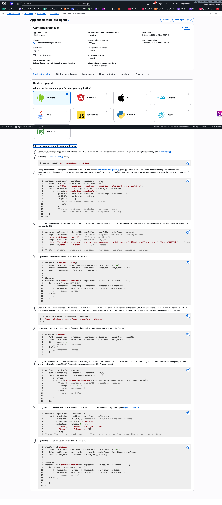

**Verification**

| Check | Command | Expected (regex) | Result |
|---|---|---|---|
| domain on managed login v2 | `aws cognito-idp describe-user-pool-domain --region $RT_REGION --domain rsidc-383386985941 --query 'DomainDescription.[Status,ManagedLoginVersion]' --output text` | `ACTIVE\s+2` | **PASS** |
| 2LO client = client_credentials only | `aws cognito-idp describe-user-pool-client --region $RT_REGION --user-pool-id $COGNITO_POOL_ID --client-id $C2LO_CLIENT_ID --query 'UserPoolClient.[AllowedOAuthFlows,AllowedOAuthScopes]' --output text` | `client_credentials\s+rsidc-reports/read` | **PASS** |
| 3LO client callback = AgentCore Identity | `aws cognito-idp describe-user-pool-client --region $RT_REGION --user-pool-id $COGNITO_POOL_ID --client-id $C3LO_CLIENT_ID --query 'UserPoolClient.[AllowedOAuthFlows[0],CallbackURLs[0]]' --output text` | `code\s+https://bedrock-agentcore.ap-southeast-1.amazonaws.com/identities/oauth2/callback/` | **PASS** |

<details><summary>Actual output: domain on managed login v2</summary>

```
ACTIVE	2
```
</details>

<details><summary>Actual output: 2LO client = client_credentials only</summary>

```
client_credentials
rsidc-reports/read
```
</details>

<details><summary>Actual output: 3LO client callback = AgentCore Identity</summary>

```
code	https://bedrock-agentcore.ap-southeast-1.amazonaws.com/identities/oauth2/callback/9cb308bc-d10a-41c2-b878-07b754f958b1
```
</details>

## Step 10: AgentCore Identity credential providers

Two CustomOauth2 providers backed by Cognito discovery: `rsidc-2lo-cognito` (M2M) and `rsidc-3lo-cognito` (user federation). Client secrets are held by AgentCore Identity (Secrets Manager, never printed).

**IaC / script:** `infra/10-credential-providers.py`  
**Deploy command:** `infra/run.sh agent/.venv/bin/python infra/10-credential-providers.py`

**Deployed resources**

| Type | ID / ARN | Name |
|---|---|---|
| AWS::BedrockAgentCore::OAuth2CredentialProvider | `arn:aws:bedrock-agentcore:ap-southeast-1:383386985941:token-vault/default/oauth2credentialprovider/rsidc-2lo-cognito` | rsidc-2lo-cognito |
| AWS::BedrockAgentCore::OAuth2CredentialProvider | `arn:aws:bedrock-agentcore:ap-southeast-1:383386985941:token-vault/default/oauth2credentialprovider/rsidc-3lo-cognito` | rsidc-3lo-cognito |

**Console: AgentCore Identity → Outbound Auth: rsidc-2lo-cognito, rsidc-3lo-cognito**  
URL at capture (2026-10-05 16:17:41 HKT): <https://ap-southeast-1.console.aws.amazon.com/bedrock-agentcore/identity?region=ap-southeast-1>

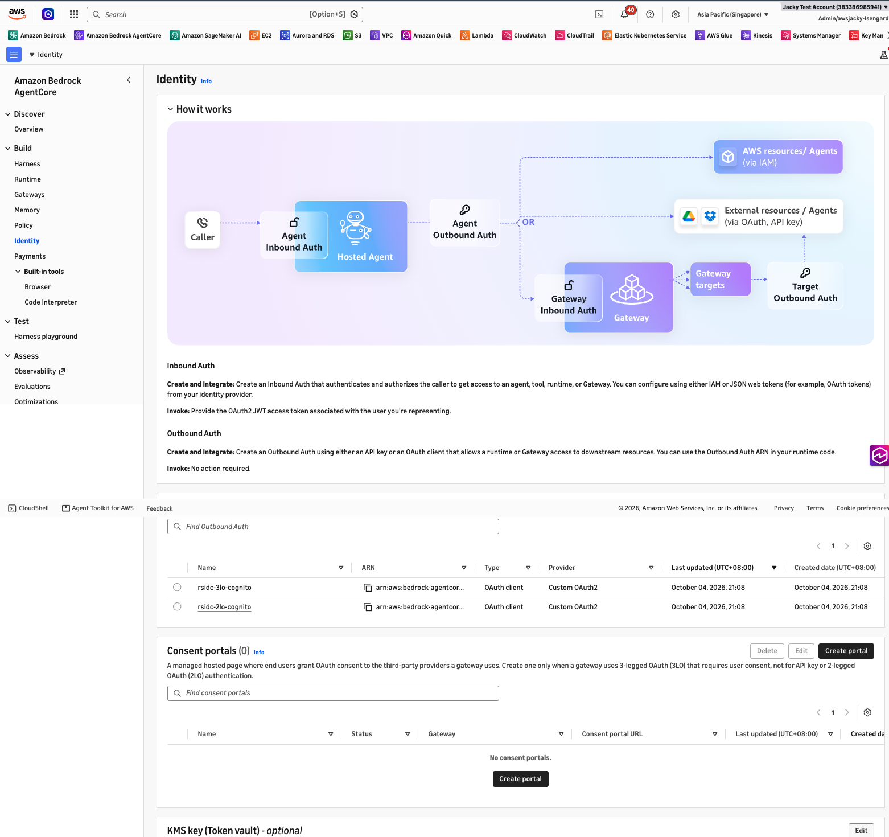

**Console: Credential provider rsidc-2lo-cognito (Custom OAuth2, M2M)**  
URL at capture (2026-10-05 16:17:49 HKT): <https://ap-southeast-1.console.aws.amazon.com/bedrock-agentcore/identity/rsidc-2lo-cognito?region=ap-southeast-1>

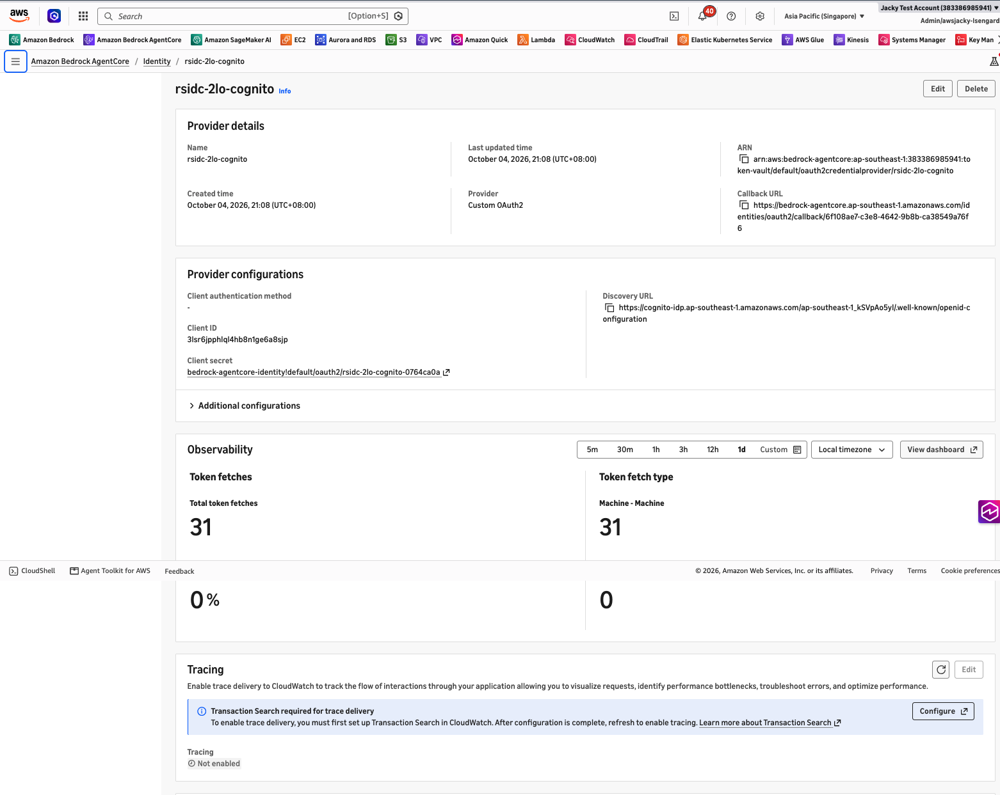

**Console: Credential provider rsidc-3lo-cognito (Custom OAuth2, user federation)**  
URL at capture (2026-10-05 16:17:58 HKT): <https://ap-southeast-1.console.aws.amazon.com/bedrock-agentcore/identity/rsidc-3lo-cognito?region=ap-southeast-1>

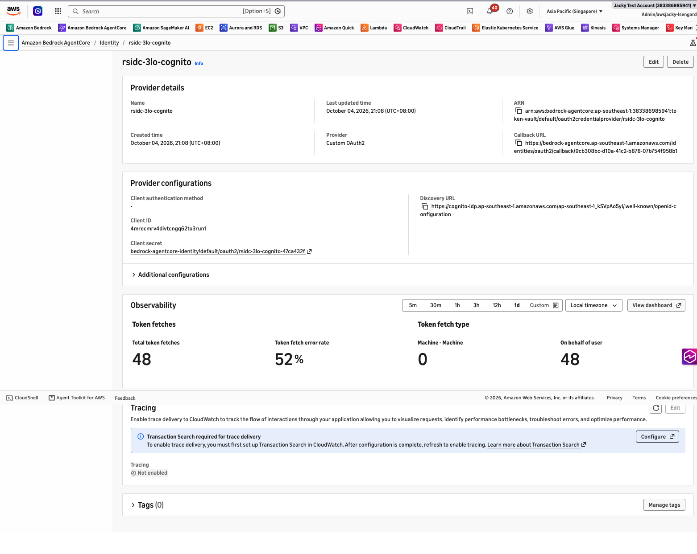

**Verification**

| Check | Command | Expected (regex) | Result |
|---|---|---|---|
| 2LO provider → 2LO client | `aws bedrock-agentcore-control get-oauth2-credential-provider --region $RT_REGION --name rsidc-2lo-cognito --query '[status,credentialProviderVendor,oauth2ProviderConfigOutput.customOauth2ProviderConfig.clientId]' --output text` | `READY\s+CustomOauth2\s+3lsr6jpphlql4hb8n1ge6a8sjp` | **PASS** |
| 3LO provider → 3LO client | `aws bedrock-agentcore-control get-oauth2-credential-provider --region $RT_REGION --name rsidc-3lo-cognito --query '[status,oauth2ProviderConfigOutput.customOauth2ProviderConfig.clientId]' --output text` | `READY\s+4mrecmrv4divtcngq62to3run1` | **PASS** |

<details><summary>Actual output: 2LO provider → 2LO client</summary>

```
READY	CustomOauth2	3lsr6jpphlql4hb8n1ge6a8sjp
```
</details>

<details><summary>Actual output: 3LO provider → 3LO client</summary>

```
READY	4mrecmrv4divtcngq62to3run1
```
</details>

## Step 11: 2LO downstream: Gateway → Lambda → Redshift service user

DB user `svc_reporting`; Lambda that queries Redshift through the Data API as that user; AgentCore Gateway (MCP) whose JWT authorizer accepts only the 2LO client; target `reporting` invoked with the Gateway IAM role.

**IaC / script:** `infra/11-2lo-gateway.sh + lambda/reporting/ + infra/sql/02-svc-reporting.sql`  
**Deploy command:** `infra/run.sh ./infra/11-2lo-gateway.sh`

**Deployed resources**

| Type | ID / ARN | Name |
|---|---|---|
| AWS::IAM::Role | `rsidc-reporting-lambda-role` | Data API as svc_reporting |
| AWS::Lambda::Function | `arn:aws:lambda:ap-southeast-1:383386985941:function:rsidc-reporting` | rsidc-reporting |
| AWS::IAM::Role | `rsidc-gateway-role` | invoke rsidc-reporting |
| AWS::BedrockAgentCore::Gateway | `rsidc-2lo-gateway-mhss1cesvt` | rsidc-2lo-gateway |
| AWS::BedrockAgentCore::GatewayTarget | `DW1PNIOIAE` | reporting (Lambda) |
| Redshift user | `svc_reporting` | SELECT sales.orders |

**Console: Lambda role: GetClusterCredentials only for dbuser svc_reporting + Data API**  
URL at capture (2026-10-05 16:18:11 HKT): <https://us-east-1.console.aws.amazon.com/iam/home#/roles/details/rsidc-reporting-lambda-role?section=permissions>

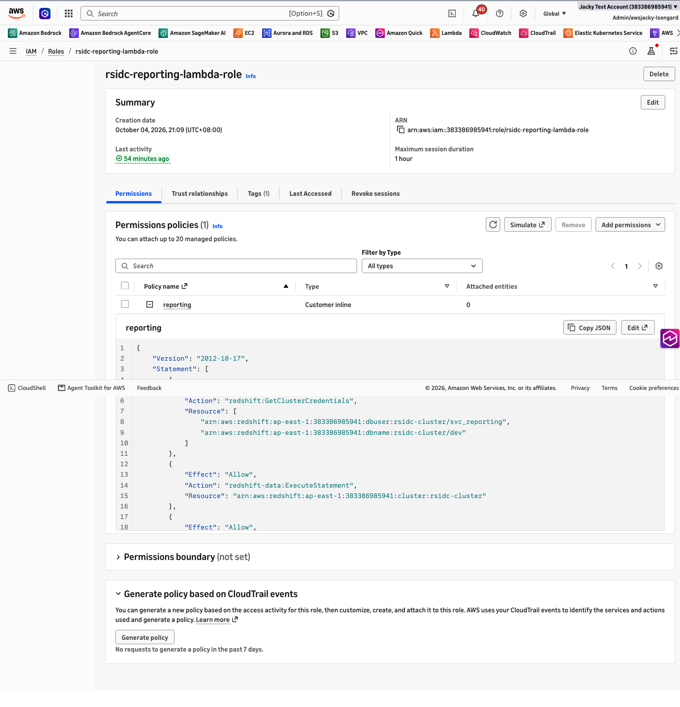

**Console: Lambda rsidc-reporting (Gateway target; queries Redshift as svc_reporting)**  
URL at capture (2026-10-05 16:18:18 HKT): <https://ap-southeast-1.console.aws.amazon.com/lambda/home?region=ap-southeast-1#/functions/rsidc-reporting?tab=configure>

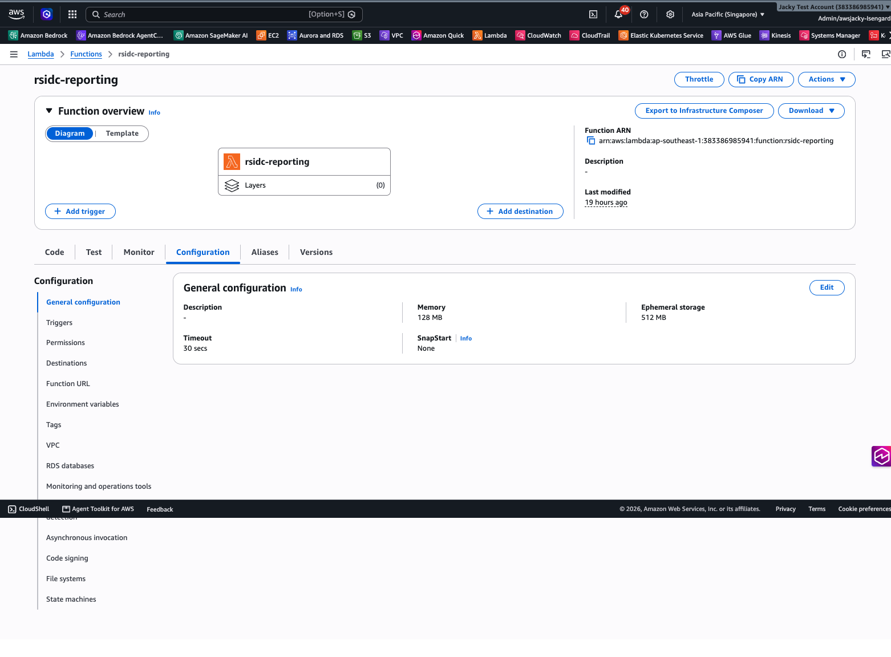

**Console: Gateway role: lambda:InvokeFunction on rsidc-reporting only**  
URL at capture (2026-10-05 16:18:31 HKT): <https://us-east-1.console.aws.amazon.com/iam/home#/roles/details/rsidc-gateway-role?section=permissions>

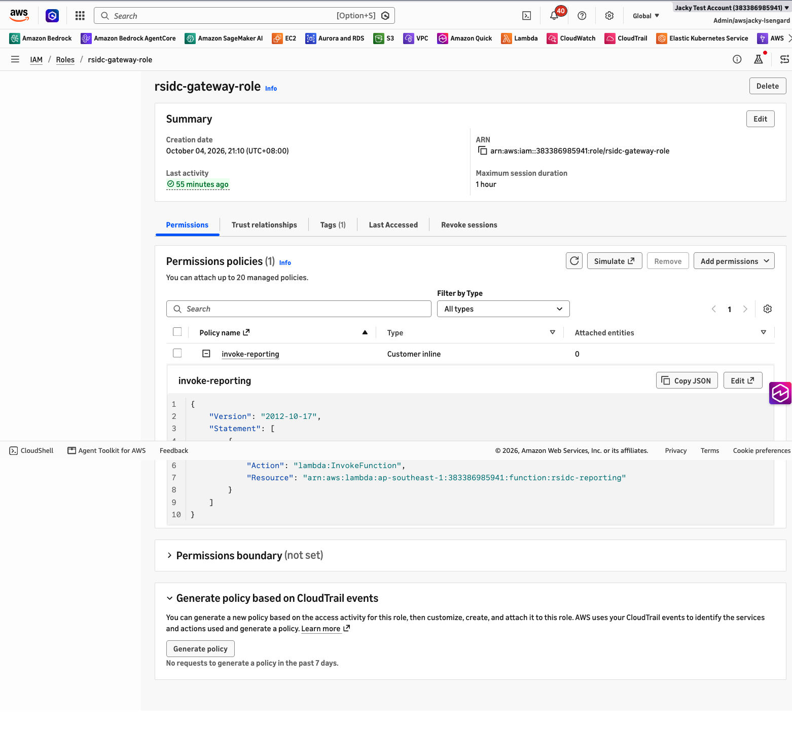

**Console: AgentCore Gateway rsidc-2lo-gateway (MCP), target reporting → Lambda**  
URL at capture (2026-10-05 16:18:47 HKT): <https://ap-southeast-1.console.aws.amazon.com/bedrock-agentcore/toolsAndGateways/rsidc-2lo-gateway-mhss1cesvt>

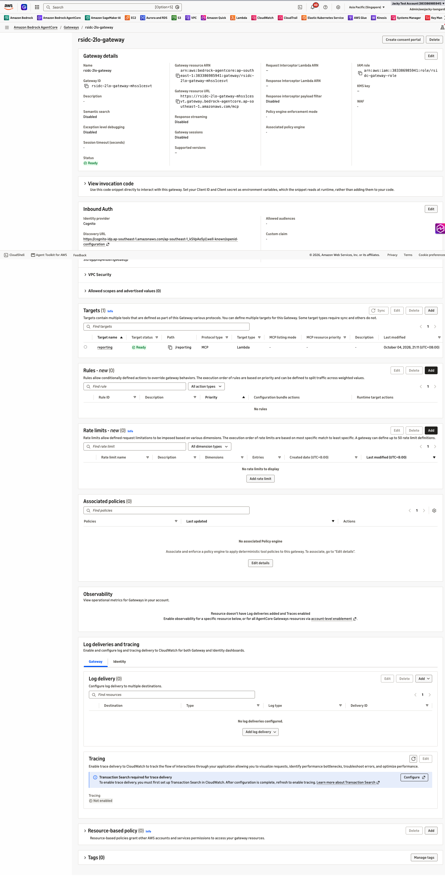

**Console: Gateway Inbound Auth: Cognito, Allowed clients = 2LO client only**  
URL at capture (2026-10-05 16:19:05 HKT): <https://ap-southeast-1.console.aws.amazon.com/bedrock-agentcore/toolsAndGateways/rsidc-2lo-gateway-mhss1cesvt>

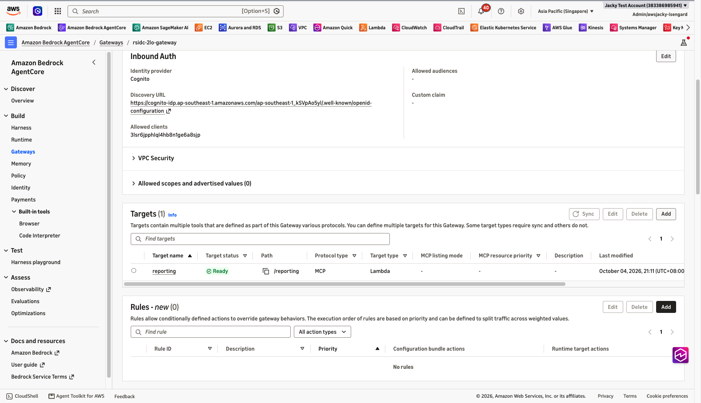

**Verification**

| Check | Command | Expected (regex) | Result |
|---|---|---|---|
| gateway READY, allowedClients = 2LO client | `aws bedrock-agentcore-control get-gateway --region $RT_REGION --gateway-identifier $GW_ID --query '[status,protocolType,authorizerConfiguration.customJWTAuthorizer.allowedClients[0]]' --output text` | `READY\s+MCP\s+3lsr6jpphlql4hb8n1ge6a8sjp` | **PASS** |
| target reporting READY | `aws bedrock-agentcore-control list-gateway-targets --region $RT_REGION --gateway-identifier $GW_ID --query 'items[].[name,status]' --output text` | `reporting\s+READY` | **PASS** |
| Lambda may impersonate only svc_reporting | `aws iam get-role-policy --role-name rsidc-reporting-lambda-role --policy-name reporting --query 'PolicyDocument.Statement[0].Resource' --output text` | `dbuser:rsidc-cluster/svc_reporting` | **PASS** |

<details><summary>Actual output: gateway READY, allowedClients = 2LO client</summary>

```
READY	MCP	3lsr6jpphlql4hb8n1ge6a8sjp
```
</details>

<details><summary>Actual output: target reporting READY</summary>

```
reporting	READY
```
</details>

<details><summary>Actual output: Lambda may impersonate only svc_reporting</summary>

```
arn:aws:redshift:ap-east-1:383386985941:dbuser:rsidc-cluster/svc_reporting	arn:aws:redshift:ap-east-1:383386985941:dbname:rsidc-cluster/dev
```
</details>

## Step 12: Separate OAuth agent runtime (2LO / 3LO)

`rsidc_oauth_agent` with its own role. The role grants `GetResourceOauth2Token` on the token vault, both credential providers and its own workload identity, plus read access to the two provider client secrets; this is what lets the runtime use `rsidc-2lo-cognito` / `rsidc-3lo-cognito`. The workload identity allowlists the 3LO return URLs.

**IaC / script:** `infra/12-deploy-oauth-runtime.sh + agent_oauth/ + infra/policies/oauth-runtime-permissions.json`  
**Deploy command:** `infra/run.sh ./infra/12-deploy-oauth-runtime.sh`

**Deployed resources**

| Type | ID / ARN | Name |
|---|---|---|
| AWS::IAM::Role | `arn:aws:iam::383386985941:role/rsidc-oauth-runtime-role` | rsidc-oauth-runtime-role |
| AWS::BedrockAgentCore::Runtime | `arn:aws:bedrock-agentcore:ap-southeast-1:383386985941:runtime/rsidc_oauth_agent-4lxrH9AmnT` | rsidc_oauth_agent (v4) |
| AWS::BedrockAgentCore::WorkloadIdentity | `rsidc_oauth_agent-4lxrH9AmnT` | return URLs :8765 (tests), :8081 (GUI) |

**Console: OAuth runtime role: GetResourceOauth2Token on token-vault + both providers + its workload identity**  
URL at capture (2026-10-05 16:19:17 HKT): <https://us-east-1.console.aws.amazon.com/iam/home#/roles/details/rsidc-oauth-runtime-role?section=permissions>

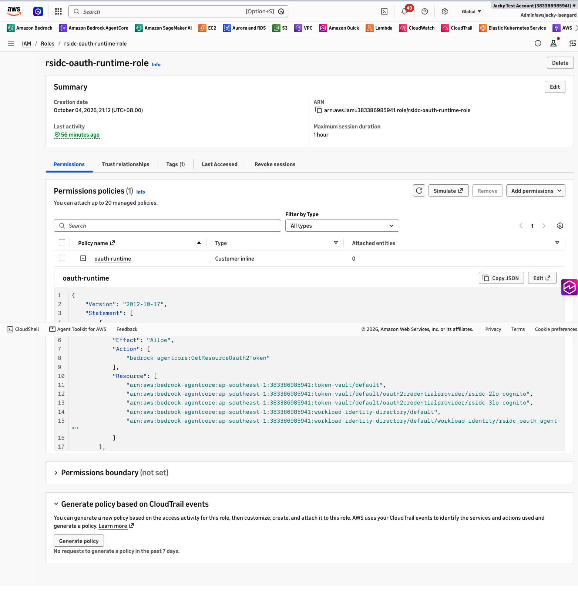

**Console: OAuth runtime rsidc_oauth_agent v4: JWT inbound, VPC, env CP_2LO / CP_3LO / GW_URL**  
URL at capture (2026-10-05 16:19:25 HKT): <https://ap-southeast-1.console.aws.amazon.com/bedrock-agentcore/agents/rsidc_oauth_agent-4lxrH9AmnT/version/4?region=ap-southeast-1>

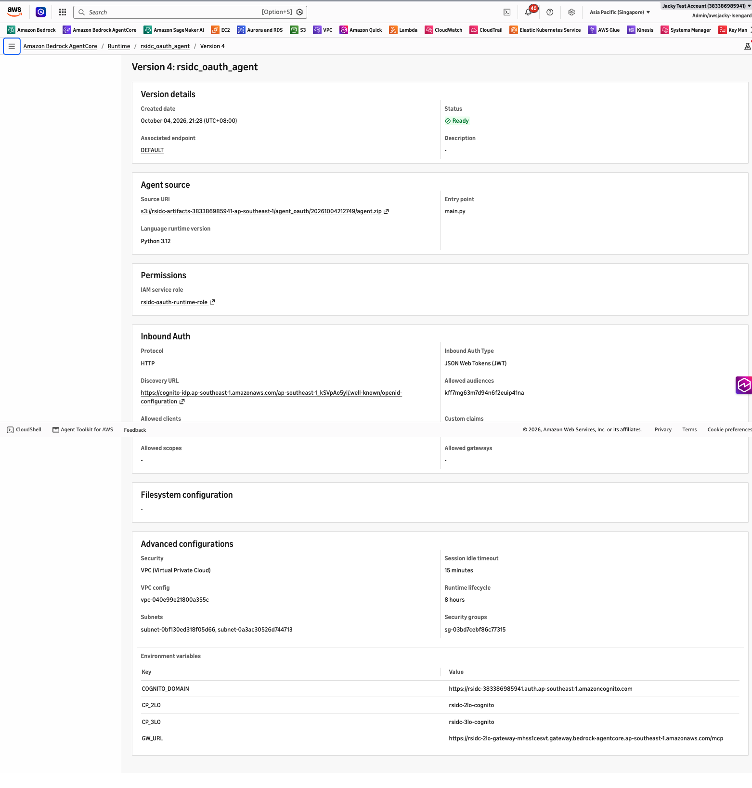

**Verification**

| Check | Command | Expected (regex) | Result |
|---|---|---|---|
| role grants GetResourceOauth2Token on the 2LO provider | `aws iam get-role-policy --role-name rsidc-oauth-runtime-role --policy-name oauth-runtime --query 'PolicyDocument.Statement[?Sid==`OutboundOAuthTokens`].Resource[]' --output text` | `oauth2credentialprovider/rsidc-2lo-cognito` | **PASS** |
| runtime READY with provider names in env | `aws bedrock-agentcore-control get-agent-runtime --region $RT_REGION --agent-runtime-id $OAUTH_RT_ID --query '[status,environmentVariables.CP_2LO,environmentVariables.CP_3LO]' --output text` | `READY\s+rsidc-2lo-cognito\s+rsidc-3lo-cognito` | **PASS** |
| workload identity return URLs | `aws bedrock-agentcore-control get-workload-identity --region $RT_REGION --name $OAUTH_WI_NAME --query allowedResourceOauth2ReturnUrls --output text` | `localhost:8765/callback.*localhost:8081/3lo/callback|localhost:8081/3lo/callback.*localhost:8765/callback` | **PASS** |

<details><summary>Actual output: role grants GetResourceOauth2Token on the 2LO provider</summary>

```
arn:aws:bedrock-agentcore:ap-southeast-1:383386985941:token-vault/default	arn:aws:bedrock-agentcore:ap-southeast-1:383386985941:token-vault/default/oauth2credentialprovider/rsidc-2lo-cognito	arn:aws:bedrock-agentcore:ap-southeast-1:383386985941:token-vault/default/oauth2credentialprovider/rsidc-3lo-cognito	arn:aws:bedrock-agentcore:ap-southeast-1:383386985941:workload-identity-directory/default	arn:aws:bedrock-agentcore:ap-southeast-1:383386985941:workload-identity-directory/default/workload-identity/rsidc_oauth_agent-*
```
</details>

<details><summary>Actual output: runtime READY with provider names in env</summary>

```
READY	rsidc-2lo-cognito	rsidc-3lo-cognito
```
</details>

<details><summary>Actual output: workload identity return URLs</summary>

```
http://localhost:8765/callback	http://localhost:8081/3lo/callback
```
</details>

## Step 13: Browser sign-in for the local web GUIs

Adds managed login (authorization code + PKCE) and the callbacks `http://localhost:8080/callback` (OBO GUI) and `http://localhost:8081/callback` (2LO/3LO GUI) to the existing OBO client. Only OAuth fields change; the audience stays the same.

**IaC / script:** `infra/13-web-login-client.py + webchat/`  
**Deploy command:** `infra/run.sh agent/.venv/bin/python infra/13-web-login-client.py`

**Deployed resources**

| Type | ID / ARN | Name |
|---|---|---|
| AWS::Cognito::UserPoolClient (update) | `kff7mg63m7d94n6f2euip41na` | code flow + localhost callbacks |

**Console: OBO client managed login: callbacks http://localhost:8080/callback and :8081/callback (web GUIs)**  
URL at capture (2026-10-05 16:19:38 HKT): <https://ap-southeast-1.console.aws.amazon.com/cognito/v2/idp/user-pools/ap-southeast-1_kSVpAo5yl/applications/app-clients/kff7mg63m7d94n6f2euip41na/login-pages?region=ap-southeast-1>

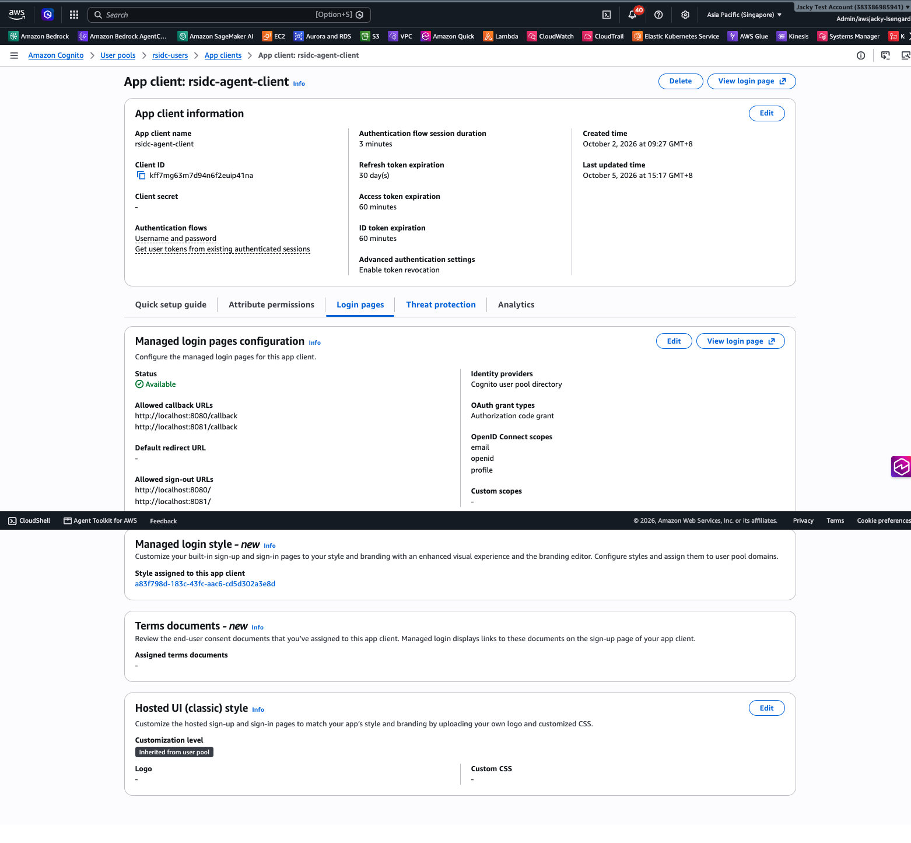

**Verification**

| Check | Command | Expected (regex) | Result |
|---|---|---|---|
| code flow + both localhost callbacks; password auth kept | `aws cognito-idp describe-user-pool-client --region $RT_REGION --user-pool-id $COGNITO_POOL_ID --client-id $COGNITO_CLIENT_ID --query 'UserPoolClient.[AllowedOAuthFlows[0],join(`,`,CallbackURLs),join(`,`,ExplicitAuthFlows)]' --output text` | `code\s+http://localhost:8080/callback,http://localhost:8081/callback\s+.*ALLOW_USER_PASSWORD_AUTH` | **PASS** |

<details><summary>Actual output: code flow + both localhost callbacks; password auth kept</summary>

```
code	http://localhost:8080/callback,http://localhost:8081/callback	ALLOW_REFRESH_TOKEN_AUTH,ALLOW_USER_PASSWORD_AUTH
```
</details>

## Findings

1. OBO enforces IdC per-user access in Redshift (16/16 matrix). The runtime role has no Redshift permission; every session runs as `AWSIDC:<user>`.
2. External JWTs are single-use at IdC; the agent exchanges once per sign-in (history/001).
3. An Allow-only IdC app ActorPolicy did not stop same-account admins; fixed with an explicit Deny (history/002, verified in step 7).
4. 2LO bypasses per-user controls by design: every user, including one with no grants, saw all rows with PII via `svc_reporting` (step 11).
5. 3LO: Token Vault isolation and session binding work; a shared IdP browser session can store another user's token, mitigated by the agent identity guard (history/003). `prompt=login` via customParameters stored no token (observed).
6. Console pitfalls (recorded in the aws-deploy-evidence skill): IdC tabs don't change the URL; Gateway deep links redirect to home; IAM inline policies must be expanded; full-page shots can hide a field behind the sticky footer.

## Teardown

`infra/run.sh ./infra/99-teardown.sh` (asks for `delete rsidc`) deletes everything above in reverse order, including the Redshift cluster **without a final snapshot**. The pre-existing IAM Identity Center instance, users and groups are not touched. Running cost while deployed ≈ USD 0.72/hour.